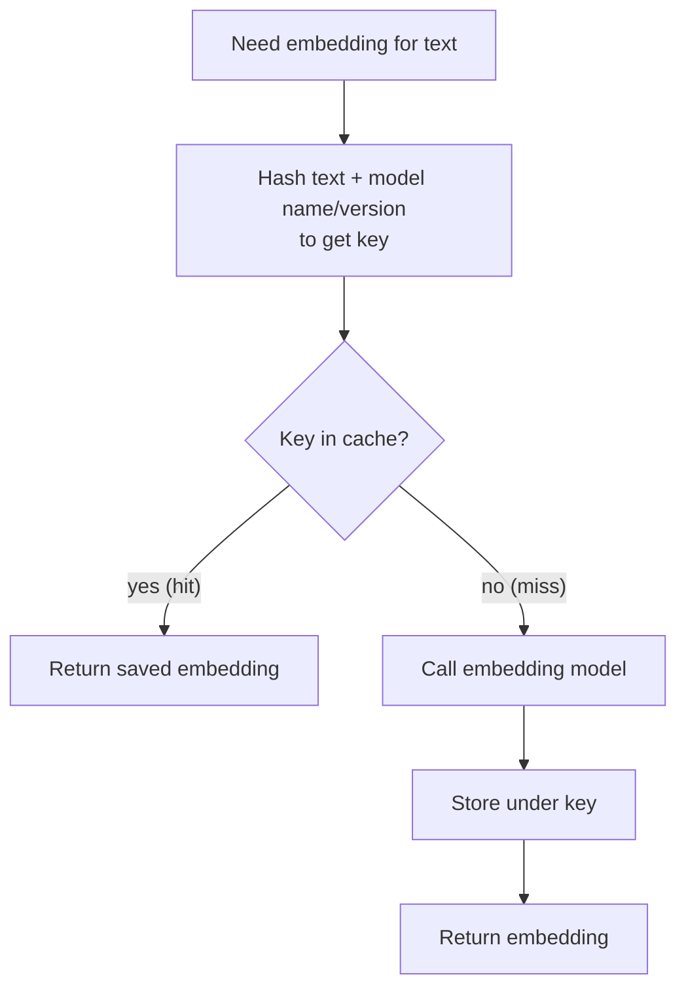

# How does an Embedding Cache work?

> **Step 9: Vector Search and RAG** · ⏱️ 21 min read · [Read original](https://outcomeschool.com/blog/how-does-an-embedding-cache-work)

## TL;DR
An Embedding Cache stores embeddings already computed so identical text is never embedded twice. The key is a hash of text + model name/version; a hit returns the saved vector, a miss computes, stores and returns it. Eviction (LRU/TTL) bounds size. It lowers cost and latency without changing result quality.

## Key Concepts
- **Embedding** — list of numbers for the meaning of text; similar meaning sits close, different meaning far (e.g. "I love dogs" near "I adore puppies", far from "The stock market crashed").
- **Embedding model** — model whose only job is text in, embedding out; costs money (usually per text sent) and time (also network delay if hosted; compute if local).
- **Cache** — place to store something for quick reuse instead of recomputing.
- **Key** — label for finding a stored item (like a folder name).
- **Hash** — function mapping any input to a short fixed-length string; same input gives same hash, tiny change gives a totally different hash.
- **Collision** — two different things landing on the same key.
- **Cache hit / miss** — embedding found / not found.
- **Eviction** — removing old items to make room. **LRU** (Least Recently Used) evicts the item unused longest. **TTL** (time to live) expires items after a fixed time regardless of use.
- **Stale** — old and no longer fresh.

## How It Works
### Why it is needed
The same text recurs a lot:
- **Re-ingestion** — ingestion = chunk documents and embed each piece. Edit one paragraph and re-run: without a cache all pieces are recomputed; with a cache only the edited piece (e.g. piece 3 of 5) is computed, the other four are free.
- **Repeated queries** — popular query ("return policy", "reset my password") searched 1,000 times a day: without cache 1,000 computations, with cache 1 compute + 999 reuses.
Without a cache it is costly (pay every time) and slow (model call + network).

### Core idea
Store each embedding paired with its text; before computing, check the cache. Step 1: first "return policy" is a miss, call model, save. Step 2: later same text is a hit, skip the model entirely.

### Cache key = hash(text + model name + version)
Raw text is clumsy (long) and unsafe: different models (or versions) give different embeddings for the same text; if the key were only text, the newer model would read the older model's vectors (collision, wrong numbers). Including model name/version keeps models separate; hash makes it compact and unique.

### Request flow
1. Need embedding for text. 2. Hash text + model to get key. 3. Key in cache? Hit: return saved. Miss: call model, store under key, return. Every text is computed at most once; the first request pays, later ones are fast and free.

### Eviction
- LRU: when full, drop least recently used (e.g. A used 1 min ago, B 2 min, C 30 min: evict C). Good for limited space.
- TTL: e.g. 1 hour; good when text or model changes and stale vectors should not linger.
- Can combine: LRU keeps popular items, TTL ensures nothing stays stale forever.

### Where it lives
| In-memory (e.g. Redis) | On disk |
|---|---|
| Very fast lookups | Slower |
| Limited space | Large space |
| Lost on restart | Kept across restarts |
| Live queries | Big ingestion jobs |
Many systems use both: fast memory cache in front, larger disk cache behind.

### Real-world uses
- **RAG** — helps at ingestion (unchanged chunks) and query time (popular questions).
- **Semantic search** — embed documents and query, find nearest via ANN; same docs/queries repeat.
- Also underlies semantic caching (which reuses past answers for same-meaning questions).

## Diagram(s)
### Request flow (hit vs miss)

## Trade-offs & Pitfalls
- Benefits: lower cost (pay once per text), lower latency (skip model and network), same quality (identical numbers).
- Only exact same text + same model is a hit; a similar but not identical text misses.
- Model upgrade gets new keys; old entries never mix; TTL clears them.
- Embedding Cache vs Semantic Cache: embedding cache skips the embedding model call for identical text; semantic cache skips the answer-writing model for same-meaning questions.
- Pick memory vs disk by use case; set eviction to avoid unbounded growth.

## Key Takeaways
- Compute an embedding once, then reuse it.
- Key = hash of text plus model name and version, so models never collide.
- Hit returns saved vector; miss computes, stores, returns.
- LRU for limited space, TTL for freshness; often both.
- Memory (Redis) for speed, disk for scale and persistence.
- Saves cost and latency in RAG ingestion and repeated queries with no quality change.
