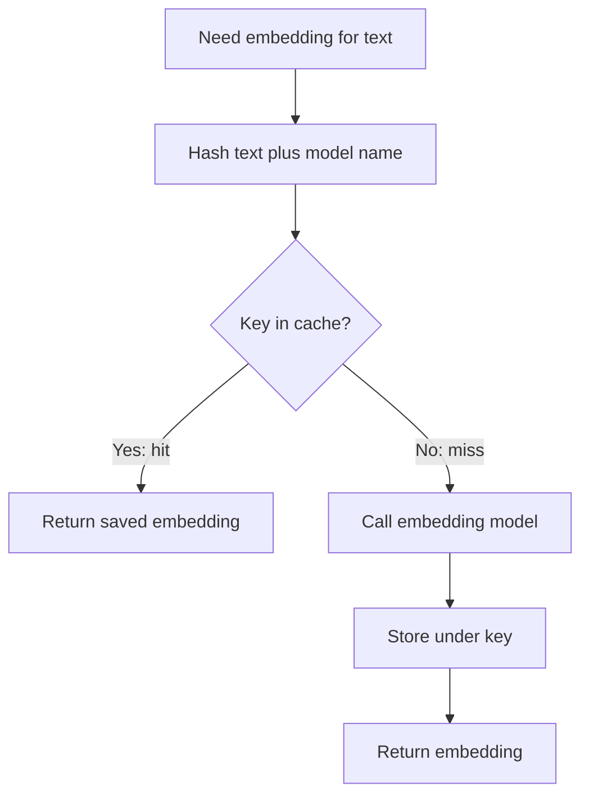

# How does an Embedding Cache work?

> **Step 9: Vector Search and Retrieval-Augmented Generation (RAG)** · ⏱️ 21 min read · [Read original](https://outcomeschool.com/blog/how-does-an-embedding-cache-work)

## TL;DR
An Embedding Cache stores embeddings already computed so identical text never has to be embedded twice. It makes RAG and semantic search cheaper and faster without changing result quality, since the cached numbers are exactly what the model would return.

## Key Concepts
- **Embedding** — a list of numbers representing the meaning of text; similar meanings land close together.
- **Embedding model** — the model whose job is to turn text into an embedding; each call costs money and time.
- **Cache key** — a hash of the text plus the model name and version.
- **Hash** — turns any input into a short fixed-length string; same input gives the same hash, a tiny change gives a totally different one.
- **Collision** — two different things landing on the same key (for example two models sharing a key).
- **Cache hit / miss** — embedding found / not found in the cache.
- **Eviction** — removing old items to make room; common policies are LRU and TTL.

## How It Works
### Why it is needed
- **Re-ingestion**: edit one paragraph, re-run ingestion; unchanged chunks should be reused, not re-embedded.
- **Repeated queries**: a popular query searched 1,000 times needs 1 computation and 999 reuses.

### Request flow
1. Hash text plus model name to get the key.
2. If the key is in the cache (hit), return the saved embedding.
3. If not (miss), call the embedding model, store the result under the key, and return it.

The first request pays; every later one for the same text is fast and free.

### Why the model is in the key
Different models, or versions of one model, produce different numbers for the same text. Keying on text alone would let a new model read an old model's embedding.

### Eviction
- **LRU (Least Recently Used)** — drop the item unused for the longest time; good when space is limited.
- **TTL (time to live)** — items expire after a fixed time; good when text or models change and staleness matters.
- Both can be combined.

### Where it lives
| In-memory (for example Redis) | On disk |
|---|---|
| Very fast | Slower |
| Limited space | Large space |
| Lost on restart | Survives restarts |
| Good for live queries | Good for big ingestion jobs |

Many systems use a fast memory layer in front of a larger disk layer.

### Real-world use
RAG (ingestion chunks and user queries) and semantic search both embed the same text repeatedly. It is different from semantic caching, which reuses a past answer for a similar question.

## Diagram

## Key Takeaways
- Compute an embedding once, then reuse it.
- Key = hash(text + model name + version) so models never collide.
- Only exact same text hits; a near-duplicate text produces a different hash and misses.
- LRU manages space; TTL manages freshness.
- Saves cost and latency with no change in result quality.
- Embedding cache skips the embedding model; semantic cache skips the answering model.
