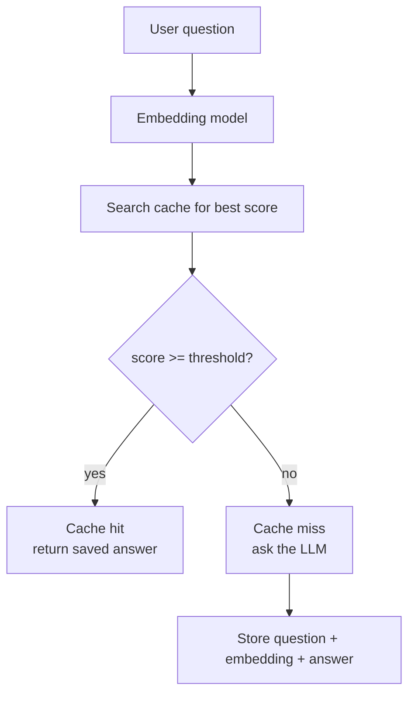

# How does Semantic Caching work?

> **Step 9: Vector Search and RAG** · ⏱️ 15 min read · [Read original](https://outcomeschool.com/blog/how-does-semantic-caching-work)

## TL;DR
Semantic Caching matches new questions to saved ones by meaning (embeddings + similarity score vs a threshold) instead of exact text. If similar enough, return the saved answer without calling the LLM; otherwise ask the LLM and store the result. It cuts cost and latency, but needs a well-tuned threshold and suits slowly-changing answers.

## Key Concepts
- **Cache** — memory of past answers; compute once, return stored answer next time.
- **Exact-match caching** — matches letter by letter; "What is the capital of France?" vs "Tell me the capital city of France." count as different, so it rarely hits for AI apps.
- **Semantic** — related to meaning.
- **Embedding** — list of numbers = address of a sentence on a map of meaning (real ones have hundreds of numbers). Toy 2-number example: [0.91, 0.10], [0.89, 0.12] (close), [0.05, 0.95] (far, cake question).
- **Similarity** — score for closeness of meaning; commonly cosine similarity; roughly 0 (different) to 1 (same).
- **Threshold** — limit deciding "close enough".
- **Cache hit / miss** — score at or above threshold / below.

| Piece | Role |
|---|---|
| Embedding model | Translator to numbers |
| Embedding | Address on meaning map |
| Similarity score | Judge of closeness |
| Threshold | "Close enough?" rule |
| Cache | Notebook of past questions and answers |

## How It Works
### Steps
1. User sends question. 2. Embed it. 3. Compare with embeddings of cached questions (score each). 4. Find the highest score. 5. If above threshold: hit, return saved answer, no model call (fast, free). 6. Else: miss, ask model, store new question + embedding + answer.
In real systems cached embeddings live in a vector database using ANN (Approximate Nearest Neighbor) search.

```python
def get_answer(question):
    e = embed(question)
    best, score = search_cache(e)
    if score >= 0.85:
        return best.answer
    ans = ask_model(question)
    store_in_cache(question, e, ans)
    return ans
```

### Numeric walkthrough (saved: "What is the capital of France?" -> "Paris", threshold 0.85)
- "Tell me the capital city of France." score 0.93: hit, return Paris.
- "What is the population of France?" score 0.40: miss, ask model, store.
- "How do I bake a chocolate cake?" score 0.05: miss, ask model, store.

### Setting the threshold
- Too high (0.99): almost nothing matches, benefit lost.
- Too low (0.50): different questions match; "capital of France" may match "capital of Germany" and give a wrong city.
- Around 0.85-0.95 works for many apps; tune on real user questions. High = fewer matches, safer; low = more matches, riskier.

## Diagram(s)
### Semantic cache flow


## Trade-offs & Pitfalls
- Advantages: saves money (fewer LLM calls), faster, less model load (more users), works across phrasings.
- Best for answers that do not change quickly (capital of France); poor fit for "weather right now".
- Wrong threshold either kills the benefit or returns wrong answers.
- Refresh or clear the cache periodically so stale answers do not persist.
- Vs prompt caching: semantic caching reuses the final answer and skips the model entirely; prompt caching reuses the model's internal work on a repeated prompt prefix. Both cut LLM cost.

## Key Takeaways
- Exact-match caches fail because people phrase the same question differently.
- Semantic cache: embed, find nearest saved question, compare score to threshold.
- Hit skips the LLM entirely; miss calls the LLM and stores the result.
- Threshold (about 0.85-0.95) is a precision vs hit-rate dial; test it on real queries.
- Use for stable answers; refresh the cache to avoid stale results.
- Saved embeddings sit in a vector database with ANN search.
