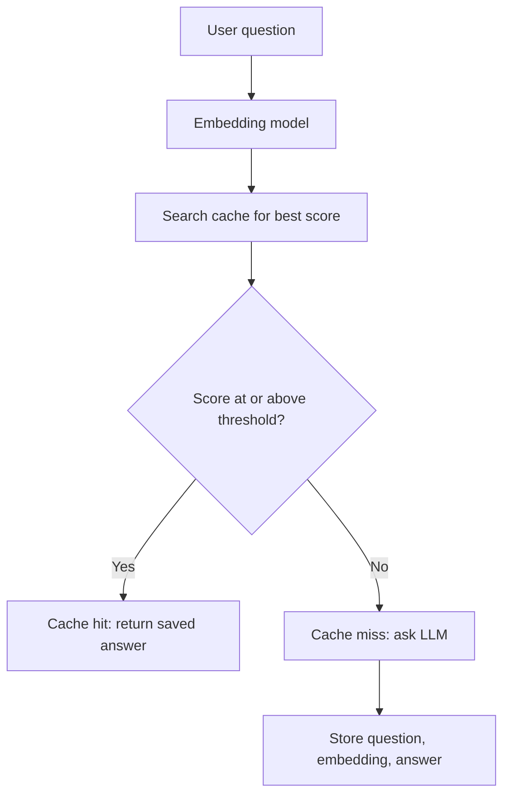

# How does Semantic Caching work?

> **Step 9: Vector Search and Retrieval-Augmented Generation (RAG)** · ⏱️ 15 min read · [Read original](https://outcomeschool.com/blog/how-does-semantic-caching-work)

## TL;DR
Semantic Caching matches new questions to past ones by meaning, not exact words, so a saved answer can be reused. It cuts LLM cost and latency, but depends on choosing a good similarity threshold.

## Key Concepts
- **Exact-match caching** — matches letter by letter, so "capital of France" and "capital city of France" miss each other.
- **Semantic Caching** — caching based on meaning, using embeddings.
- **Embedding** — list of numbers representing the meaning of text; similar meanings sit close.
- **Cosine similarity** — common score, roughly 0 to 1; higher means closer meaning.
- **Similarity threshold** — the cutoff that decides hit or miss.
- **Cache hit / miss** — best score at or above the threshold / below it.

## How It Works
1. User sends a question.
2. Embed it with an embedding model.
3. Compare with embeddings of all saved questions (in practice stored in a vector database and searched with ANN).
4. Take the best-scoring saved question.
5. If score >= threshold: cache hit, return the saved answer without calling the LLM.
6. Otherwise: cache miss, ask the LLM, then store question, embedding, and answer.

```python
if score >= 0.85:
    return best_match.answer
answer = ask_model(question)
store_in_cache(question, new_embedding, answer)
```

### Numeric walkthrough (saved: "What is the capital of France?" -> "Paris", threshold 0.85)
| New question | Score | Result |
|---|---|---|
| Tell me the capital city of France | 0.93 | Hit |
| What is the population of France? | 0.40 | Miss |
| How do I bake a chocolate cake? | 0.05 | Miss |

### Threshold trade-off
- Too high (0.99): almost nothing matches, benefit lost.
- Too low (0.50): different questions match, for example France vs Germany capital returns the wrong city.
- Around 0.85 to 0.95 often works, but test with real user questions.

### Cautions
Best for answers that change slowly; poor for things like current weather. Refresh the cache periodically.

## Diagram


## Key Takeaways
- Exact-match caching fails because people phrase the same question differently.
- Semantic caching = embed, find nearest saved question, compare to a threshold.
- The threshold is the key tuning knob: high is safe but misses, low is risky.
- Good for stable answers, bad for time-sensitive ones.
- Different from prompt caching, which reuses the model's internal work on a repeated prefix.
