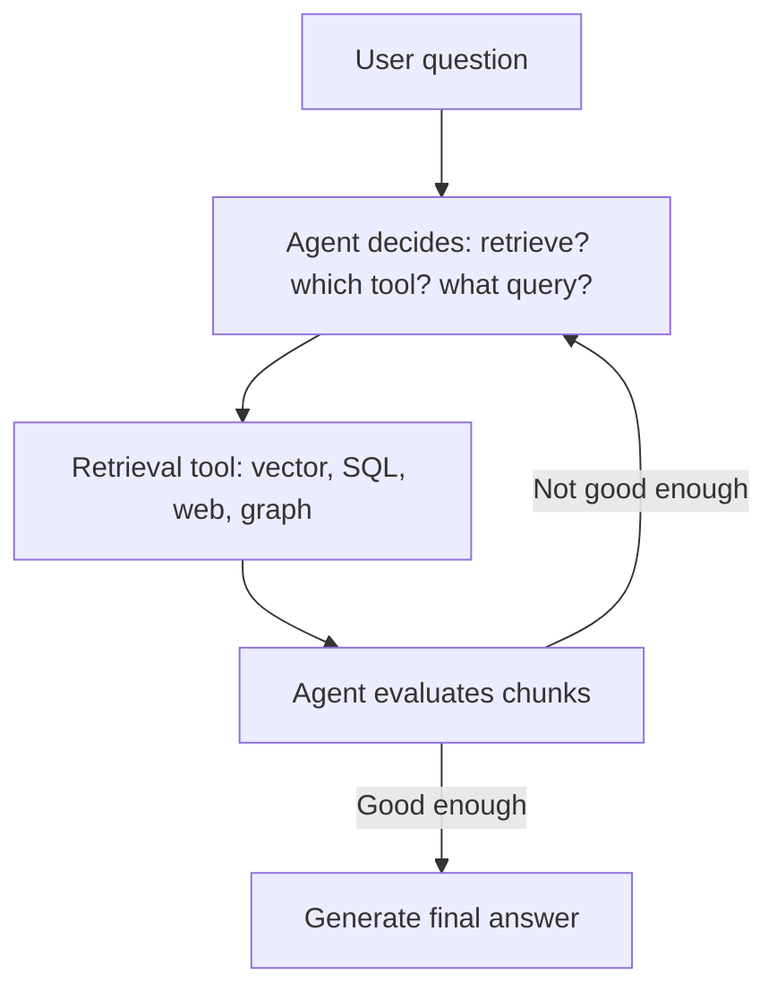

# What is Agentic RAG?

> **Step 9: Vector Search and Retrieval-Augmented Generation (RAG)** · ⏱️ 15 min read · [Read original](https://outcomeschool.com/blog/agentic-rag)

## TL;DR
Agentic RAG puts an AI Agent in charge of retrieval, turning the one-shot "retrieve then generate" pipeline into a loop where the agent decides what to search, where, and when to stop. It handles multi-hop, ambiguous, and multi-source questions that standard RAG cannot, at the cost of latency, money, and complexity.

## Key Concepts
- **Standard RAG** — fixed pipeline: embed question, vector search top-k, LLM generates. Retrieve once, generate once (the "librarian").
- **Agentic RAG** — an agent controls retrieval in a loop (the "researcher").
- **Multi-hop question** — needs one search result to form the next query.
- **Scratchpad / agent memory** — running record of actions taken and results seen.
- **ReAct-style RAG** — think, act, observe loop.
- **Self-RAG** — agent grades its retrievals for relevance and support.
- **Corrective RAG (CRAG)** — falls back to another source (for example web) when retrieval is bad.

## How It Works
### Why standard RAG falls short
1. Multi-hop questions (Q4 revenue of whoever acquired Acme in 2023).
2. Ambiguous queries ("What about the new policy?").
3. Multiple data sources (SQL, vector, web, graph).
4. No check on retrieval quality, so the LLM may make up an answer.

### What the agent decides
Whether to retrieve at all, which tool, what query, whether chunks are good enough, whether to retrieve again, whether to combine sources, and when to stop.

### Three building blocks
- **Agent (brain)** — the LLM that plans and evaluates.
- **Tools (hands)** — vector search, keyword search, SQL, web search, knowledge graph query.
- **Loop (workflow)** — the runtime that calls the agent, runs the recommended tool, feeds results back, repeats. The LLM only outputs the tool name and arguments; the runtime actually calls the tool.

### Walkthrough
Question: Q4 revenue of the company that acquired Acme in 2023. The agent uses web search to find "Globex", then vector search over internal reports for "Globex Q4 2023 revenue", judges the chunks sufficient, and answers.

### Standard vs Agentic
| Aspect | Standard RAG | Agentic RAG |
|---|---|---|
| Flow | Fixed pipeline | Dynamic loop |
| Retrievals | One | Many as needed |
| Tools | Usually one | Many |
| Query rewriting / quality check | No | Yes |
| Multi-hop | No | Yes |
| Latency, cost, complexity | Low | Higher |

### Limitations
Higher latency and cost (each step is an LLM call with growing prompts), harder to debug (non-fixed paths), can loop forever without stopping rules (LLM says done, confidence threshold, max steps), more moving parts.

## Diagram

## Key Takeaways
- Agentic RAG = RAG + an agent that controls each retrieval step.
- Use it for multi-hop, multi-source, or ambiguous questions where quality beats latency.
- Use standard RAG for simple, single-source questions where speed and cost matter.
- The runtime, not the LLM, executes tools.
- Always add a stopping rule such as a max step count.
