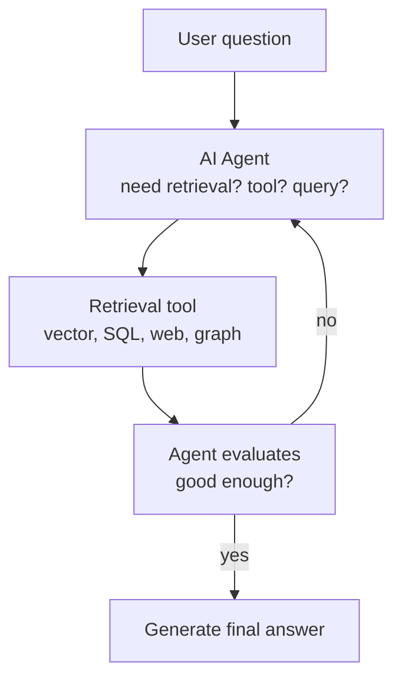

# What is Agentic RAG?

> **Step 9: Vector Search and RAG** · ⏱️ 15 min read · [Read original](https://outcomeschool.com/blog/agentic-rag)

## TL;DR
Agentic RAG = RAG + an AI Agent that controls retrieval in a loop: it decides whether to retrieve, which tool/source, what query, whether the results are good enough, and when to stop. Standard RAG is a fixed one-shot pipeline (the librarian); Agentic RAG is a researcher who keeps digging. Great for multi-hop, multi-source, ambiguous questions, at higher latency, cost and complexity.

## Key Concepts
- **Standard RAG** — embed question, vector search top-k chunks, LLM generates. Straight line, no decisions. A Reranker often sits between retrieval and LLM. HyDE can improve the query step.
- **AI Agent** — LLM as brain in a loop: plans next step, recommends a tool, observes result, decides next.
- **Agentic RAG** — agent drives each retrieval decision.
- **Scratchpad / agent memory** — running record of actions and results the agent reads each step.
- **Self-RAG** — agent grades its retrievals on relevance (about the question?) and support (backs up the answer?). Quality control.
- **Corrective RAG (CRAG)** — falls back to another source (e.g. web) when main retrieval is bad. Robustness.
- **ReAct-style RAG** — think, act, observe loop.

## How It Works
### Why standard RAG falls short
1. **Multi-hop**: "Q4 revenue of the company that acquired Acme in 2023?" needs two searches.
2. **Ambiguous**: "What about the new policy?" - no clarification, random chunks.
3. **Multiple sources**: SQL, vector store, web, graph; standard RAG hits one.
4. **Bad retrieval quality**: passes whatever it found; LLM then makes things up.

### What the agent decides
Whether retrieval is needed (not for greetings/small talk), which tool/source, query shape, if chunks suffice, whether to re-retrieve, whether to combine sources, when to stop.

### Three building blocks
1. **Agent (brain)** — LLM reads question, plans, recommends tool, evaluates.
2. **Tools (hands)** — vector search (meaning), keyword search (exact terms), SQL (structured), web search (fresh), knowledge graph query (relationships).
3. **Loop (workflow)** — runtime calls the agent, runs the recommended tool, feeds results back, repeats; keeps the scratchpad.
Note: the LLM only outputs text (tool name + args); the runtime actually calls the tool.

### Walkthrough
Question: Q4 revenue of the company that acquired Acme in 2023.
1. Agent: multi-hop, find acquirer first. 2. Web search "company that acquired Acme in 2023". 3. Returns Globex. 4. Plan: need Globex Q4 2023 revenue. 5. Vector search over internal financial reports. 6. Returns Globex Q4 report chunks. 7. Agent judges enough. 8. Generates answer. (Real web results are noisy; agent extracts.) Agent may also combine two sources in one step. Standard RAG would fail with one retrieval. Related: Vectorless RAG replaces vector search with LLM walking document structure.

### Patterns
ReAct-style (think/act/observe), Self-RAG (quality control), CRAG (robustness). All share: agent decides each step.

## Diagram(s)
### Agentic RAG loop

## Trade-offs & Pitfalls
| Aspect | Standard RAG | Agentic RAG |
|---|---|---|
| Flow | Fixed pipeline | Dynamic loop |
| Retrievals | One | Many as needed |
| Tools | One (usually vector) | Many |
| Query rewriting | No | Yes |
| Quality check | No | Yes |
| Multi-hop | No | Yes |
| Latency / cost | Low | Higher |
| Complexity | Simple | More complex |

Use Agentic when: multi-hop, multiple sources, ambiguous queries, quality over latency (research, legal, medical), need to decide if retrieval is needed. Use Standard when: simple direct questions, one data source, latency/cost matter.

Limitations: higher latency (each step is LLM calls); higher cost (tokens grow as tool results are fed back); harder to debug (non-deterministic paths); can loop too long (stopping rules: LLM signals done, confidence high enough, max step count); more moving parts (tools, prompts, evaluation, stopping rules).

## Key Takeaways
- Standard RAG: retrieve once, generate once. Agentic RAG: agent-driven loop.
- Three parts: agent, tools, loop (plus scratchpad).
- The LLM names the tool; the runtime executes it.
- Patterns: ReAct-style, Self-RAG, CRAG.
- Fits multi-hop, multi-source, ambiguous queries.
- Always set a stopping rule; expect more latency, cost and complexity.
- Not always better; simple questions favor standard RAG.
