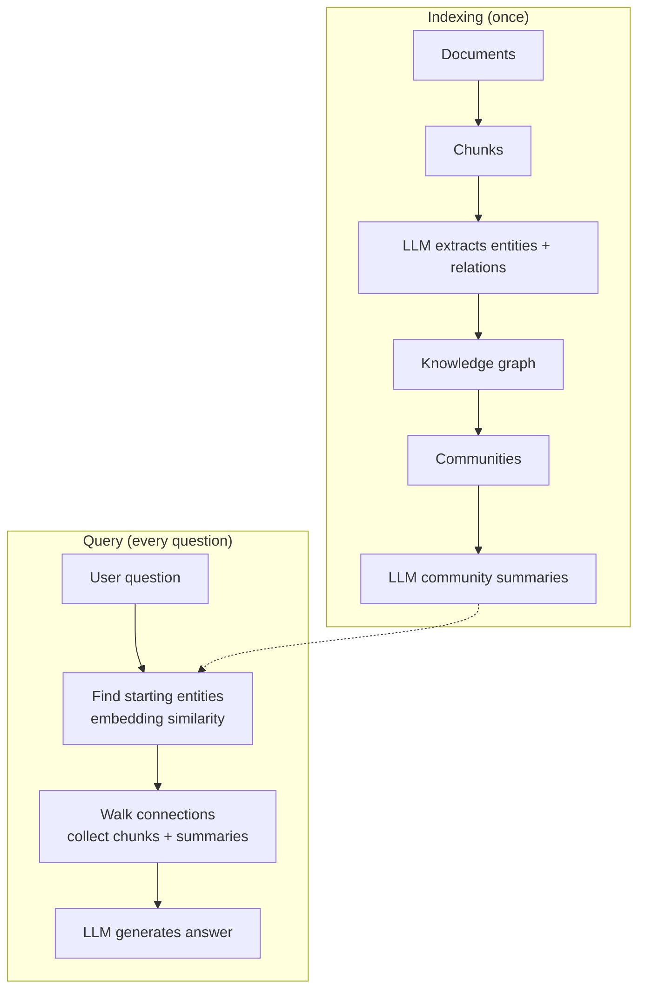

# What is GraphRAG? How Knowledge Graphs Improve RAG

> **Step 9: Vector Search and RAG** · ⏱️ 14 min read · [Read original](https://outcomeschool.com/blog/graphrag)

## TL;DR
GraphRAG = Graph + RAG: an LLM extracts entities and relations from documents into a knowledge graph (plus community summaries) once at indexing; at query time it finds starting entities by embedding similarity, walks the connections, and feeds connected context to the LLM. It answers multi-hop and whole-dataset questions that chunk similarity search cannot, at higher indexing cost and complexity.

## Key Concepts
- **Knowledge graph** — nodes = important things (entities), edges = relations. Like a small Wikipedia of our data.
- **Normal RAG** — chunk, embed, retrieve nearest chunks, LLM. Treats each chunk as an island.
- **Multi-hop question** — needs more than one hop across information (e.g. how Person A connects to Company X through work history).
- **Entities / Relations** — e.g. Alice, Acme, Globex, Bob; "works at", "acquired", "CEO of".
- **Community** — cluster of closely connected nodes on a theme ("Acme acquisition story"); an LLM writes a **community summary**.
- **Local vs global search** — zoom in on a specific region vs zoom out over the whole dataset.
- Related flavors: Agentic RAG, HyDE; Embedding Cache can skip re-embedding unchanged items on re-index.

## How It Works
### Two phases
- **Indexing (once)**: documents -> chunks -> LLM extracts entities + relations -> build graph -> group into communities -> LLM writes community summaries. Stored: graph + embeddings (entity, relation, chunk, community summary) + summaries.
- **Query (per question)**: find starting entities -> walk connections, collect chunks + summaries -> LLM answers.

### Building the graph
Text: "Alice worked at Acme as an engineer. Acme was acquired by Globex in 2020. Bob was the CEO of Globex at that time." Entities: Alice, Acme, Globex, Bob. Relations: Alice works at Acme; Globex acquired Acme; Bob CEO of Globex. Repeat per chunk; the same entity from different chunks merges into one node.
GraphRAG keeps embeddings and uses them with the graph (to find starting points).

### Answering ("How is Alice connected to Bob?")
1. Embed question; find relevant entities by similarity plus any named in the question: Alice, Bob.
2. Walk: Alice -> Acme -> Globex -> Bob.
3. Collect nodes, edges, chunks, community summaries on the path; pass with question to LLM.
4. LLM answers: Alice worked at Acme, later acquired by Globex where Bob was CEO. It stitches three sentences no single chunk contained.

### Local vs Global search
- **Local**: question about a specific entity ("What is Alice's role at Acme?"); small subgraph + connected chunks.
- **Global**: whole-dataset question ("major themes across all company documents?"); uses community summaries via **map** (LLM gives partial answer + relevance score per community, in parallel) then **reduce** (combine highest-scoring partials). Scales to thousands of communities without overflowing the context window.

## Diagram(s)
### Indexing and query phases

## Trade-offs & Pitfalls
Use GraphRAG when: many connected entities (people, products, companies, events), questions combine several chunks, high-level whole-dataset questions, relationship-rich data (research papers, legal documents, company KBs, news archives). Example: law firm - "Which judges ruled in our favor on IP cases involving our top three clients?" Skip when one chunk usually suffices.
Not every graph needs an LLM: teams hand-write linked markdown files (OKF, Open Knowledge Format).

| Aspect | Normal RAG | GraphRAG |
|---|---|---|
| Retrieval | Similarity on chunks | Graph walk + similarity |
| Best for | Single-fact | Multi-hop and high-level |
| Indexing cost | Low | High (many LLM calls) |
| Storage | Vector store | Graph + vectors + summaries |
| Engineering | Simple | Complex |
| Quality on connected data | Limited | Much better |

Costs: expensive indexing, heavier storage, updates must refresh graph and summaries (not just embeddings), maintain graph structure plus vector store. Author's view: worth it only for relationship-rich data and genuine multi-hop questions.

## Key Takeaways
- GraphRAG adds a knowledge graph on top of vector search; it does not replace embeddings.
- Normal RAG fails on multi-hop because chunks are disconnected islands.
- Indexing: LLM extracts entities/relations, merges nodes, builds communities and summaries.
- Query: embedding finds entry points, then walk the graph.
- Local search for specific entities; global search via community summaries with map-reduce.
- Better connected answers, but costly indexing/updates and more complexity; start with normal RAG otherwise.
