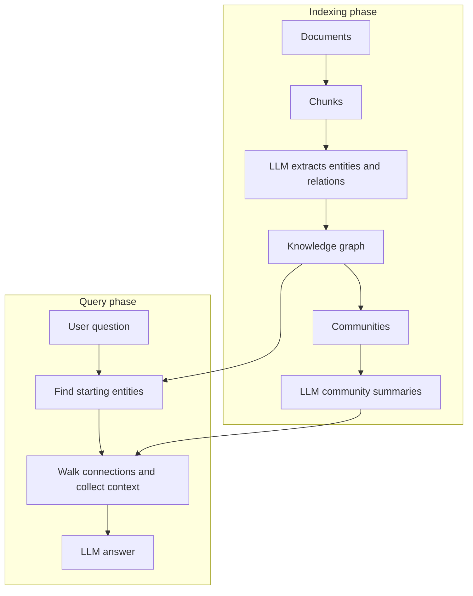

# What is GraphRAG? How Knowledge Graphs Improve RAG

> **Step 9: Vector Search and Retrieval-Augmented Generation (RAG)** · ⏱️ 14 min read · [Read original](https://outcomeschool.com/blog/graphrag)

## TL;DR
GraphRAG builds a knowledge graph of entities and relations from your documents and uses it, alongside vector search, to retrieve connected information. It answers multi-hop and whole-dataset questions that similarity search over isolated chunks cannot, but indexing is expensive.

## Key Concepts
- **Knowledge graph** — entities as nodes, relations as edges (like a small private Wikipedia).
- **Entity / Relation** — a person, company, date, and how they connect ("works at", "acquired").
- **Multi-hop question** — needs several hops across pieces of information.
- **Community** — cluster of closely connected nodes with a theme.
- **Community summary** — LLM-written plain-English summary of a community.
- **Local search** — zoom into a specific entity's neighborhood.
- **Global search** — whole-dataset questions answered via community summaries (map then reduce).

## How It Works
### Why normal RAG struggles
Chunks are treated as islands; similarity search cannot stitch together facts scattered across many chunks.

### Indexing phase (once)
1. Split documents into chunks.
2. LLM extracts entities and relations from each chunk. Example: Alice works at Acme; Globex acquired Acme; Bob is CEO of Globex.
3. Merge the same entity across chunks into one node.
4. Group nodes into communities and have the LLM write a summary for each.
5. Store the graph, embeddings (for entities, relations, chunks, summaries), and summaries. Embeddings are kept, not discarded.

### Query phase (each question)
1. Embed the question and find starting entities (plus any named directly).
2. Walk connections (Alice to Acme to Globex to Bob).
3. Collect nodes, edges, source chunks, and summaries as context.
4. LLM writes a connected answer.

### Local vs global
- **Local**: specific entity questions ("What is Alice's role at Acme?") use a small subgraph plus chunks.
- **Global**: big-picture questions ("major themes across all documents") use a map step (partial answer plus relevance score per community summary, in parallel) then a reduce step (combine the top partial answers). This scales across thousands of communities without overflowing context.

### Normal RAG vs GraphRAG
| Aspect | Normal RAG | GraphRAG |
|---|---|---|
| Retrieval | Similarity on chunks | Graph walk plus similarity |
| Best for | Single-fact questions | Multi-hop and high-level |
| Indexing cost | Low | High (many LLM calls) |
| Storage | Vector store | Graph, vectors, summaries |
| Effort | Simple | More complex |

Trade-offs: expensive indexing, heavier storage, updates must refresh graph and summaries, more engineering. Worth it only when data is relationship-rich and users ask multi-hop questions.

## Diagram

## Key Takeaways
- GraphRAG = RAG over a knowledge graph plus vectors, not instead of vectors.
- It solves multi-hop questions by following relations rather than matching similar text.
- Community summaries with map-reduce power global (big-picture) search.
- The cost is mostly in indexing (LLM extraction and summarization).
- If one chunk usually answers the question, normal RAG is the better starting point.
