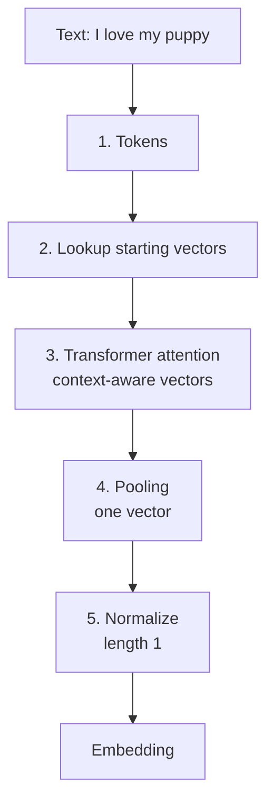
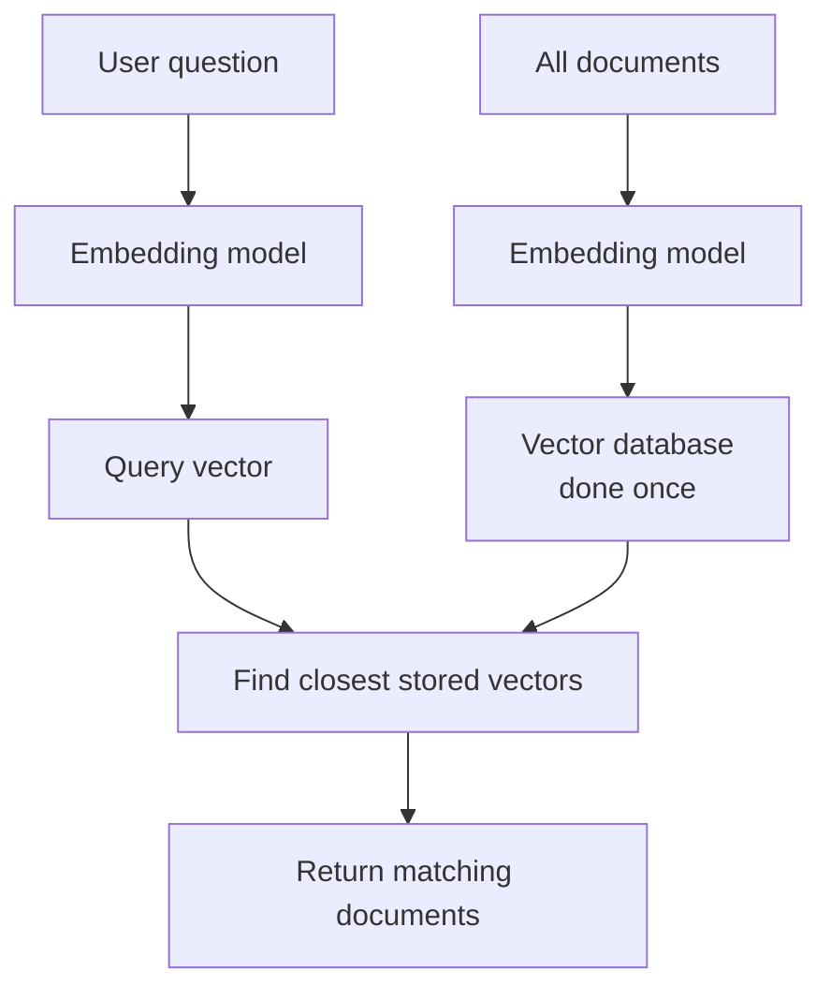

# How does an embedding model work?

> **Step 9: Vector Search and Retrieval-Augmented Generation (RAG)** · ⏱️ 17 min read · [Read original](https://outcomeschool.com/blog/embedding-model)

## TL;DR
An embedding model is a Transformer-based model that turns text of any length into a fixed-length list of numbers capturing its meaning. It is trained with contrastive learning so similar meanings land close together, and closeness is measured with cosine similarity. It powers semantic search, RAG, recommendations and clustering.

## Key Concepts
- **Embedding / vector** — ordered list of numbers representing meaning; length = dimension (hundreds to thousands; all-MiniLM-L6-v2 gives 384). No single number has a human meaning; meaning lives in the whole list.
- **Embedding space** — the "map of meanings": similar meanings nearby, different ones far.
- **Token** — word or part of a word; **vocabulary** — fixed list of known tokens with IDs.
- **Attention** — tokens look at all others and update their vectors using context.
- **Pooling** — combining token vectors into one sentence vector (mean pooling or [CLS]).
- **Normalization** — scale vector to length 1 (direction kept).
- **Contrastive learning** — train by pulling similar items together, pushing different ones apart.
- **In-batch negatives** — other pairs' positives in the batch serve as free negatives.
- **Cosine similarity** — angle between two vectors.

## How It Works

### Meaning as a position on a map
- On a 2D map, pets (puppy, dog, cat, kitten), vehicles (car, bus, truck) and fruits (apple, banana, mango) cluster separately. A position is just two numbers (e.g. dog = [2.0, 9.0], truck = [8.5, 5.0]).
- Position is the meaning; close positions mean similar things.
- Real embeddings use hundreds of directions instead of two (same idea, e.g. 384).

### What the model does
- Text in (word, sentence, paragraph, page) gives a fixed-length vector out (a short sentence and a long paragraph both give 384 numbers), so any two texts compare the same way.

### Step by step ("I love my puppy")
1. **Tokenize**: ["I","love","my","puppy"]. Rare words split into pieces ("unbelievable" to "un","believ","able"), so unseen words are handled. Tokens become vocabulary IDs.
2. **Lookup**: each token gets a starting vector from a table. Same vector wherever it appears ("bank" is identical in "river bank" and "bank account").
3. **Transformer layers (attention)**: each token looks at all others and updates; "bank" near water/shore vs near money/loan. Vectors now carry contextual meaning.
4. **Pooling**: mean pooling averages token vectors number by number. Example: first numbers 0.2, 0.8, 0.1, 0.9 sum to 2.0, average 0.5, giving [0.5, 0.5]. Alternative: prepend a [CLS] token and use its final vector.
5. **Normalize**: scale length to 1; keeps direction (the meaning), removes size; makes comparison simple and fair.

### Training (contrastive learning)
- Start from random numbers, or usually from a pretrained Transformer that knows language but doesn't yet place similar sentences close.
- Triplet: anchor "How do I bake a cake?", positive "Steps to make a cake at home", negative "How do I change a car tire?".
- Rule: pull anchor and positive closer, push anchor and negative apart. Wrong placement gives a penalty (loss); parameters update to reduce it. Repeat over millions of examples.
- Pairs come from natural data: question and answer on Q&A sites, article title and first paragraph, search query and clicked page.
- In-batch negatives provide many negatives without hand-picking.
- The model is never told what each number means; the map emerges from "these are similar, these are not".

### Measuring similarity
- Cosine similarity: same direction is about 1; right angle about 0 (unrelated); opposite about -1.
- For normalized vectors it equals the dot product (multiply matching numbers, sum).
- Example: A = [0.6, 0.8], B = [0.8, 0.6]: 0.48 + 0.48 = 0.96, very similar.

### Code (sentence-transformers)
```python
from sentence_transformers import SentenceTransformer, util
model = SentenceTransformer("all-MiniLM-L6-v2")
sentences = ["I love my puppy", "I adore my dog", "The stock market crashed today"]
embeddings = model.encode(sentences)      # shape (3, 384)
scores = util.cos_sim(embeddings[0], embeddings[1:])
```
- "puppy" vs "adore my dog" scores high despite different words; vs stock market much lower (exact numbers depend on model).

### Embedding model vs LLM
| Point | Embedding model | LLM |
|---|---|---|
| Input | Text | Text |
| Output | Fixed list of numbers | New text, token by token |
| Job | Understand and compare meaning | Generate answers/content |
| Size | Small, fast | Large, slower |
| Cost per use | Very low | Higher |
| Use | Search, matching, grouping | Chat, writing, reasoning |

Both are Transformer-based and often work together.

### Use cases
- **Semantic search** ("cheap phone" finds "budget smartphone").
- **RAG**: embed to find relevant private documents, hand them to the LLM.
- **Recommendations** of close-in-meaning items.
- **Clustering** reviews into topics.
- **Duplicate detection** (same ticket, different words).
- Flow: embed all documents once into a vector database; per query embed only the question and find nearest vectors. Very fast.

## Diagram(s)

### Text to embedding


### Semantic search / RAG flow


## Trade-offs & Pitfalls
- **Fixed input length**: long text is cut off; split long documents into chunks first.
- **Different models, different maps**: embeddings not comparable across models; changing model means re-embedding all data.
- **Similar is not always correct**: "The movie was good" vs "was not good" can land close; topic captured well, small details like "not" can be missed.
- **Domain knowledge**: general models may do poorly on medical/legal text; use a domain-trained model or fine-tune.

## Key Takeaways
- Embedding = fixed-length vector representing meaning; no single dimension is interpretable.
- Pipeline: tokenize, lookup, Transformer attention, pooling, normalize.
- Attention makes token vectors context-dependent.
- Trained with contrastive learning (anchor, positive, negative; in-batch negatives).
- Cosine similarity measures closeness; equals dot product when normalized.
- Embed documents once, embed only queries at search time; basis of semantic search and RAG.
- Cannot mix embeddings across models; mind input length limits and negation.
