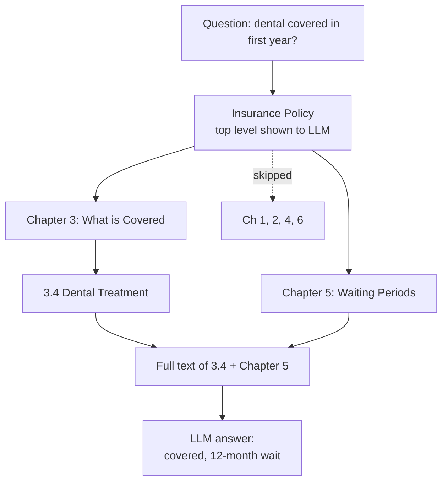

# What is Vectorless RAG? RAG Without Embeddings or a Vector Database

> **Step 9: Vector Search and RAG** · ⏱️ 21 min read · [Read original](https://outcomeschool.com/blog/vectorless-rag)

## TL;DR
Vectorless RAG retrieves without embeddings or a vector database: the document is organized as a tree (table of contents with titles, summaries, locations) and the LLM walks it level by level, choosing which sections to open, then answers from complete section text. It trades speed/cost for reasoning, explainability and no chunking, and suits long structured documents.

## Key Concepts
- **LLM** — knows only its training data; never saw our private documents.
- **RAG** — Retrieval (find useful part) + Augmented (add to question) + Generation. Open-book exam analogy. Not sending whole documents because: limited context, cost per word, and burying the useful pages distracts the model (Lost in the Middle).
- **Vector / embedding model** — vector = long list of numbers; similar meaning gives similar numbers; search by meaning is semantic search.
- **Chunk, vector database, top-k** — fixed-size pieces, DB for nearest vectors, number of closest chunks returned (5 or 10).
- **Vectorless RAG** — LLM reads document structure and decides which part to open; still uses an LLM.
- **Tree** — table of contents: book > chapters > sections > sub-sections. Each node stores title, 1-2 line summary, location of real text (e.g. pages 41-43).
- **Tree search / reasoning-based retrieval** — walking down the tree with LLM decisions.
- **Agentic search** — LLM given tools (list folders, open file, search file) and explores on its own, like a developer in a codebase (e.g. Claude Code).

## How It Works
### Vector RAG recap
Phase 1: chunk, embed each chunk, store in vector DB. Phase 2: embed question with same model, fetch top-k nearest chunks, send chunks + question to LLM.

### Problems with Vector RAG
1. Chunking breaks meaning (sentence split, table from heading, rule from exception: "Dental treatment is covered" vs later waiting-period line).
2. Similar is not correct: "Which policy does NOT cover dental?" - "not" barely moves vectors.
3. No thinking in search; pure distance.
4. Cannot explain a wrong pick.
5. System to maintain: embedding model, vector DB, chunking, re-embedding on change; switching model means rebuilding everything.
6. Codes/numbers/terms: Clause 14.2.b vs 14.3.b look alike.
7. Fixed top-k: one question needs a line, another six sections.

### Vectorless process
Think of a 200-page washing-machine manual: open table of contents, see "Chapter 9: Warranty", jump to the page.
- **Phase 1 (one time)**: build the tree (use existing TOC, or LLM reads section by section writing titles/summaries). No numbers, no cutting; document untouched.
- **Phase 2**:
  1. User asks.
  2. Show LLM only the top level (chapter names + summaries; about a page even for 300 pages: cheap).
  3. LLM picks chapters and says why.
  4. Open those; LLM picks sub-sections.
  5. Repeat down levels (tree search).
  6. Pull full text of chosen sections (nothing cut).
  7. LLM answers citing section number.
Every step is a reasoned, explained decision, so wrong turns are traceable.

### Example (300-page insurance policy: "Is dental treatment covered in the first year?")
Tree: Ch1 Definitions, Ch2 How to Buy, Ch3 What is Covered (3.1 Hospital, 3.2 Surgery, 3.3 Eye, 3.4 Dental), Ch4 Not Covered, Ch5 Waiting Periods, Ch6 How to Claim.
- Vector RAG: returns five chunks from 3.4 all saying covered; Chapter 5's 12-month waiting-period line sat in a long chunk and did not sound close. Answer "Yes" is wrong.
- Vectorless: LLM reasons two parts (coverage, timing), picks Ch3 and Ch5, then 3.4; answers "covered, but not in the first year; 12-month waiting period per Chapter 5." Correct. Search by reading, not math.

### Other vectorless approaches
- **Keyword search** — exact strings (Invoice INV-2024-8891).
- **Structured filtering** — LLM writes a database query; numbers and dates handled exactly.
- **Full document in context** — if small enough, no retrieval at all.
- **Model browses files** — agentic search.

## Diagram(s)
### Tree search for the insurance question

## Trade-offs & Pitfalls
| Vector RAG | Vectorless RAG |
|---|---|
| Docs to vectors | Docs kept as is |
| Needs embedding model + vector DB | Neither |
| Fixed-size chunks | Whole sections |
| Distance in numbers | LLM reads titles/summaries |
| No reasoning | Reasoning each step |
| Milliseconds | Slower (LLM call per level) |
| Cheap per question | Costlier |
| Hard to explain | Reason given each step |
| Scales to millions of docs | Best on long structured docs |
| Update = re-embed | Update one summary |
| Weak on codes, numbers, negation | Handles them well |

Advantages: no chunking, less infrastructure, easy updates, visible reasoning, special words work, good on long structured docs (reports, policies, manuals, legal), can look in far-apart chapters.
Disadvantages: slower; more costly per question; needs structure (ten million unstructured chat messages give no tree); quality depends on summaries (poor summary may get skipped); does not scale alone to millions of docs (needs a cheap first filter).
When: Vector RAG for huge collections, simple lookups, speed, low cost (help center with a million short articles). Vectorless for long structured docs, costly wrong answers, cross-section reasoning (policies, contracts, annual reports, medical guidelines, manuals). Hybrid: cheap vector/keyword search narrows five million docs to twenty, then tree search inside.

## Key Takeaways
- Vectorless RAG replaces vector similarity with LLM reasoning over a document tree (titles, summaries, locations).
- No chunking, embeddings or vector DB; still uses an LLM.
- Rule-and-exception questions are its sweet spot.
- Fully explainable path, easy updates, good with exact codes and negation.
- Costs: more LLM calls, slower, needs structure and good summaries.
- Many production systems go hybrid: cheap filter first, tree search second.
