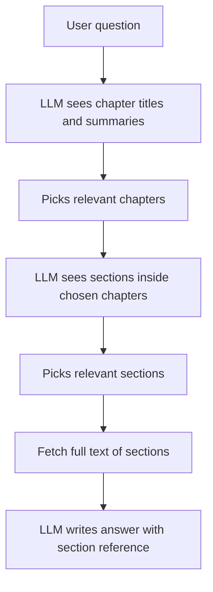

# What is Vectorless RAG? RAG Without Embeddings or a Vector Database

> **Step 9: Vector Search and Retrieval-Augmented Generation (RAG)** · ⏱️ 21 min read · [Read original](https://outcomeschool.com/blog/vectorless-rag)

## TL;DR
Vectorless RAG answers questions from documents without embeddings or a vector database. The LLM reads a tree of titles and summaries (like a table of contents) and decides which sections to open, replacing mathematical similarity with reasoning.

## Key Concepts
- **Vector RAG** — chunk documents, embed chunks, store in a vector DB, retrieve top-k nearest to the question vector.
- **Vectorless RAG** — retrieval with no vectors; the LLM navigates document structure.
- **Tree** — table-of-contents-style hierarchy; each node stores title, short summary, and location of real text.
- **Tree search** — walking down the tree level by level, with the LLM choosing at each level.
- **Reasoning-based retrieval** — another name for this approach.
- **Agentic search** — LLM uses tools (list folders, open file, search in file) to explore on its own.

## How It Works
### Problems with Vector RAG (per the blog)
Chunking breaks meaning (a rule separated from its exception); similar is not correct (a small word like "not" barely moves vectors); no reasoning during search; results are hard to explain; a whole system to maintain (re-embedding, model switches); exact codes and clause numbers blur; fixed top-k suits no question.

### Vectorless phases
**Prepare (once):** build a tree from the document (use the existing table of contents, or let the LLM write titles and summaries). No numbers, no cutting.

**Answer:**
1. Show the LLM only the top level (chapter names plus one-line summaries).
2. LLM picks relevant chapters and says why.
3. Open them, show their sections, LLM picks again; repeat down the tree.
4. Pull the full text of the chosen sections.
5. LLM answers and cites the section used.

### Example
300-page policy, "Is dental treatment covered in the first year?" Vector RAG returns five chunks from 3.4 Dental Treatment and wrongly says yes, missing the 12-month waiting period buried in Chapter 5. Vectorless picks Chapter 3 and Chapter 5 and answers correctly: covered, but not in the first year.

### Other vectorless approaches
Keyword search (exact strings like invoice numbers), structured queries (LLM writes SQL), give the whole document if it fits, and agentic file browsing.

### Vector vs Vectorless
| Aspect | Vector RAG | Vectorless RAG |
|---|---|---|
| Needs embeddings and vector DB | Yes | No |
| Documents | Cut into chunks | Kept whole |
| Search | Distance between numbers | LLM reasoning |
| Speed and cost per query | Fast, cheap | Slower, costlier (several LLM calls) |
| Explainability | Hard | Easy |
| Updates | Re-embed | Update one summary |
| Scale | Millions of docs | Best on long structured docs |

Disadvantages: slower, costlier, needs structure, quality depends on summaries, does not scale to millions of documents alone.

### When to use
Vector for huge collections, simple lookups, speed and low cost. Vectorless for long structured documents (policies, contracts, reports, manuals) where wrong answers are expensive. Hybrid: cheap vector or keyword filter to narrow documents, then tree search inside.

## Diagram

## Key Takeaways
- Vectorless still uses an LLM; it just skips embeddings and the vector database.
- Search by reading structure instead of measuring distance; no chunking.
- Every step comes with a reason, so debugging is easier.
- Tradeoff: more LLM calls per query, and it needs structured documents.
- Hybrid (cheap narrowing, then tree search) combines speed and accuracy.
