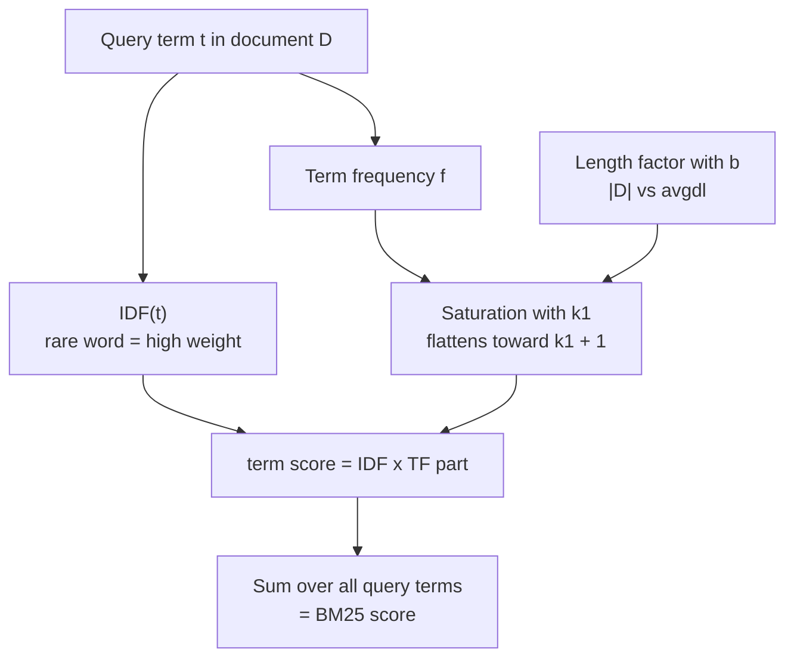

# How does BM25 work?

> **Step 9: Vector Search and Retrieval-Augmented Generation (RAG)** · ⏱️ 16 min read · [Read original](https://outcomeschool.com/blog/bm25)

## TL;DR
BM25 is a scoring formula that ranks documents for a query. It scores higher when query words appear often (with a cap), when those words are rare across the collection, and when the document is not unnecessarily long. It counts words only and does not understand meaning, so it is often paired with vector search in hybrid search.

## Key Concepts
- **Ranking** — give every document a score for a query, sort by score. Used in Elasticsearch and in RAG retrieval.
- **BM25** — "Best Matching", 25 = version number; from Robertson, Spärck Jones and others in the Okapi system (1990s), so also "Okapi BM25".
- **Term frequency (f)** — how many times a term appears in a document.
- **IDF** — Inverse Document Frequency; rare terms get a high weight, common terms near zero.
- **Saturation** — extra repetitions add less and less (pizza slices analogy); controlled by `k1` (common 1.2).
- **Length normalization** — compare document length to average length; controlled by `b` in 0..1 (common 0.75).
- **Inverted index** — like a book index: for each word, the documents containing it plus counts.
- **Hybrid search** — BM25 (exact words) plus vector search (meaning), results combined.

## How It Works

### Why plain word counting fails
Score = term frequency fails three ways:
1. Common words win ("the" appears everywhere).
2. Repetition wins (spam page repeating "cat" 100 times beats a genuine page).
3. Long documents win (a book mentions "cat" more than a focused paragraph).

BM25 fixes each with one idea.

### Idea 1: IDF (rare words matter more)
$$
\text{IDF}(t) = \ln\left(\frac{N - n + 0.5}{n + 0.5} + 1\right)
$$

`N` = total docs, `n` = docs containing the term.
- Few docs contain the term: IDF big. Nearly all docs contain it: IDF near 0.
- `ln` keeps numbers small, `0.5` keeps it safe when `n = 0`, `+1` keeps IDF from going below zero.
- Example, 1000 docs: "the" in 990 docs gives 0.01, "cat" in 20 docs gives 3.89.

### Idea 2: Saturation (repetition has a limit)
TF part = `f * (k1 + 1) / (f + k1)`. With `k1 = 1.2`:

| f | 1 | 2 | 3 | 5 | 10 | 100 |
|---|---|---|---|---|---|---|
| TF part | 1.00 | 1.38 | 1.57 | 1.77 | 1.96 | 2.17 |

1 to 2 adds a lot, 10 to 100 adds little. It can never exceed `k1 + 1` (2.2 here).

### Idea 3: Length normalization
Same count means more in a short doc (2 mentions in 10 words vs 1000 words).

length factor = `1 - b + b * (|D| / avgdl)`
- Average length: factor 1, no change. Longer: factor above 1, lowers score. Shorter: below 1, raises score.
- `b = 0` ignores length, `b = 1` full effect.

### Full formula
$$
\text{score}(D,t) = \text{IDF}(t)\cdot\frac{f\,(k_1+1)}{f + k_1\left(1 - b + b\frac{|D|}{avgdl}\right)}
$$

$$
\text{BM25}(D,Q) = \sum_{t \in Q} \text{score}(D,t)
$$

Length factor sits in the denominator next to `k1`, so a long document flattens faster and needs more repetitions for the same score. Per term: how rare × how often (capped, length-adjusted).

### Worked example
Docs: D1 "the cat eats cat food" (5 words), D2 "dog food is cheap" (4), D3 "the cat sat on the mat near the door" (9), D4 "fresh food for every pet" (5). Query "cat food", `k1 = 1.2`, `b = 0.75`.
1. `N = 4`, `avgdl = 23/4 = 5.75`.
2. "cat" in D1, D3 (n=2): IDF = ln(2.00) = 0.69. "food" in D1, D2, D4 (n=3): IDF = ln(1.43) = 0.36. Rarer "cat" gets about double weight.
3. TF parts: D1 cat(f=2) 1.43, food 1.06. D2 food 1.14. D3 cat 0.81. D4 food 1.06. D2's "food" beats D1/D4 because D2 is shorter (4 vs 5 words). D3's single "cat" is only 0.81 because it is long (9 words).
4. Scores: D1 = 0.69×1.43 + 0.36×1.06 = 1.37. D2 = 0.36×1.14 = 0.41. D3 = 0.69×0.81 = 0.56. D4 = 0.36×1.06 = 0.38.
5. Ranking: D1 (1.37), D3 (0.56), D2 (0.41), D4 (0.38). D1 has both words, D3 second because "cat" is rarer, D2 beats D4 only by being shorter.

### Python implementation
Tokenize by `split()`, compute `N`, `avgdl`; `idf(term)` counts docs containing the term and applies the formula; `bm25(doc)` loops query terms, computes `tf_part = f*(k1+1)/(f + k1*(1-b+b*len(doc)/avgdl))`, adds `idf*tf_part`. Output matches hand calculation (1.37, 0.41, 0.56, 0.38).

```python
def bm25(doc):
    score = 0.0
    for term in query.split():
        f = doc.count(term)
        tf_part = f * (k1 + 1) / (f + k1 * (1 - b + b * len(doc) / avgdl))
        score += idf(term) * tf_part
    return score
```

Real engines do not loop over all docs: an inverted index lets them look only at the lists for the query words, so BM25 stays fast on millions of docs.

### k1 and b
- `k1` — saturation. Small: repetition stops helping quickly. Large: helps longer. `k1 = 0`: only presence matters. Common range 1.2 to 2.0.
- `b` — length normalization. 0 ignore, 1 full. Common 0.75.
- Defaults usually work. Tune only when testing on your own data shows a clear gain.

### TF-IDF vs BM25
| Point | TF-IDF | BM25 |
|---|---|---|
| Rewards rare words | Yes (IDF) | Yes (IDF) |
| Repeating a word | Keeps growing (maybe log-softened, no hard limit) | Flattens to a fixed limit (saturation) |
| Document length | Usually separate normalization | Built in, controlled by `b` |
| Tunable settings | Almost none | `k1` and `b` |
| Ranking quality | Good | Usually better, common search default |

## Diagram(s)

### BM25 score composition


## Trade-offs & Pitfalls
- Strengths: fast (inverted index), no training or GPU, great at exact matches (product codes, error messages, names, rare technical words), easy to explain.
- No meaning: "car" does not match "automobile".
- Ignores word order: "dog bites man" equals "man bites dog".
- Misses negation: "not good" looks like "good".
- Fix: hybrid search, BM25 for exact words plus vector search for meaning.

## Key Takeaways
- BM25 = IDF × saturated, length-normalized term frequency, summed over query terms.
- IDF fixes common-word dominance, saturation (`k1`) fixes spam repetition, `b` fixes long-document bias.
- Term TF part is capped at `k1 + 1`.
- Defaults `k1 = 1.2`, `b = 0.75`; tune only with evidence.
- It counts words, not meaning: no synonyms, word order or negation.
- Needs no training or GPU, and inverted indexes make it fast at scale.
- Modern systems combine BM25 with vector search (hybrid).
