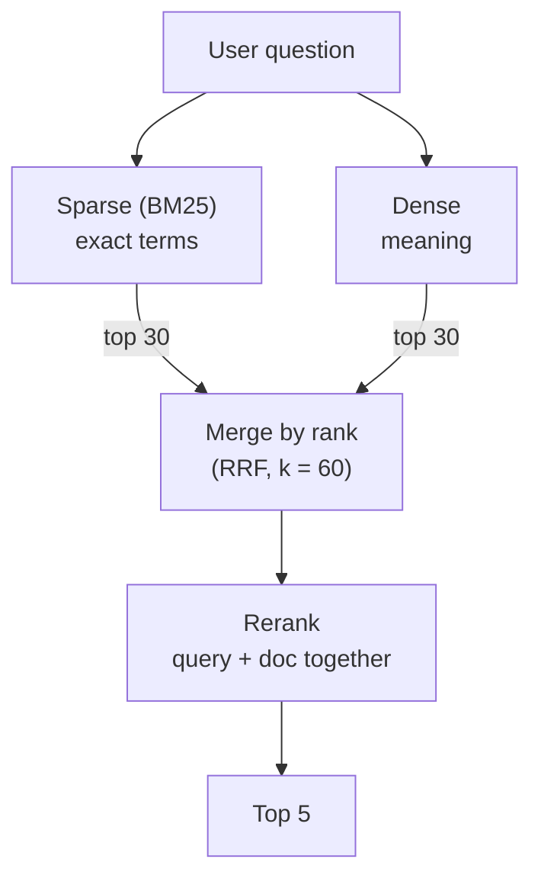
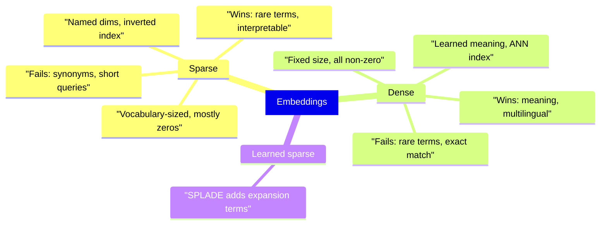

# How do sparse and dense embeddings differ?

> **Step 9: Vector Search and Retrieval-Augmented Generation (RAG)** · ⏱️ 21 min read · [Read original](https://outcomeschool.com/blog/sparse-vs-dense-embeddings)

## TL;DR
A sparse embedding has one named position per vocabulary word, almost all zeros, and matches on exact terms. A dense embedding is a fixed-size (256 to 4,096) vector of learned, unnamed numbers that matches on meaning. They fail in opposite places, so production systems usually run hybrid search: both retrievers, merged by rank (Reciprocal Rank Fusion), then reranked.

## Key Concepts
- **Embedding** — list of numbers representing text, so closeness is arithmetic.
- **Sparse embedding** — vocabulary-sized (e.g. 50,000 positions), mostly zero, each position names a word (position 8,412 = "refund").
- **BM25** — classic weighting: a word appearing more in this document matters more; a word appearing in fewer documents overall matters much more ("the" ~0, "refund" high, "XJ-7741" enormous).
- **Dense embedding** — fixed 256 to 4,096 positions (e.g. 768), all non-zero, no position has a name; meaning spread across all, produced by a neural network trained on similar vs dissimilar text pairs.
- **Learned sparse (SPLADE)** — neural net sets weights and adds terms not in the text.
- **Inverted index** — term to documents list. **ANN index** — graph/clusters over vectors.
- **Hybrid search**, **Reciprocal Rank Fusion (RRF)**, **reranker**.
- **Vocabulary mismatch** — query and document mean the same but share no words.

## How It Works

### Same sentence, both ways
"how do I get my money back": sparse = 5 non-zero values of 50,000 (every one named, e.g. money 1.9, back 2.4); dense = 768 non-zero values, none named. Example "the refund policy": 3 non-zero (refund 2.8, policy 2.1, the 0.1) = 99.994% zeros.

### Matching
- **Sparse**: score = sum of products over shared non-zero positions. Query "refund policy" vs "our refund policy allows 30 days": 2.8 x 2.4 = 6.72, plus 2.1 x 1.9 = 3.99, total 10.71. Vs "how to get your money returned": no shared positions, score 0.
- **Dense**: both are points in a space; "refund policy" and "how to get your money returned" end up close, high score with zero shared words. Sparse matches words, dense matches meaning.

### Where each wins and fails
| | Wins | Fails |
|---|---|---|
| **Sparse** | Exact/rare terms (ERR_4471, product codes, part numbers, names, versions); out-of-domain text (no training); interpretable (named dims); no training/cheap to build; long documents (more text = more non-zeros) | Vocabulary mismatch (synonyms car/automobile, paraphrases, laptop/notebook, other languages, misspellings recieve/receive); short queries (two words = two non-zeros) |
| **Dense** | Meaning without shared words ("my laptop won't turn on" vs "troubleshooting power issues on portable computers"); short vague queries; multilingual (Hindi question finds English doc); robust to rewording | Rare/unseen terms (ERR_4471 lands near ERR_4472/ERR_4481, SKU-88213 vs SKU-88219 nearly same point); exact matching; out-of-domain (legal, medical, internal code); long docs get averaged and diluted; cost (model call per doc; changing model = re-embed whole corpus since vectors from two models are incomparable); opaque |

### Storage and search
- **Sparse: inverted index** (refund -> doc 4, 19, 88, 204). Look up query terms, score only docs sharing terms; rare terms make search faster.
- **Dense: ANN index** (graph or clusters); every query walks the structure, cost roughly constant.
- Memory: sparse small and compresses well; dense 768 numbers per doc always (10 million docs = tens of GB).
- Updates: sparse adds update a few lists (cheap, immediate); dense add modifies a graph, deletes awkward, need periodic compaction.
- Maturity: sparse = decades of production search; dense newer, evolving fast.

### Learned sparse
- Example: "how do I get my money back": BM25 gives money 1.9, back 2.4, get 0.7; learned adds refund 2.1, return 1.6, payment 1.1, policy 0.8.
- Gets synonym matching (like dense), exact matching, interpretability and a normal inverted index (like sparse).
- Costs: a model call per doc at indexing, larger index (more non-zeros), same out-of-domain weakness as dense.

### Comparison table
| Property | Sparse | Dense |
|---|---|---|
| Length | vocabulary size, 30k+ | fixed 256 to 4,096 |
| Non-zero | a handful | all |
| Dimensions meaningful | yes (words) | no |
| Produced by | counting or a model | trained neural network |
| Matches on | shared exact terms | position in meaning space |
| Synonyms/paraphrases | no | yes |
| Rare terms/identifiers | excellent | poor |
| Cross-language | no | yes |
| Out of domain | unchanged | degrades |
| Short queries | weak | strong |
| Long docs | good | diluted |
| Misspellings | fails | tolerant |
| Interpretable | fully | not at all |
| Needs training | no | yes |
| Index cost | very low | model call per doc |
| Storage | very small | large, fixed |
| Updates/deletes | cheap | more involved |
| Index type | inverted index | ANN graph |
| Changing model | n/a | re-embed everything |

### Hybrid search and score combination
- Run sparse (exact terms) and dense (meaning), each top 30, merge, rerank, return top 5. Works better than either because users ask both kinds of question.
- Scores are not comparable: sparse is unbounded (about 0 to 40), dense similarity about 0 to 1. Adding lets sparse dominate; normalizing is unstable (sparse range depends on query). So **combine by rank**.
- **RRF**: each list adds $1/(k+\text{rank})$, k usually 60. Example:

| Doc | Sparse rank | Dense rank | Score |
|---|---|---|---|
| A | 1 | 8 | 1/61 + 1/68 = 0.0311 |
| B | 3 | absent | 1/63 = 0.0159 |
| C | absent | 1 | 1/61 = 0.0164 |
| D | 5 | 4 | 1/65 + 1/64 = 0.0310 |

- A top (both liked it), D nearly ties, B and C lower (one method only). RRF needs no tuning or normalization.
- A weighted combination (normalize both scores, weight) can be tried afterwards: lets you favor one method for your query mix, needs tuning on own data, can beat RRF when tuned.

### When to use which
| Situation | Use |
|---|---|
| General production search | Hybrid |
| Identifiers, codes, part numbers | Hybrid, weight sparse |
| Technical/internal jargon domain | Hybrid, weight sparse |
| Natural conversational queries | Hybrid, weight dense |
| Multiple languages | Hybrid, dense essential |
| Cannot run a model at indexing | Sparse only |
| Need to explain matches | Sparse or learned sparse |
| Constantly updating corpus | Sparse |
| Very long documents | Sparse, or chunk for dense |
| No labeled data to tune | Hybrid with RRF |
| One index with synonym matching | Learned sparse |
| Quick prototype, one domain, natural language | Dense alone fine |
- Good default: hybrid with RRF plus a reranker.

### Code (key ideas)
- BM25 class: inverted index `term -> [(doc, count)]`; idf = log(1 + (n - df + 0.5)/(df + 0.5)); score only docs sharing a term, with k1=1.5, b=0.75 length normalization.
- Dense: `model.encode(..., normalize_embeddings=True)`; cosine = dot product `vectors @ q`.
- `reciprocal_rank_fusion` sums 1/(k+rank); `hybrid_search`: BM25 top 30 + dense top 30 -> RRF top 20 -> reranker -> top 5.
- Retrieve wide from both so fusion has candidates; reranker reads query and doc together, usually more accurate than vector comparison.

## Diagram(s)

### Hybrid search pipeline

### Sparse vs dense at a glance

## Trade-offs & Pitfalls
- Sparse and dense fail in opposite places; use hybrid.
- Do not add raw sparse and dense scores; combine by rank.
- Changing the dense model forces re-embedding the whole corpus.
- Dense hurts on identifiers/codes and out-of-domain text; sparse misses paraphrases and languages.
- Learned sparse costs indexing model calls and a larger index.

## FAQ
- Is BM25 sparse? → Yes, the classic weighting; positions still name words.
- Vocabulary mismatch? → Same meaning, no shared words ("money back" vs "refund procedure"); sparse scores 0; dense or learned sparse reduce it.
- SPLADE sparse or dense? → Learned sparse: still named words, inverted index, but adds terms.
- Compare vectors from two models? → No; hence re-embedding.
- Reranker still needed with hybrid? → Yes, good default on the fused list.

## Key Takeaways
- Sparse = word-named, mostly zeros, exact-match; dense = fixed-size learned meaning vector.
- Sparse excels at rare terms, identifiers, interpretability, no-training cost; fails on synonyms, languages, short queries.
- Dense excels at paraphrase, short vague and multilingual queries; fails on rare terms, exact match, long docs.
- Sparse uses an inverted index; dense uses an ANN index and more memory.
- Learned sparse (SPLADE) adds synonyms while keeping inverted-index interpretability.
- BM25 and cosine scores are on different scales, so fuse by rank with RRF (1/(60+rank)).
- Default: hybrid + RRF + reranker.
