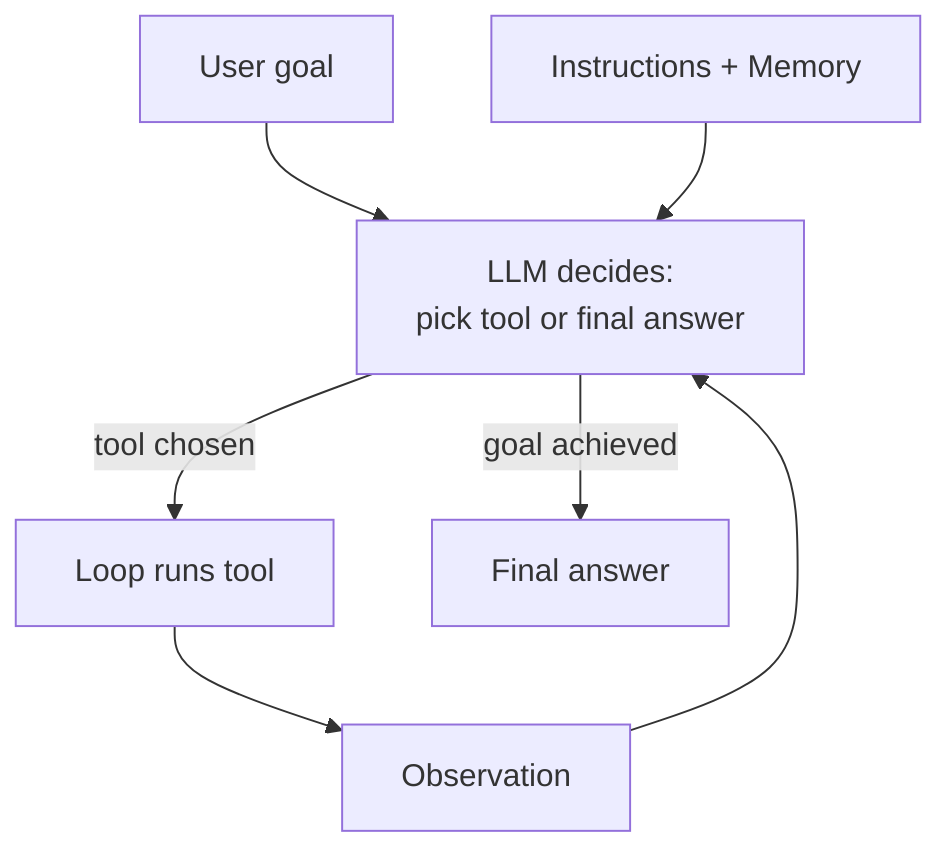
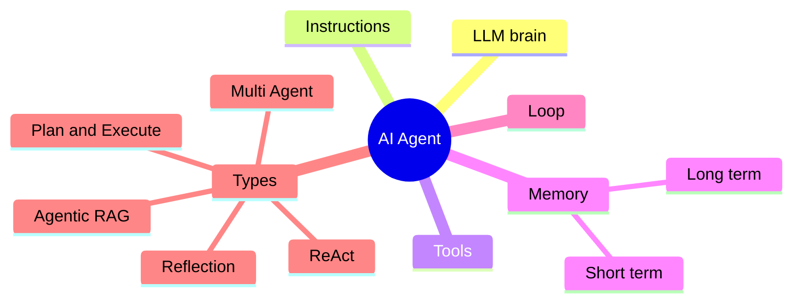

# What is an AI Agent? How It Works

> **Step 10: AI Agents and Agentic Systems** · ⏱️ 22 min read · [Read original](https://outcomeschool.com/blog/ai-agent)

## TL;DR
AI Agent = LLM + Instructions + Tools + Memory + a Loop that runs until the goal is achieved. The LLM decides the next action (pick a tool or answer); the loop runs the tool and feeds the observation back. It suits multi-step, adaptive, tool-needing tasks; for simple tasks a plain LLM call or script is better.

## Key Concepts
- **AI Agent** — software that uses an LLM to decide, acts via tools, and loops until the goal is done (intern analogy: read task, pick a tool, check result, decide next).
- **Plain LLM** — one request, one response.
- **Chatbot** — LLM + memory of the conversation; classic form only produces text.
- **Agent** — chatbot that also uses tools and runs in a loop (or a background LLM with the same setup; no chat UI needed). Plain LLM talks once; chatbot talks many times; agent talks AND acts until done. ChatGPT and Claude.ai have crossed that line.
- **Tool definition** — name, description, input schema (JSON). Description is the most important field; vague leads to wrong tool.
- **Short-term memory** — current run's history (prompts, tool calls, observations), fed back every call since the LLM is stateless. **Long-term memory** — across runs (preferences, decisions, facts) in external store (vector DB, user profile).
- **Observation** — tool result fed back to the LLM.
- Related: MCP (servers describe their own tools), Agent Skills (procedures loaded on demand), Loop Engineering (step budget, checks, exits).

## How It Works
### Five core parts (remove any and it is not an agent)
1. **LLM (brain)** — recommends a tool or returns final answer; does NOT call tools itself.
2. **Instructions (system prompt)** — job, tools, rules.
3. **Tools (hands)** — search, calculate, read files, APIs, email, code.
4. **Memory** — short and long term.
5. **Loop (runtime)** — send prompt, read response, run chosen tool, feed back, repeat until "done". Tool calls actually happen here.
Intern mapping: brain, job description, laptop/email, notebook, the workday.

### End-to-end steps
1. User goal ("3 cheapest direct flights to Delhi tomorrow under 8000 rupees"). 2. Loop sends goal + instructions + memory to LLM. 3. LLM decides next action (search flights). 4. Loop runs tool. 5. Result returns as observation. 6. LLM decides next (filter, pick top 3). 7. Repeat. 8. LLM returns final answer (AI-123 6500, IX-201 7200, SG-312 7800). Modern LLMs may emit multiple tool calls per step, run in parallel. Flow is not hardcoded.

### Research agent example ("best laptop for video editing under USD 1500")
Tools: web search, page reader, calculator. Actions: broad search, read top results, compare 5 laptops' specs, check prices, read reviews, summarize pros/cons, return top 3. Writing code that takes input, calls an LLM, executes actions and repeats is an agent.

```python
async def run_agent(user_goal, tools, max_steps=10):
    messages = [{"role": "user", "content": user_goal}]
    step = 0
    while True:
        if step >= max_steps: return "Reached step limit"
        step += 1
        response = await call_llm(messages, tools)
        if response.is_done: return response.final_answer
        for tc in response.tool_calls:
            result = await call_tool(tc.name, tc.arguments)
            messages.append({"role": "tool", "name": tc.name, "content": str(result)})
```
Step limit prevents infinite loops. Everything else (memory, parallel calls, retries, logging) is polish.

### Types (can be combined)
- **ReAct** — Thought, Action, Observation each step (most common).
- **Plan-and-Execute** — full plan, then execute (long tasks).
- **Reflection** — draft, critique, revise (quality over speed).
- **Agentic RAG** — decides when/how to retrieve.
- **Multi-Agent** — roles (research, write, review).

### What agents do today
Coding (Claude Code, Cursor, Copilot agent mode); research (OpenAI Deep Research, Perplexity, Gemini Deep Research); customer support (with human handoff); browser agents (Computer Use, ChatGPT Agent); data analysis (agents need table meaning; OKF standard); personal assistants (Apple Intelligence, Gemini). Same five parts everywhere.

## Diagram(s)
### Agent loop


### Five parts and agent types


## Trade-offs & Pitfalls
Use an agent when: multiple steps, next step depends on current result, needs external info/actions, path not fixed. Avoid when: a single LLM call works, fixed pipeline (use a script), latency/cost over flexibility, non-determinism unacceptable. Agent for a script-sized job is over-engineering.

| Failure mode | Fix |
|---|---|
| Infinite loops | Hard step limit |
| Wrong tool selection | Very clear tool descriptions |
| Hallucinated actions (nonexistent tool / bad args) | Native tool-use, validate inputs, return error as observation to self-correct |
| Context overflow | Summarize/drop stale observations; goal at start, newest at end (avoid lost in the middle) |
| Premature stopping | Clear completion criteria in instructions |
Production agents are mostly about handling these; see AI Agent Evaluation (outcome, trajectory, tool use).

## Key Takeaways
- Agent = LLM + instructions + tools + memory + loop.
- The LLM decides; the loop executes tools and feeds results back.
- Tool use plus loop (not chat UI) defines an agent.
- The core is about 20 lines: while loop, LLM call, stop check, tool branch.
- Tool descriptions are the most important field.
- Always bound the loop with a step limit.
- Use agents only when decisions and actions depend on each other.
