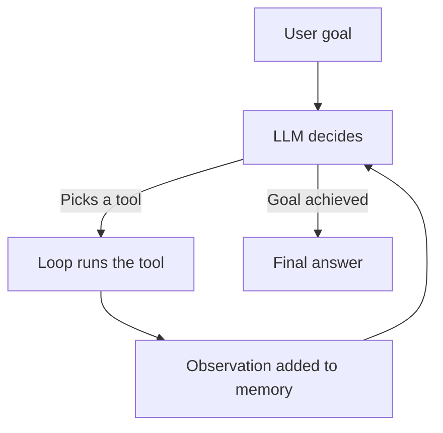

# What is an AI Agent? How It Works

> **Step 10: AI Agents and Agentic Systems** · ⏱️ 22 min read · [Read original](https://outcomeschool.com/blog/ai-agent)

## TL;DR
An AI Agent is an LLM wrapped in a loop with instructions, tools, and memory, so it can take a goal, decide steps, act, and keep going until done. The loop and tool use, not a chat UI, are what separate it from a plain LLM or chatbot.

## Key Concepts
- **AI Agent** — LLM + Instructions + Tools + Memory + Loop.
- **Plain LLM / Chatbot / Agent** — one request-response; plus conversation memory; plus tools and a loop (talks AND acts).
- **Tool definition** — name, description, input schema; the description is the most important field for tool choice.
- **Short-term memory** — the history of the current run, re-sent to the stateless LLM every call.
- **Long-term memory** — facts kept across runs in an external store (for example a vector database).
- **Loop (runtime)** — code that calls the LLM, runs the chosen tool, feeds back the result, repeats.

## How It Works
### Five core parts
1. **LLM (brain)** — decides the next action; it only recommends a tool, the loop calls it.
2. **Instructions** — the system prompt: job, tools, rules.
3. **Tools (hands)** — search, code, APIs, email; discoverable through MCP.
4. **Memory** — short-term and long-term.
5. **Loop** — keeps it going until the LLM says it is done.

### End-to-end flow
Goal goes in; the loop sends goal, instructions, and memory to the LLM; the LLM picks a tool or gives a final answer; the loop runs the tool and feeds back an observation; repeat. Modern LLMs can emit several tool calls per step, run in parallel.

### Minimal code skeleton
```python
while True:
    if step >= max_steps: return "limit reached"
    response = await call_llm(messages, tools)
    if response.is_done: return response.final_answer
    for tc in response.tool_calls:
        messages.append(tool_result(await call_tool(tc)))
```
About 20 lines; memory, retries, and logging are polish on top.

### Types
ReAct (thought, action, observation), Plan-and-Execute (plan first, then run), Reflection (draft, critique, revise), Agentic RAG, Multi-Agent systems. They combine freely.

### When to use
Use when a task is multi-step, each step depends on the last, needs external info or actions, and the path is not fixed. Skip it when one LLM call or a fixed script works, or when latency, cost, or determinism matter more.

### Failure modes and fixes
| Failure | Fix |
|---|---|
| Infinite loops | Hard step limit |
| Wrong tool | Precise tool descriptions |
| Hallucinated actions | Native tool use, validate inputs, return errors as observations |
| Context overflow | Summarize or drop stale observations |
| Premature stopping | Clear completion criteria in instructions |

## Diagram


## Key Takeaways
- Agent = LLM + Instructions + Tools + Memory + Loop; remove any part and it is no longer an agent.
- The LLM decides; the loop executes tools.
- The LLM is stateless, so the loop re-sends the history each turn.
- Always set a max step limit.
- Do not use an agent when a script or single LLM call suffices.
