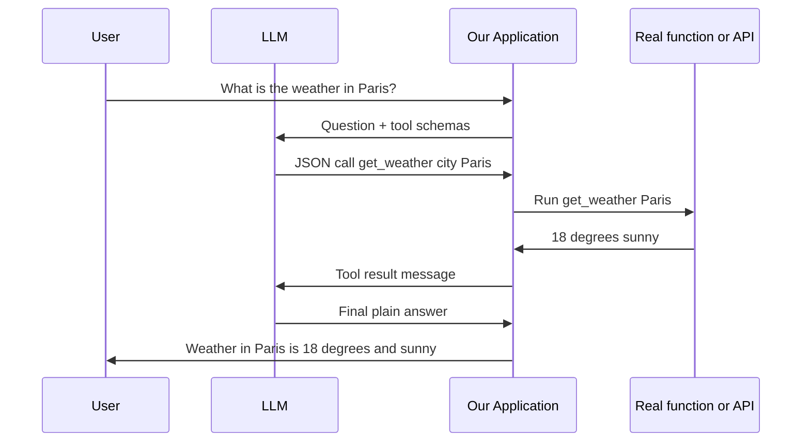

# How does Function Calling work in LLMs?

> **Step 10: AI Agents and Agentic Systems** · ⏱️ 20 min read · [Read original](https://outcomeschool.com/blog/how-does-function-calling-work-in-llms)

## TL;DR
Function (tool) Calling lets an LLM use external functions and APIs, but the model never runs them: it emits a structured JSON request (function name + arguments), our application executes it, and the result goes back so the model writes the final answer. This bridges text generation to live data and real actions and is the backbone of AI agents.

## Key Concepts
- **Function Calling = tool calling** — same thing.
- **LLM** — only reads and generates text. **Function** — block of code doing one job. **API** — doorway for one program to ask another.
- **Hallucination** — confident made-up answer (e.g. guessing live weather).
- **Argument** — input value passed to a function.
- **JSON** — text format of key/value pairs. **JSON schema** — shape of data (fields, types, required); a blank form with no real values.
- **Structured outputs** — answer in a fixed shape. **JSON mode** — forces valid JSON only.
- Two gaps solved: **live data gap** (no post-training knowledge, cannot look up) and **action gap** (cannot send, book, save, pay).

## How It Works
### Key insight
The model is the brain, our app the hands. Model only outputs text; here, special JSON: "run get_weather with city = Paris". Our code stays in control and decides whether to run it and what to do with the result.

### Five steps
1. **Describe functions** — for each: `name`, `description`, `parameters` (JSON schema).
2. **User asks** — send question + function descriptions.
3. **Model returns JSON call** instead of prose.
4. **Our code executes** the real function/API (e.g. 18 degrees, sunny).
5. **Send result back**; model writes final answer ("The weather in Paris is currently 18 degrees and sunny.").

### Concrete example
Definition:
```json
{"name":"get_weather","description":"Get the current weather for a given city.",
 "parameters":{"type":"object","properties":{"city":{"type":"string","description":"The name of the city, for example Paris."}},"required":["city"]}}
```
Model output: `{"name":"get_weather","arguments":{"city":"Paris"}}`. Code: `result = get_weather(city="Paris")` giving `{temperature:18, condition:"sunny"}`.

### Conversation loop (history kept in full)
- Message 1 (user): "What is the weather in Paris?"
- Message 2 (model): function call get_weather(city="Paris")
- Message 3 (tool): result
- Message 4 (model): final sentence.
Model message may be prose or a function call; tool message is our fed-back result. Loop continues until the model gives a normal answer without function calls. This is the AI Agent loop.

### Multi-step and parallel
- **Multi-step** — dependent calls: "What should I wear in Paris today?" needs weather first, then advice (each round = one loop turn).
- **Parallel** — independent calls returned together: "Compare weather in Paris and London" gives a list of two get_weather calls; we run both, send both results, model writes one comparison.
Model only suggests; our code always runs.

### Relation to structured outputs / JSON mode
| Idea | What it does | Who runs anything |
|---|---|---|
| Structured outputs | Fixed data shape for the answer | Nobody; it is the answer |
| JSON mode | Valid JSON only | Nobody |
| Function Calling | JSON request naming function + args | Our application runs it |
All rely on schema-following; Function Calling is structured output put to work.

## Diagram(s)
### Function-calling round trip


## Trade-offs & Pitfalls
- Real-world uses: travel (search_flights, book_flight, send_confirmation_email); coding (read_file, edit_file, run_tests); support (lookup_order, check_refund_policy, issue_refund); data (run_sql_query). Pattern: describe tools, user states goal, model recommends tools in order, code runs and feeds back, until done.
- Security: model asks, code decides, so a tricked model (prompt injection) still cannot do what code refuses to run. Strongest security boundary.
- Function Calling vs MCP: Function Calling = model requesting a tool; MCP = open standard for describing tools once for reuse.
- Model returns a call only when it decides a tool is needed; otherwise a normal answer.

## Key Takeaways
- The model never executes functions; it only emits a JSON request.
- Five steps: describe, ask, model emits call, code runs, result returned.
- The conversation is a user/model/tool message loop until a plain answer.
- Supports multi-step (dependent) and parallel (independent) calls.
- Built on the same schema-following ability as structured outputs/JSON mode.
- It is the backbone of agents and a security boundary because our code controls execution.
