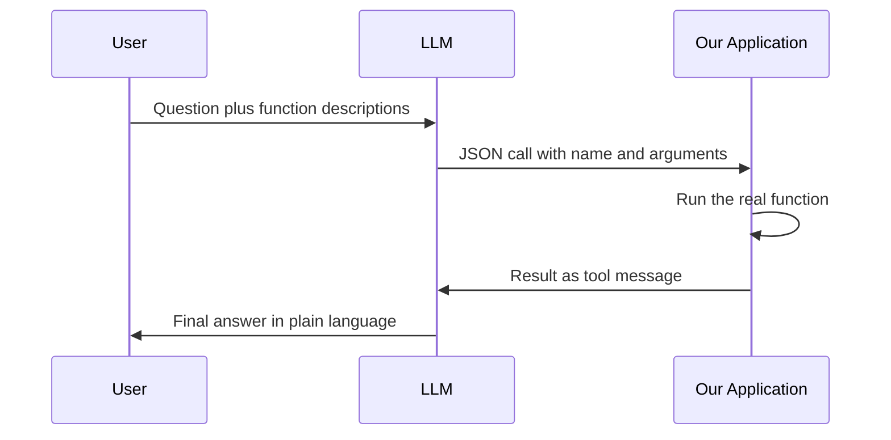

# How does Function Calling work in LLMs?

> **Step 10: AI Agents and Agentic Systems** · ⏱️ 20 min read · [Read original](https://outcomeschool.com/blog/how-does-function-calling-work-in-llms)

## TL;DR
Function Calling (also called tool calling) lets an LLM use external functions and APIs, but the model never runs anything. It outputs a structured JSON request with a function name and arguments, and our application executes it and returns the result. This closes the live-data and action gaps and is the backbone of agents.

## Key Concepts
- **Live data gap / action gap** — an LLM only generates text; it cannot fetch fresh data or act in the world.
- **Hallucination** — a confident but made-up answer.
- **Function description** — name, description, and parameters (a JSON schema, a blank form with types and required fields).
- **Function call** — JSON with the function name and filled-in arguments.
- **Tool message** — the message role carrying the function's result back.

## How It Works
### Key insight
The model is the brain; our application is the hands. The model only suggests; our code decides whether to run it. This split is also the strongest security boundary: a tricked model still cannot do what our code refuses to run.

### Five steps
1. Describe available functions (name, description, parameters).
2. User asks a question; send it with the function descriptions.
3. Model returns a JSON call (for example `get_weather` with `city = "Paris"`).
4. Our code runs the real function and gets the result.
5. Send the result back; the model writes the final answer.

### Message loop
User message, model message (function call), tool message (result), model message (final answer). The full history is kept; the loop continues until the model gives a normal answer with no more calls.

### Multi-step and parallel
- **Multi-step** — a later call depends on an earlier result ("What should I wear in Paris?" needs the weather first).
- **Parallel** — independent calls returned together as a list ("Compare Paris and London"); we run both and send both results back.

### Relation to structured outputs and JSON mode
| Idea | What it does | Who runs code |
|---|---|---|
| Structured outputs | Fixed data shape for the answer | Nobody |
| JSON mode | Valid JSON only | Nobody |
| Function Calling | JSON request for a real action | Our application |

Function calling is structured output put to work.

### Function Calling vs MCP
Function Calling is how the model requests a tool. MCP is an open standard for describing tools once so any AI app can reuse them.

## Diagram

## Key Takeaways
- The model never runs the function; it emits a structured JSON request.
- The tool description and schema are how the model knows what exists and how to call it.
- The conversation is a loop of user, model, and tool messages.
- Parallel calls handle independent lookups; multi-step handles dependent ones.
- Our code stays in control of every real action, which is the security boundary.
