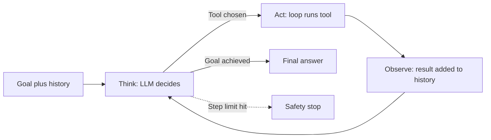

# What is an AI Agent Loop?

> **Step 10: AI Agents and Agentic Systems** · ⏱️ 20 min read · [Read original](https://outcomeschool.com/blog/ai-agent-loop)

## TL;DR
The AI Agent Loop is the runtime code that runs an agent: send the situation to the LLM, run the tool it picks, feed the result back, and repeat until done. Without it, an LLM answers once and stops; with it, the LLM can finish multi-step goals.

## Key Concepts
- **Agent loop / agentic loop** — Think, Act, Observe, repeat. One pass is a step or turn.
- **Stateless LLM** — remembers nothing between calls; the loop re-sends the full history.
- **Observation** — tool result added to the history.
- **Natural stop** — the LLM says it is done.
- **Safety stop** — step limit and other guards from our code.
- **Loop Engineering** — designing turns, carry-forward, and exits on purpose.

## How It Works
### Why a loop is needed
1. One LLM call cannot finish a multi-step task whose steps depend on one another.
2. The LLM is stateless; the growing history held by the loop is the agent's short-term memory.

### Think, Act, Observe
- **Think** — LLM reads goal, instructions, tools, and history; picks a tool or gives a final answer.
- **Act** — the loop (not the LLM) runs the tool.
- **Observe** — result is appended to history and fed back next turn.

This is the core of the ReAct agent, but every agent loop is some version of it.

### Real code skeleton
A `while True` with a `max_steps` guard, a `call_llm`, an `is_done` check, and a branch that runs each tool call and appends the result to `messages`. About 20 lines; long-term memory, retries, and logging are extras.

### Parallel tool calls
A single turn can contain several tool calls (weather in three cities); the loop runs them in parallel. The loop shape does not change.

### When to stop
- Natural stop: LLM returns a final answer.
- Safety stop: max steps.
- Extra production guards: time budget, cost budget, human interrupt.
Always have both natural and safety stops; hitting the limit often signals bad instructions or tools.

### Common failures
| Failure | Fix |
|---|---|
| Infinite loop | Hard step limit |
| Repeating the same action | Detect repeats, tell the LLM to try something else, improve instructions |
| Context overflow (history keeps growing) | Summarize old turns, drop stale observations |
| Premature stopping | Clear definition of done |

## Diagram

## Key Takeaways
- Agent Loop = Think, Act, Observe, repeat until the goal is achieved.
- The LLM decides; the loop executes tools and carries memory.
- Re-sending the history every turn is what gives a stateless LLM continuity.
- Use two stop conditions: LLM done, plus step limit.
- Production agent work is mostly handling loop failures well.
