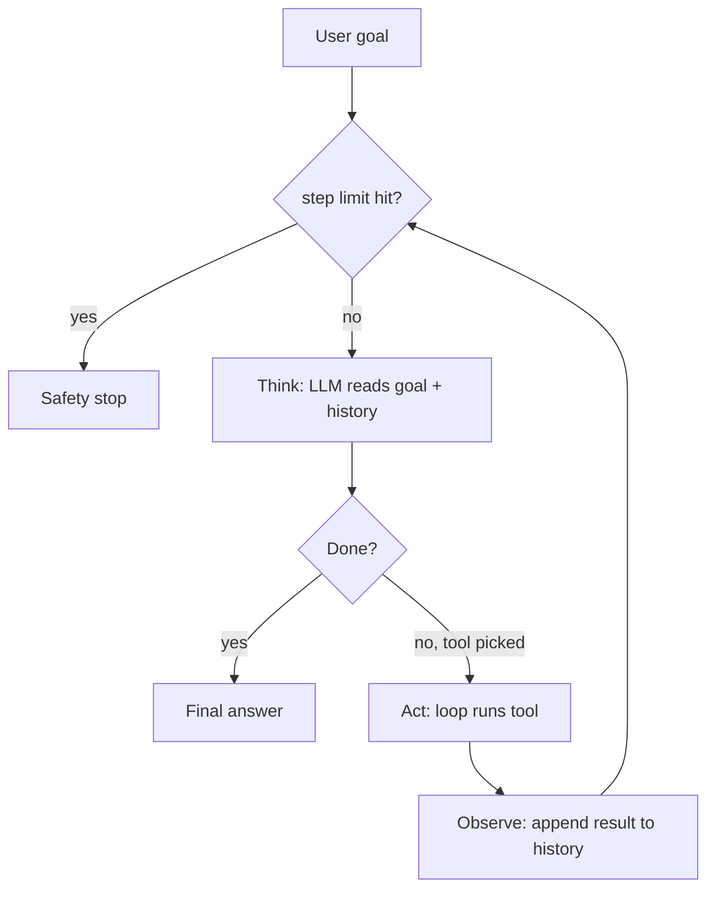

# What is an AI Agent Loop?

> **Step 10: AI Agents and Agentic Systems** · ⏱️ 20 min read · [Read original](https://outcomeschool.com/blog/ai-agent-loop)

## TL;DR
The AI Agent Loop (agentic loop) is the runtime code that powers an agent: Think (LLM decides) -> Act (loop runs the tool) -> Observe (result appended to history) -> repeat until the LLM says it is done or a safety limit hits. Without it an LLM answers once; with it, the LLM becomes a goal-completing agent. It is about 20 lines of code.

## Key Concepts
- **AI Agent Loop** — the engine: sends goal/instructions/history to the LLM, runs the picked tool, feeds results back, repeats. One pass = a **step** or **turn**. The loop wraps LLM, Instructions, Memory and Tools.
- **The LLM does not call tools; the loop does.** LLM = brain; loop = runtime turning decisions into actions.
- **Stateless LLM** — remembers nothing between calls, so the loop re-sends the full history each turn; this growing history is short-term memory.
- **Observation** — tool result added to history.
- **ReAct** (Reason and Act) — the most common pattern built on this cycle, but every loop is some version of think/act/observe.
- **Loop Engineering** — deliberately designing turns, what carries forward, and when to stop.
- **Context window** — max text the model can read at once.

## How It Works
### Why a loop is needed
1. One LLM call cannot finish a multi-step task ("cheapest flight to Delhi tomorrow": search live data, read, compare, pick; each step depends on the previous).
2. The LLM is stateless; the loop carries history (goal, every tool picked, every result).

### Think -> Act -> Observe
1. **Think** — loop sends goal, instructions, tools, full history; LLM outputs "use tool X with inputs" or final answer.
2. **Act** — loop runs the tool.
3. **Observe** — result appended to history as an observation, fed back next turn.
Each turn the LLM knows a bit more.

### Step by step (flights example: "3 cheapest direct flights to Delhi tomorrow under 8000 rupees")
1. Goal. 2. Loop sends goal, instructions, history. 3. LLM: search flights (Think). 4. Loop runs flight search (Act). 5. Result fed back (Observe). 6. LLM filters/picks top 3 (Think). 7. Repeat. 8. Final answer: AI-123 6500, IX-201 7200, SG-312 7800. Flow is not hardcoded; the number of turns and tools are decided as it goes.

### Code
```python
async def run_agent(user_goal, tools, max_steps=10):
    messages = [{"role": "user", "content": user_goal}]
    step = 0
    while True:
        if step >= max_steps: return "Reached step limit"
        step += 1
        response = await call_llm(messages, tools)       # Think
        if response.is_done: return response.final_answer
        for tc in response.tool_calls:                    # Act + Observe
            result = await call_tool(tc.name, tc.arguments)
            messages.append({"role":"tool","name":tc.name,"content":str(result)})
```
`messages` is the short-term memory. Long-term memory, parallel calls, retries, logging are polish.

### Parallel tool calls
Modern LLMs (Claude, GPT) may emit several tool calls in one turn (e.g. weather in three cities); the loop runs them in parallel and feeds all results back. Loop shape unchanged. Same loop powers computer-use agents (clicks and keystrokes).

### When to stop
1. **Natural stop** — LLM returns final answer (`is_done`).
2. **Safety stop** — `max_steps`; hitting it often means instructions/tools need fixing.
Extra guards: time budget, cost budget (tokens/money), human interrupt. Always have both stops; never trust the LLM to stop alone. Claude Code runs this loop: gather context, act, verify, repeat.

## Diagram(s)
### Loop with stop conditions


## Trade-offs & Pitfalls
| Failure | Fix |
|---|---|
| Infinite loops | Hard step limit (most important guard) |
| Repeating the same action | Detect repeated calls, tell the LLM "you already tried this, try another approach"; better instructions |
| Context overflow (history re-sent each turn keeps growing) | Summarize older turns / drop stale observations |
| Premature stopping | Instructions clear about when the task is truly done |
Production agents are mostly about handling these; see AI Agent Evaluation (outcome, trajectory, tool use).

FAQ: ReAct is a pattern on this cycle, not identical to it. Loop is ~20 lines. Frequently hitting the step limit signals bad instructions/tools.

## Key Takeaways
- Loop = Think, Act, Observe, repeat.
- LLM decides; loop executes tools.
- Loop exists because tasks are multi-step and the LLM is stateless.
- Messages list is the short-term memory re-sent every turn.
- Two stops: LLM done plus step limit (and time/cost/human guards).
- Watch for infinite loops, repetition, context overflow, premature stop.
