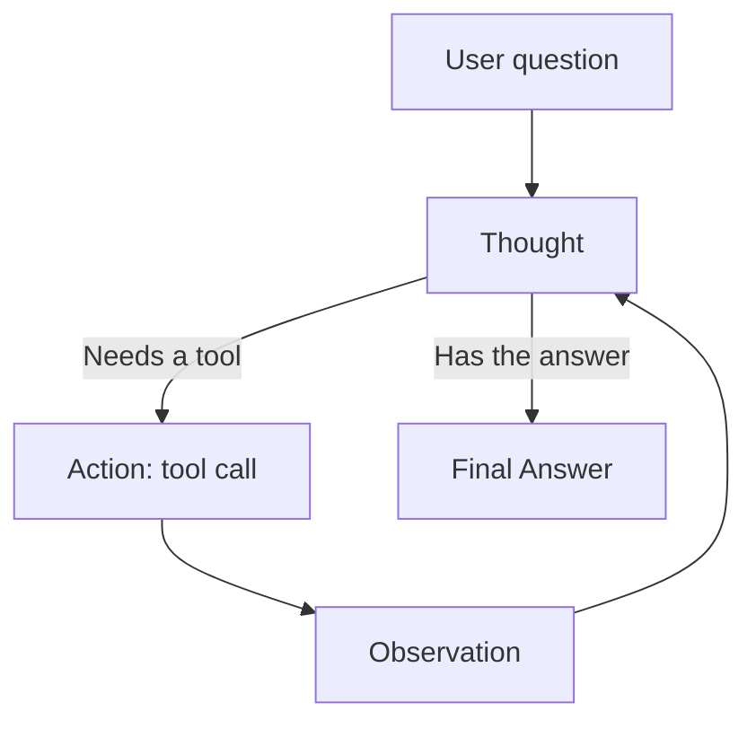

# What is a ReAct Agent?

> **Step 10: AI Agents and Agentic Systems** · ⏱️ 19 min read · [Read original](https://outcomeschool.com/blog/react-agent)

## TL;DR
A ReAct Agent is an AI Agent built with the ReAct (Reasoning + Acting) pattern, the most common agent pattern. The LLM loops through Thought, Action, Observation until it can give a final answer, with its reasoning visible at every step.

## Key Concepts
- **ReAct** — a pattern for building AI Agents; AI Agent is the category, ReAct is one way to shape the loop.
- **Thought / Action / Observation** — reason about the next step; pick a tool; read the result.
- **System prompt** — explains the pattern, lists tools, sets rules.
- **Loop Controller** — code that sends memory to the LLM, runs tools, appends results, enforces stop conditions.
- **CoT link** — the explicit Thought is Chain-of-Thought prompting surfaced inside the agent loop.

## How It Works
### Anatomy (five parts)
LLM (brain), System Prompt, Tools (name, description, input schema), Memory (question, thoughts, actions, observations), Loop Controller. Remove any and it is no longer a ReAct Agent.

### Prompt template
The prompt tells the LLM to respond either as `Thought` plus `Action: tool(input)` or `Thought` plus `Final Answer`, always start with a Thought, wait for the Observation, and stop once it has the answer. With Claude, GPT, or Gemini, do not copy the string format; use the API's native tool/function-calling schema, which validates and parses calls. Modern APIs can also return several independent tool calls from one Thought, run in parallel.

### Loop steps
1. Add the question to Memory and send Memory to the LLM.
2. LLM returns Thought plus Action, or Final Answer.
3. Final Answer: return it. Otherwise execute the tool; the result is the Observation.
4. Append Thought, Action, Observation to Memory; repeat, up to a max step limit.

### Trace example
"What is 15% of the population of Tokyo?" The agent searches for the population (about 14 million), uses the calculator on `14000000 * 0.15` (2,100,000), and returns about 2.1 million, chaining one tool's output into the next.

### Failure modes
| Failure | Fix |
|---|---|
| Infinite loops | max_steps; detect repeated actions |
| Wrong tool | Clear tool descriptions |
| Hallucinated tool calls | Native tool use, validate inputs, return error as Observation |
| Context explosion | Summarize, drop stale observations, external memory (Context Engineering) |
| Premature stopping | Critic step or checklist before Final Answer |
| Stuck after tool error | Turn errors into natural-language Observations |

## Diagram

## Key Takeaways
- ReAct = LLM + tools + a Thought, Action, Observation loop.
- ReAct is a pattern, not a separate category from AI Agents.
- The system prompt makes a plain LLM behave as a ReAct agent; native tool calling handles the action format.
- Always set a step limit and validate tool inputs.
- The whole agent is about 20 lines: while loop, LLM call, stop check, tool branch.
