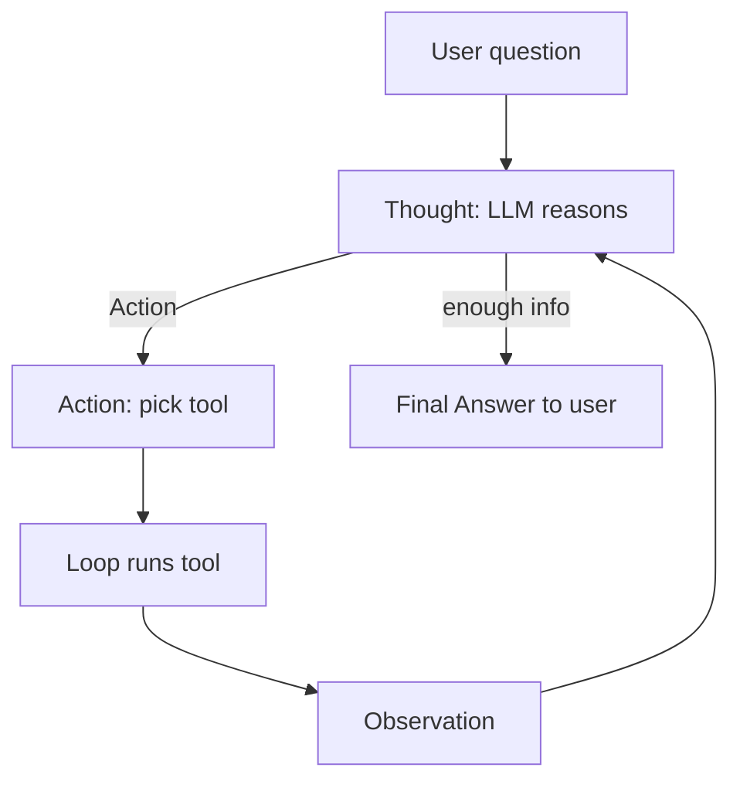

# What is a ReAct Agent?

> **Step 10: AI Agents and Agentic Systems** · ⏱️ 19 min read · [Read original](https://outcomeschool.com/blog/react-agent)

## TL;DR
A ReAct Agent is an AI Agent built with the ReAct (Reasoning + Acting) pattern: an LLM in a loop with tools and memory that repeats Thought -> Action -> Observation until it gives a Final Answer. It is the most common agent pattern; a system prompt teaches the LLM the pattern, and a loop controller executes tools and manages stopping.

## Key Concepts
- **ReAct Agent** = Reasoning + Acting + Agent. Reasoning: LLM decides next step. Acting: LLM picks a tool, the loop calls it. Agent: wrapper that runs the loop. (Intern analogy.)
- **AI Agent vs ReAct** — AI Agent is the category (any LLM in a loop with tools and memory); ReAct is a pattern for the loop with explicit visible reasoning (Chain-of-Thought surfaced inside the loop). Other patterns: Plan-and-Execute, Reflection, Agentic RAG.
- **Thought / Action / Observation / Final Answer** — reasoning text / tool pick / tool result / ends loop.
- **Memory** — running history of question, thoughts, actions, observations.
- **Loop Controller** — code that sends memory to LLM, executes tools, appends results, checks stop (e.g. max steps). Designing it = Loop Engineering.

| Property | AI Agent | ReAct Agent |
|---|---|---|
| Definition | Any LLM in loop with tools | Loops Thought, Action, Observation |
| Reasoning | May or may not be visible | Explicit Thought step (classic) |
| Loop pattern | Unspecified | Thought -> Action -> Observation |
| Examples | ReAct, Plan-and-Execute, Reflection, Agentic RAG | ReAct only |
Computer-use agents run the same think-act loop but operate a screen.

## How It Works
### Five parts
1. **LLM** (brain). 2. **System prompt** (explains pattern, lists tools, sets rules). 3. **Tools** (name, description, input schema). 4. **Memory**. 5. **Loop Controller**. Remove one and it is not a ReAct Agent.

### Prompt template (essence)
Persona "solves problems by thinking step by step and recommending tools"; lists tools (e.g. search(query), calculator(expression)); two formats - Format 1: `Thought:` + `Action: tool(input)`; Format 2: `Thought:` + `Final Answer:`. Rules: always start with a Thought; one tool per turn unless parallel clearly helps; wait for Observation; stop once there is a final answer. The prompt explains the pattern, lists tools, sets rules.
Note: the literal Action string is the classic format (original paper used `Action: search[Apple Remote]`). With Claude, GPT, Gemini use the API's tool/function-calling schema instead; the API validates inputs and parses the call.

### Run steps
1. User question added to Memory. 2. Memory (system prompt + question + history) sent to LLM. 3. LLM returns Thought + Action, or Final Answer. 4. Final Answer: return, done. 5. Else loop executes tool; result = Observation. 6. Append Thought, Action, Observation to Memory. 7. Back to step 2. Ends on Final Answer or max steps. Classic form: one tool per Thought; modern APIs may return multiple independent calls run in parallel.

### Trace: "What is 15% of the population of Tokyo?"
- Thought 1: need Tokyo population -> Action: search("current population of Tokyo") -> Obs: about 14 million.
- Thought 2: compute 15% -> Action: calculator("14000000 * 0.15") -> Obs: 2100000.
- Thought 3: have answer -> Final Answer: about 2.1 million.
It recognized missing data, chained search output into the calculator, and stopped promptly.

### Implementation
Same ~20-line skeleton: messages seeded with system prompt (first message) + user question; `while True`; `max_steps` check; `call_llm(messages, tools)` (Thought step); `if response.is_done: return final_answer`; for each tool call, run `call_tool` and append observation as a tool message. Real APIs differ in message shape (OpenAI uses tool_call_id, Anthropic wraps in tool_result block). Extras (tracing thoughts, retries, reflection, parallel calls) are polish.

## Diagram(s)
### Thought-Action-Observation loop

## Trade-offs & Pitfalls
| Failure mode | Fix |
|---|---|
| Infinite loops (same tool/input) | Hard max_steps; detect repeated identical actions, stop or tell agent to try differently |
| Wrong tool selection (search for math) | Very clear tool descriptions: what it does, when to use |
| Hallucinated tool calls | Native tool-use schema; validate inputs; error message as Observation |
| Context explosion | Summarize older steps, drop stale observations, separate memory store (Context Engineering; RLMs offload to sub-models) |
| Premature stopping | Critic step or checklist (covered all parts? cited a source? verified math?) made explicit in prompt |
| Stuck after tool error | Catch errors, convert to natural-language Observation ("search API timed out, retry or change query") |
Handling these is the real work of production agents.

## Key Takeaways
- ReAct = Thought -> Action -> Observation loop until Final Answer.
- ReAct is a pattern for building AI Agents, not a separate category.
- Five parts: LLM, system prompt, tools, memory, loop controller.
- With modern APIs use native tool-calling schemas, not hand-parsed Action strings.
- Parallel tool calls are supported in modern APIs; loop shape is unchanged.
- Always cap steps and plan for tool errors, wrong tools, context growth and early stopping.
