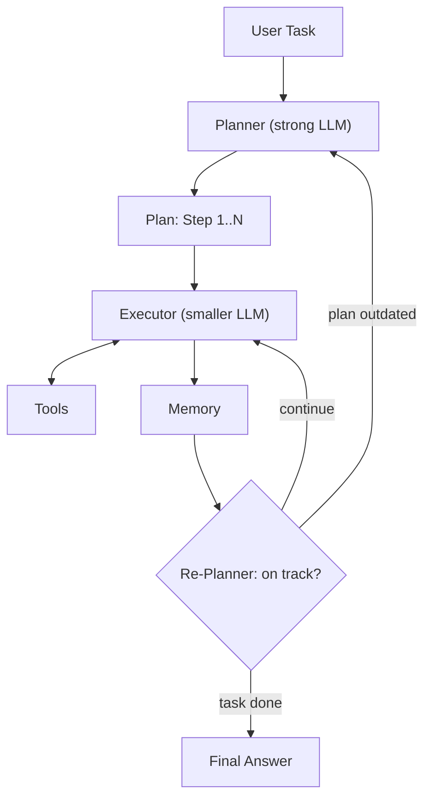
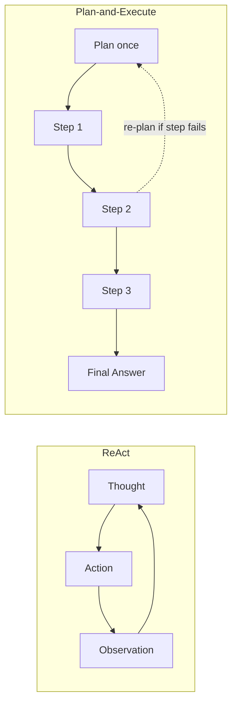

# What is a Plan-and-Execute Agent?

> **Step 10: AI Agents and Agentic Systems** · ⏱️ 15 min read · [Read original](https://outcomeschool.com/blog/plan-and-execute-agent)

## TL;DR
A Plan-and-Execute Agent is an AI Agent that writes the full plan up front, then runs it step by step, re-planning only when reality diverges from the plan. A strong LLM plans, a smaller cheaper LLM executes. It suits multi-step tasks with a clear path and is cheaper than ReAct for long, predictable tasks.

## Key Concepts
- **Plan-and-Execute Agent** = Plan + Execute + Agent: a Planner that writes steps + an Executor that runs them + a loop connecting them.
- **AI Agent vs pattern** — "AI Agent" is the category (LLM in a loop with tools and memory); Plan-and-Execute is one pattern to shape that loop (like ReAct, Reflection, Agentic RAG). Planning is one LLM call, execution is separate calls.
- **Planner** — strong LLM; turns the task into a numbered list of small, clear steps.
- **Executor** — usually a smaller, cheaper LLM; picks a tool for the current step, runtime calls it, result goes to memory. May itself be a small sub-agent (e.g. ReAct loop). Never plans ahead.
- **Tools** — actions (search, DB query, calculator, email, file read); each has name, description, input schema.
- **Memory** — task, plan, every executed step and result. Planner reads it to revise; Executor reads it to know what is done.
- **Re-Planner** — after each step decides: continue, update plan, or stop. Optional in the simplest setups (Planner, Executor, Tools, Memory are must-haves) but most production agents include it; often the same LLM as the Planner called again with latest state.
- Analogy: project manager (plans, updates plan) and worker (does tasks). Prompt Chaining is the manual precursor (pass output of one prompt to the next by hand).

## How It Works
### Three phases
1. **Plan** — Planner reads task, writes step-by-step plan, saved to memory.
2. **Execute** — Executor takes the next step, LLM recommends a tool, runtime calls it, result saved to memory.
3. **Re-Plan** — after every step (or few steps) the Re-Planner checks state: on track, continue; step failed / unexpected / plan invalid, update plan; done, return final answer.

Loop runs until plan finishes or Re-Planner decides the answer is final. Shaping the step budget, re-plan trigger and exit is Loop Engineering. Motto: plan once, execute step by step, re-plan when reality does not match.

### Worked trace
Task: population of India and Japan, which is larger and by how much.
- Plan: (1) search India population, (2) search Japan population, (3) compare, (4) return larger and difference.
- Execute: India 1.43 billion; Japan 124 million; calculator 1,430,000,000 - 124,000,000 = 1,306,000,000; compose answer.
- Re-Plan: on track after each step; done after step 4.
- Answer: India larger by about 1.31 billion.

### Plan-and-Execute vs ReAct
ReAct thinks every turn (Thought, Action, Observation); Plan-and-Execute thinks once at the start and re-plans only on failure.

| Property | ReAct | Plan-and-Execute |
|---|---|---|
| When LLM plans | One step at a time | Full plan up front, re-plan if needed |
| LLM calls | One per step | One big planning call + smaller calls per step |
| Cost | Higher with many steps | Lower for many predictable steps |
| Latency | Slower for long tasks | Faster for long tasks (smaller Executor calls) |
| Adaptability | Very high | Lower, only on re-plan |
| Best for | Open-ended, next step unclear | Multi-step, clear path |
| Visibility | Reasoning each turn | Whole plan visible up front |

Rule: ReAct when next step depends on last result; Plan-and-Execute when steps can be planned ahead.

## Diagram(s)
### Architecture and loop

### ReAct vs Plan-and-Execute

## Trade-offs & Pitfalls (failure modes and fixes)
| Failure | What happens | Fix |
|---|---|---|
| Bad Plan | Incomplete, wrong order, skipped steps | Clear Planner system prompt, good-plan examples, list tools, small concrete steps |
| Step Drift | Step "search the docs" becomes a public web search | Make steps specific: exact tool, input, expected output |
| No Re-Planning | Failed step ignored, rest runs blindly | Re-Planner after each step, at least after errors/surprises |
| Over-Planning | 30 steps for a 3-step task, each costs LLM + tool call | Ask for smallest plan, merge steps |
| Plan Becomes Outdated | New info/format/wrong assumption invalidates rest | Re-Planner rewrites remaining steps from latest state |
| Infinite Re-Planning | Keeps rewriting, no progress | Max re-plans, max total steps, stop if plan unchanged for two re-plans in a row |

## FAQ
- Same LLM for Planner and Executor? → Usually not: strong Planner, smaller cheaper Executor (steps are narrower). Re-Planner may reuse the Planner LLM.
- Is Re-Planner required? → No in simplest setups, but most production agents include it.
- Can the Executor be an agent? → Yes (e.g. ReAct loop), but it still only handles the current step.
- Stop endless re-planning? → Hard limits on re-plans and total steps plus the unchanged-plan stop condition.

## Key Takeaways
- Plan-and-Execute is a pattern for building AI Agents, not a separate category.
- Five parts: Planner, Executor, Tools, Memory, Re-Planner (last is optional but common).
- Three phases: Plan once, Execute stepwise, Re-Plan on mismatch.
- Cheaper and faster than ReAct on long tasks with predictable steps; less adaptive.
- Use ReAct for open-ended tasks, Plan-and-Execute for clear multi-step paths.
- Control failures with specific steps, a strict Re-Planner, and hard caps on re-plans and steps.
