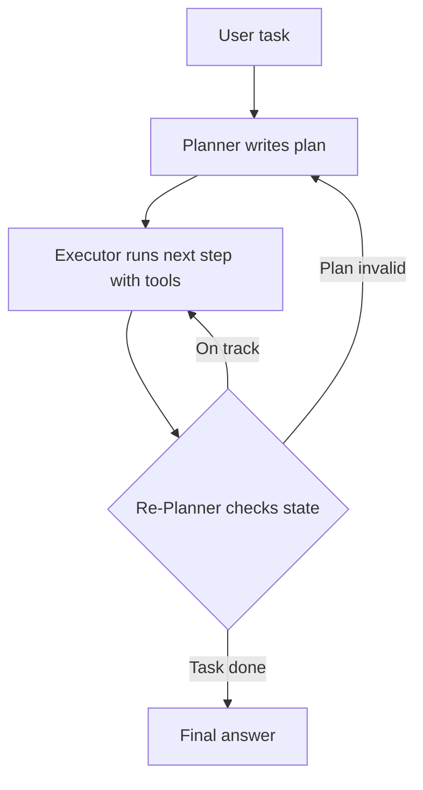

# What is a Plan-and-Execute Agent?

> **Step 10: AI Agents and Agentic Systems** · ⏱️ 15 min read · [Read original](https://outcomeschool.com/blog/plan-and-execute-agent)

## TL;DR
A Plan-and-Execute Agent writes the full plan up front, then runs it step by step, re-planning only when reality diverges. It suits multi-step tasks with a predictable path and can be cheaper than thinking at every turn.

## Key Concepts
- **Planner** — strong LLM that writes a numbered, step-by-step plan.
- **Executor** — usually a smaller, cheaper LLM that handles only the current step (sometimes a mini ReAct sub-agent).
- **Tools** — actions the Executor can call.
- **Memory** — task, plan, executed steps, and results.
- **Re-Planner** — after steps, decides: continue, update the plan, or stop. Optional in simplest setups but common in production.
- **Prompt Chaining** — the manual precursor: pass one prompt's output to the next by hand.

## How It Works
Plan once, execute step by step, re-plan when reality does not match.

1. **Plan**: Planner writes the plan, saved to memory.
2. **Execute**: Executor takes each step, picks a tool, runtime runs it, result saved.
3. **Re-Plan**: after each step, the Re-Planner keeps going, revises, or finishes.

### Example
Task: compare the populations of India and Japan. Plan: search India, search Japan, compare, return the larger and the difference. Execution gives 1.43 billion and 124 million; the calculator gives a difference of 1.306 billion. The Re-Planner sees everything on track and the agent stops.

### Versus ReAct
| Property | ReAct | Plan-and-Execute |
|---|---|---|
| When the LLM plans | One step at a time | Full plan first, re-plan if needed |
| LLM calls | One per step | One big plan plus smaller step calls |
| Cost / latency on long tasks | Higher | Lower for predictable steps |
| Adaptability | Very high | Lower |
| Best for | Open-ended, unclear next step | Clear path, many steps |

Use ReAct when the next step depends on the last result; use Plan-and-Execute when steps can be planned ahead.

### Failure modes
| Failure | Fix |
|---|---|
| Bad plan | Clear prompt, examples, small concrete steps |
| Step drift | Specify tool, input, and expected output per step |
| No re-planning | Run the Re-Planner after each step or on errors |
| Over-planning | Ask for the smallest plan that works |
| Outdated plan | Rewrite remaining steps from latest state |
| Infinite re-planning | Cap re-plans and total steps; stop if the plan is unchanged twice |

## Diagram

## Key Takeaways
- Think once up front, then execute; re-plan only on surprises.
- Split roles: strong Planner, cheap Executor.
- Best for long, multi-step tasks with a clear path; ReAct for open-ended ones.
- Make plan steps specific to prevent drift.
- Cap re-plans and steps to avoid infinite loops.
