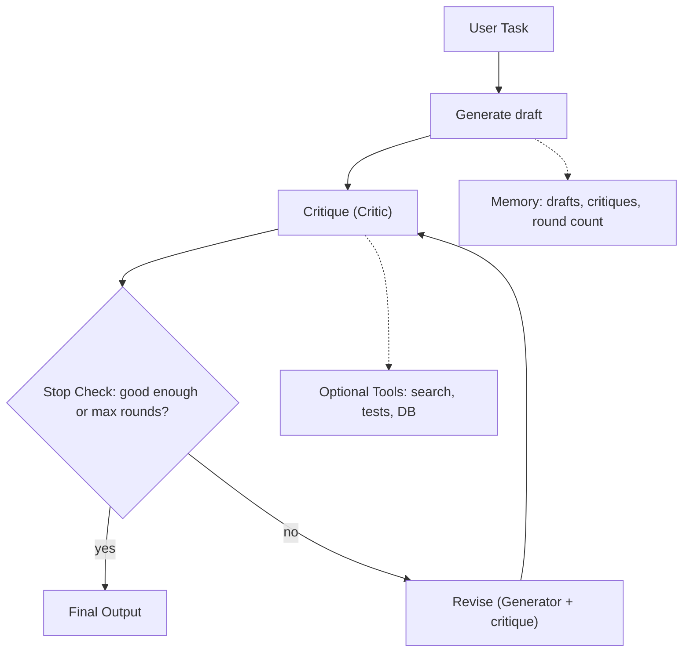
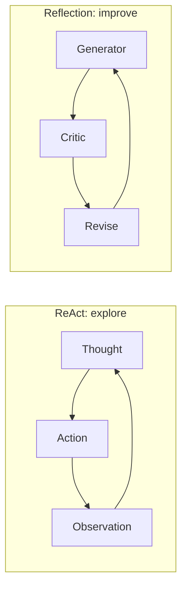

# What is a Reflection Agent?

> **Step 10: AI Agents and Agentic Systems** · ⏱️ 17 min read · [Read original](https://outcomeschool.com/blog/reflection-agent)

## TL;DR
A Reflection Agent writes a draft, critiques its own draft, and revises using the critique, repeating until a Stop Check says it is good enough. It is the pattern to reach for when quality matters more than speed and no exact checker exists for the task. Its main risks are a soft or vague Critic, runaway cost, and hallucinated specifics.

## Key Concepts
- **Reflection Agent** = Reflection + Agent: a Generator that drafts + a Critic that reviews + a loop that revises. Analogy: writer and editor on one essay.
- **Pattern, not category** — AI Agent is the broad category; Reflection is one way to shape the loop (others: ReAct, Plan-and-Execute, Agentic RAG).
- **Generator** — LLM that writes the first draft; later reads previous draft plus critique and writes a revision.
- **Critic** — LLM that reviews and writes what is wrong/missing/better. Usually the same LLM as Generator with a different prompt (two models also possible). It is LLM as a Judge inside the loop.
- **Tools** — optional; Critic can search, run unit tests, query DBs, check citations. A Critic that verifies is much stronger than one relying on its own knowledge.
- **Memory** — task, drafts, critiques, revision count. Full history bloats context after a few rounds, so keep only latest draft + critique or summarize older rounds. Critic uses it to avoid repeating feedback.
- **Stop Check** — stops when the Critic says good enough, max rounds hit, or two rounds in a row give the same critique. Deciding when loops stop is core to Loop Engineering.

## How It Works
### Three phases
1. **Generate** — Generator writes draft, saved to memory.
2. **Critique** — Critic writes critique, saved to memory; Stop Check decides: good enough (return), max rounds (return latest draft), or continue.
3. **Revise** — Generator reads latest draft + critique, writes new draft; back to Critique.

Stop Check sits right after Critique so no Revise round is wasted if the first draft is already good. This node/edge shape is what Graph Engineering designs.

### Worked trace
Task: one-paragraph product description of a wireless mouse for office workers.
- Draft 1: generic ("good for office work... battery lasts a long time").
- Critique: too generic, no specific features (silent clicks, grip), no concrete battery numbers, weak phrase "good for office work", no opening hook.
- Draft 2: silent-click mouse, contoured grip, precision scroll wheel, single AA battery for up to 18 months.
- Caveat: "18 months" was invented by the Generator to satisfy the Critic's request for numbers (hallucination via critique).
- Critic finds nothing important; Stop Check fires; draft 2 returned.

### Reflection vs ReAct
| Property | ReAct | Reflection |
|---|---|---|
| Loop purpose | Explore: gather info and act | Improve: critique and revise |
| Changes per turn | Action and observation | The draft |
| Tools | Central | Optional, back up critique |
| Stop | Enough info to answer | Critic satisfied or max rounds |
| Best for | Needs external information | Quality over speed |
| Cost grows with | Tool calls | Revision rounds |
| Visibility | Reasoning each turn | Each draft and critique |

Skip Reflection when the first draft is usually correct (simple Q&A, classification, lookups) or latency matters more than polish (real-time chat, voice agents).

## Diagram(s)
### Reflection loop

### Loop purpose compared

## Trade-offs & Pitfalls
| Failure | Problem | Fix |
|---|---|---|
| Soft Critic | Praises everything, stops round 1 | Prompt for at least 3 specific issues; "no issues" only if strong against named criteria |
| Useless Critic | Vague ("improve wording") | Require concrete, actionable feedback ("split the second sentence") |
| Worse Revisions | New draft worse | Keep previous draft; Stop Check compares and reverts if worse or critique unaddressed |
| Endless Loop | Critic always finds something | Max rounds (2 or 3 often enough); stop on same complaints twice in a row |
| Cost Explosion | 5 rounds = 1 generate + 5 critiques + 5 revises = 11 LLM calls | Cap rounds, smaller Critic model with named criteria, skip reflection when unneeded |
| Drift From the Task | Critic pushes longer/fancier drafts away from request | Give original task in every Critic prompt; check it answers the task first |
| Hallucination via Critique | Generator invents numbers/citations to satisfy Critic | Give Critic verification tools, or forbid asking for specifics not in task/previous drafts |

## FAQ
- Critic must be a separate model? → No, usually same LLM with a review prompt.
- Critic needs tools? → Optional, but verification makes it much stronger.
- How many rounds? → Often 2 or 3; always set a max, since each round costs a Critic + Generator call.
- Can it reduce accuracy? → Yes, via invented specifics; fix with tools or prompt rules.
- When to skip? → Easy first-draft tasks, or latency-critical ones.

## Key Takeaways
- Reflection = generate, critique, revise, loop until a Stop Check fires.
- Five parts: Generator, Critic, Tools, Memory, Stop Check.
- ReAct loops to explore the world; Reflection loops to polish the output.
- Critic quality decides everything: must be strict, specific, and anchored to the task.
- Always cap rounds; cost is roughly 2 calls per round plus one initial generate.
- Guard against hallucinated specifics with real verification tools.
- Revert to the previous draft if a revision is worse.
