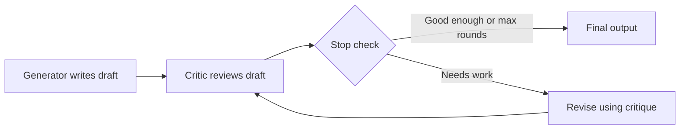

# What is a Reflection Agent?

> **Step 10: AI Agents and Agentic Systems** · ⏱️ 17 min read · [Read original](https://outcomeschool.com/blog/reflection-agent)

## TL;DR
A Reflection Agent writes a draft, critiques its own draft, and revises it, looping until the work is good enough. It is for tasks where output quality matters more than speed and the first attempt is rarely good enough.

## Key Concepts
- **Generator** — LLM that writes and revises drafts.
- **Critic** — LLM that reviews a draft (often the same LLM with a different prompt); effectively LLM-as-a-Judge inside the loop.
- **Tools** — optional; let the Critic verify claims (run tests, search, check citations).
- **Memory** — drafts, critiques, round count; usually trimmed to the latest draft and critique to save context.
- **Stop Check** — stops when the Critic is satisfied, max rounds hit, or two rounds repeat the same critique.

## How It Works
Generate, Critique, Revise, with a Stop Check right after each Critique so no round is wasted on an already-good draft.

### Example
Task: a product description for a wireless mouse. The first draft is generic. The Critic notes the lack of specific features, no concrete battery figures, a weak hook. The revision is much stronger, but it invented "18 months" of battery life, showing the hallucination risk when a Critic demands specifics the model does not have.

### ReAct vs Reflection
| Property | ReAct | Reflection |
|---|---|---|
| Loop purpose | Explore and act | Improve the output |
| What changes per turn | Action and observation | The draft |
| Tools | Central | Optional, back the critique |
| Stop | Enough info | Critic satisfied or max rounds |
| Best for | Needs external info | Quality over speed |

Skip Reflection when the first draft is usually right (simple Q&A, classification, lookups) or latency matters (real-time chat, voice).

### Failure modes
| Failure | Fix |
|---|---|
| Soft Critic | Require several specific issues; "no issues" only against named criteria |
| Useless Critic | Demand concrete, actionable feedback |
| Worse revisions | Keep the previous draft; revert if the new one is worse |
| Endless loop | Cap rounds (often 2 or 3); stop on repeated critique |
| Cost explosion | 5 rounds is about 11 LLM calls; cap rounds, smaller Critic model |
| Drift from the task | Give the Critic the original task every time |
| Hallucination via critique | Give real verification tools; forbid asking for unsupported specifics |

## Diagram

## Key Takeaways
- Reflection = generate, critique, revise until a quality bar is met.
- The loop is for improving output, whereas ReAct's loop is for exploring.
- A strict Critic prompt and a hard round cap are essential.
- Critics demanding specifics can cause the Generator to fabricate them; give verification tools.
- Each round costs two LLM calls, so skip it where the first draft is already good.
