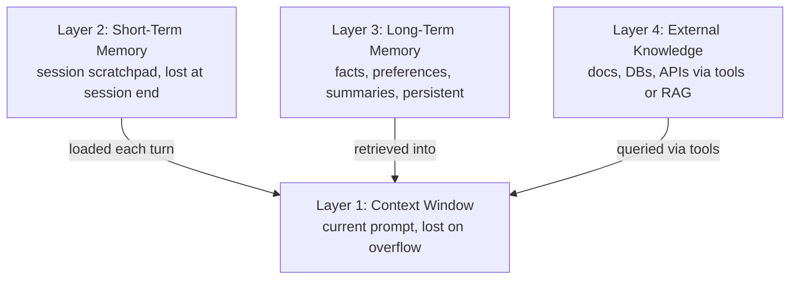
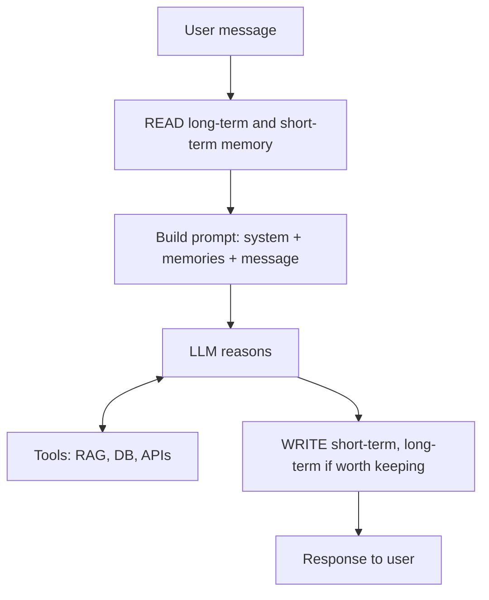

# How does AI Agent Memory work?

> **Step 10: AI Agents and Agentic Systems** · ⏱️ 17 min read · [Read original](https://outcomeschool.com/blog/ai-agent-memory)

## TL;DR
An LLM is stateless; AI Agent Memory is the system built around it so it appears to remember across turns, sessions, and users. It is a stack of four layers, driven by four operations (write, read, update, forget), and on every turn the agent reads memory, builds the prompt, calls the LLM, then writes memory. Most failures are silent and come from storing too much or retrieving badly.

## Key Concepts
- **Stateless LLM** — every call starts fresh; the agent remembers on its behalf. Analogy: a brilliant assistant who forgets after every meeting; memory is their notebook, filing cabinet and diary.
- **Why memory** — without it: no continuity, no personalization (short answers, Python, Bangalore), no learning (repeats mistakes), no long tasks (forgets plan halfway; designing the cycle is Loop Engineering).
- **Layer 1 Context window** — text the LLM sees in one call; fastest, smallest; overflow drops/summarizes old messages. (Recursive Language Models split oversized input across sub-model calls.)
- **Layer 2 Short-term memory** — session scratchpad: plan, current step, intermediate results; usually lost at session end. Loaded back into the context window each turn. Some frameworks equate short-term with the context window; the blog keeps them separate.
- **Layer 3 Long-term memory** — persistent across sessions: user facts, preferences, conversation summaries, learned behaviors. Sub-types: episodic (experiences), semantic (facts), procedural (how-to).
- **Layer 4 External knowledge** — documents, DBs, APIs, web via tools/RAG; queried, not maintained or written back as agent memory (some frameworks count it as long-term).
- Desk analogy: context window = desk, short-term = notepad, long-term = diary in drawer, external = library.

## How It Works
### Four core operations
Memory system = Write + Read + Update + Forget.
1. **Write** — save important info (user says "I prefer Go" gives "preferred language: Go").
2. **Read** — retrieve only what matters now (reverse-string request pulls the language preference, not the shipping address); hardest part.
3. **Update** — replace contradicted memories (Python last month, Go now).
4. **Forget** — remove stale/wrong/irrelevant (e.g. "debugging login right now" after session). Without it the store grows and retrieval degrades.

Break one and it all fails: write-only wastes disk, no-update acts on stale facts, no-forget drowns.

### Runtime flow per turn
1. User sends message.
2. Search long-term memory for relevant facts.
3. Read short-term memory (plan, recent actions, results).
4. Build prompt: system prompt + retrieved long-term + short-term scratchpad + user message (formatted into the system prompt text).
5. LLM reasons; may call tools (RAG, DB, APIs) in a loop before the final answer.
6. Write: short-term gets the new step; long-term only if worth keeping.
7. Respond.

Production note: long-term write is often asynchronous after the response, to hide latency.

Example: turn 1 "My name is Priya and I code in Go" writes "Priya. Preferred language: Go". A week later "write a function that reverses a string" retrieves it, the LLM answers in Go for Priya. The LLM remembered nothing.

### What to store
- Store: stable user facts (name, role, language, timezone); strong preferences; outcomes of past tasks; decisions shaping future work (architecture, policies, constraints).
- Do not store: every message (context window has live chat), chit-chat, temporary state already in short-term, sensitive data without consent.
- Test: "Will this be useful in a future conversation?" Store what matters next week, skip what matters next minute.
- Company data semantics (what a table means) belong in shared files readable by all agents (OKF), not one agent's memory.

## Diagram(s)
### Memory stack

### Per-turn runtime flow

## Trade-offs & Pitfalls
| Mistake | Fix |
|---|---|
| Context window overflow (oldest info lost) | Summarize old turns, drop stale tool outputs, include only the most relevant memories |
| Retrieval misses the memory | Semantic (embedding) search, good titles/descriptions, over-retrieve and let LLM pick; ANN search for speed at scale |
| Outdated memories | On write, check contradictions and update/replace, do not just append |
| Memory bloat | Forget policy: delete unused or superseded memories |
| Privacy leaks | Scope memory to user ID, never mix users, encrypt at rest and in transit, require consent |
| Confusing short vs long term | Be deliberate: task-only is short-term, future-relevant is promoted; when in doubt short-term |

- Most failures are silent (subtly wrong answers): add logging, monitoring, regular audits.
- Memory poisoning: attacker text stored once returns every session (see prompt injection).

## FAQ
- Does the LLM remember? → No; agent stores and re-injects.
- Short vs long term? → Session scratchpad vs persistent across sessions.
- RAG = memory? → No, it is external knowledge the agent queries but does not maintain.
- Store everything? → No; storing too much is a top mistake.
- Does writing slow replies? → Not if done asynchronously after responding.

## Key Takeaways
- The LLM is stateless; the agent does the remembering.
- Four layers: context window, short-term, long-term, external knowledge.
- Four operations: write, read, update, forget; all are required.
- Each turn: read, build prompt, respond, write.
- Store what matters next week; failures come from over-storing.
- Scope by user, handle conflicts by update not append, and monitor because errors are silent.
