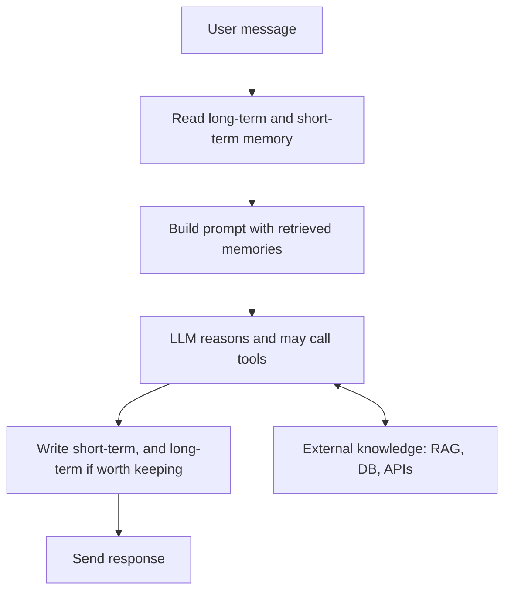

# How does AI Agent Memory work?

> **Step 10: AI Agents and Agentic Systems** · ⏱️ 17 min read · [Read original](https://outcomeschool.com/blog/ai-agent-memory)

## TL;DR
An LLM is stateless, so AI Agent Memory is the system built around it that lets it appear to remember across turns, sessions, and users. It is a stack of layers with four operations (write, read, update, forget) that runs on every turn.

## Key Concepts
- **Stateless LLM** — remembers nothing between calls; the agent remembers on its behalf.
- **Context window** — text the LLM sees in one call; fastest but smallest.
- **Short-term memory** — session scratchpad: plan, current step, intermediate results.
- **Long-term memory** — persistent user facts, preferences, summaries, learned behavior.
- **External knowledge** — documents, databases, APIs, RAG; queried, not maintained by the agent.

## How It Works
### Why agents need memory
Without it: no continuity, no personalization, no learning from mistakes, and no long-running tasks.

### Memory stack (desk analogy)
Context window is the desk; short-term is the notepad; long-term is the diary; external knowledge is the library.

### Four operations
- **Write** — save important facts ("preferred language: Go").
- **Read** — retrieve only what is relevant now (usually the hardest part).
- **Update** — fix memories contradicted by new info.
- **Forget** — drop stale or irrelevant memories to prevent bloat.

If any is broken, the system breaks.

### Runtime flow (every turn)
1. User message arrives.
2. Read long-term memory (relevant facts) and short-term memory (plan, recent steps).
3. Build prompt: system prompt plus retrieved memories plus user message.
4. LLM reasons, possibly calling tools in a loop (which can use external knowledge).
5. Write to short-term memory, and to long-term only if worth keeping (often asynchronously).
6. Respond.

Example: Priya says she codes in Go; a week later asks for a string-reverse function; the retrieved "prefers Go" makes the LLM answer in Go.

### What to store
Store: stable user facts, strong preferences, task outcomes, key decisions. Skip: every message, chit-chat, temporary state, sensitive data without consent. Rule: "Will this be useful in a future conversation?"

### Common mistakes
| Mistake | Fix |
|---|---|
| Context overflow | Summarize old turns, drop old tool outputs |
| Retrieval misses | Semantic search, good titles, over-retrieve then pick |
| Outdated memories | Check contradictions on write; update, do not just append |
| Memory bloat | Forget policy |
| Privacy leaks | Scope to user ID; encrypt; require consent |
| Mixing layers | Be deliberate; prefer short-term, promote later |

Most failures are silent, so add logging, monitoring, and audits (also guards against poisoned memory via prompt injection).

## Diagram

## Key Takeaways
- The LLM never remembers; the agent re-injects memory into the prompt each turn.
- Four layers: context window, short-term, long-term, external knowledge.
- Four operations: write, read, update, forget.
- Store what matters next week, not next minute.
- Scope memory per user and audit it; most memory bugs are silent.
