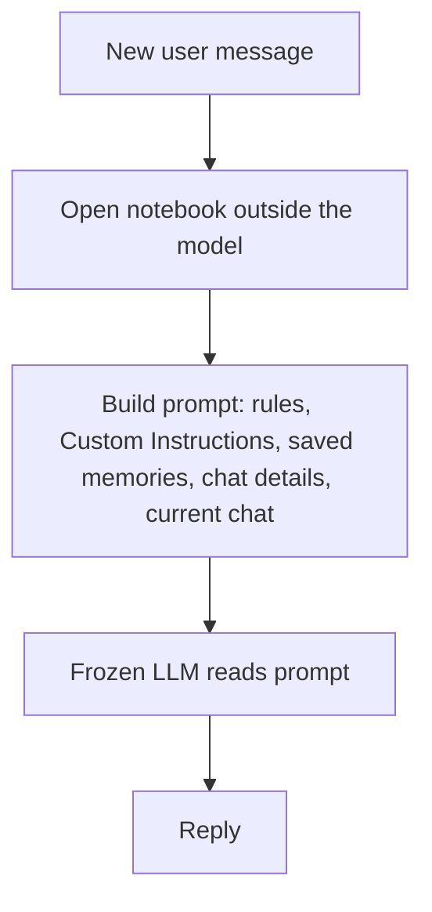

# How does ChatGPT remember you?

> **Step 10: AI Agents and Agentic Systems** · ⏱️ 15 min read · [Read original](https://outcomeschool.com/blog/how-does-chatgpt-remember-you)

## TL;DR
ChatGPT does not remember you; the model is frozen and stateless. A separate system saves notes about you and adds the relevant ones to the prompt before each reply, so the model just reads them.

## Key Concepts
- **LLM** — frozen after training; each reply depends only on the text sent in that call.
- **Context window** — all text the LLM can read at once (the "desk"); limited, so ChatGPT must choose what goes on it.
- **Saved memories** — short fact notes, saved on request or when ChatGPT decides they will be useful; shown by a "Memory updated" message.
- **Reference chat history** — useful details picked from past chats, with no fixed list.
- **Custom Instructions** — text we write ourselves in settings; ChatGPT never changes it.
- **Temporary Chat** — uses no memories, creates none, and is not saved in history.

## How It Works
### Within one chat
Memory is just the whole conversation re-sent with every message. A new chat starts with an empty desk.

### Across chats
A notebook kept outside the model is consulted before each reply. The prompt is built roughly as: company rules, Custom Instructions, saved memories, useful details from past chats, then the current chat. Only relevant items are included (the Goa trip is left out of a dinner-recipe request). The real prompt is not public; this is a simplified picture.

### Example
Riya says "Remember that I am a vegetarian." A note is saved. Days later, in a new chat, she asks for a dinner recipe; the note is added to the prompt and the model suggests vegetable upma. The model never changed; only the prompt did.

### Code idea
```python
memory_store = []
def build_prompt(msg):
    notes = "\n".join("- " + n for n in memory_store)
    return "You are a helpful assistant.\n" + notes + "\nUser: " + msg
```
In real systems notes live in a database and only relevant ones are picked.

### Saved memories vs reference chat history
| | Saved memories | Reference chat history |
|---|---|---|
| What | Clear facts as short notes | Useful details from past chats |
| Created | We ask, or ChatGPT decides | Picked when needed |
| List visible? | Yes, in settings | No fixed list |
| Lifetime | Until deleted | Changes with chats |

### Control
Ask "What do you remember about me?", view and delete under Personalization, say "Forget that...", update facts, or turn memory off. Deleting a chat does not delete memories created in it.

### Where it helps and fails
Helps: no repetition, tailored answers, continuity. Fails: stale notes (Bengaluru vs Pune), missed details, unwanted saved notes, no real understanding.

## Diagram


## Key Takeaways
- The model is frozen; memory lives outside it and is injected into the prompt.
- Context window is limited, so only relevant notes are selected.
- Saved memories, reference chat history, and Custom Instructions are distinct mechanisms.
- Deleting a chat does not remove its saved memories.
- Review saved memories periodically; Temporary Chat avoids memory entirely.
