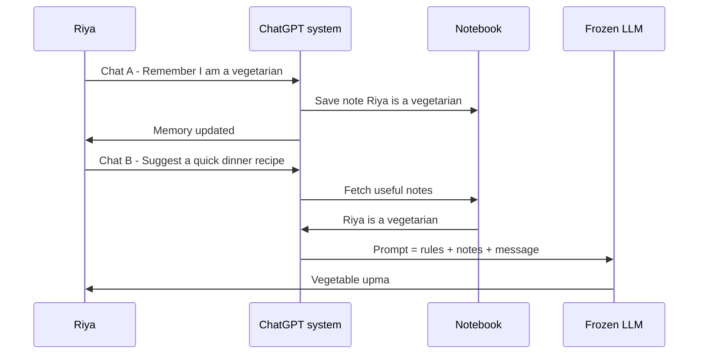
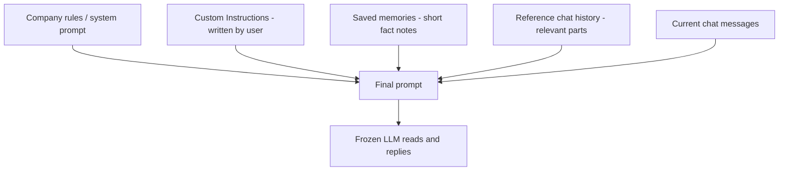

# How does ChatGPT remember you?

> **Step 10: AI Agents and Agentic Systems** · ⏱️ 15 min read · [Read original](https://outcomeschool.com/blog/how-does-chatgpt-remember-you)

## TL;DR
ChatGPT does not remember you; the model is frozen after training. A separate system keeps notes about you outside the model and puts the useful ones into the prompt before every reply. The model just reads them. Sources are saved memories, reference chat history and Custom Instructions.

## Key Concepts
- **LLM** — learned from huge text to predict the next word; training happens once, then the model is frozen. It does not learn your name or store chats. Every reply depends only on the text sent at that moment.
- **Context window** — all text the LLM can read at once (the "desk"); limited, so ChatGPT must choose what goes on it. Context Engineering is choosing well.
- **Within one chat** — memory is just the whole conversation re-sent with each new message. A new chat means an empty desk.
- **ChatGPT Memory** — a notebook about you kept outside the model; before each reply the useful pages are put on the desk.
- **Saved memories** — short fact notes kept until you delete them. Created when you ask ("Remember that I am a vegetarian") or when ChatGPT decides a fact is useful (e.g. "I teach maths to class 8"); shows "Memory updated". Short notes use little desk space.
- **Reference chat history** — ChatGPT mines past chats for useful parts (e.g. earlier Goa trip plan helps "what should I pack?"). Only small relevant parts are selected.
- **Custom Instructions** — text you write by hand in settings (about you, how to reply); ChatGPT never changes them.
- **Prompt** — the full text sent to the LLM.
- **Temporary Chat** — uses no saved memories, creates none, not in history ("closed notebook").

## How It Works
### Saved memories vs reference chat history
| | Saved memories | Reference chat history |
|---|---|---|
| What | Clear facts as short notes | Useful details from past chats |
| Created | You ask, or ChatGPT decides | Picked from old chats when needed |
| List visible? | Yes, in settings | No fixed list |
| Lifetime | Until you delete | Changes as chats change |

### Prompt assembly
Simplified (real format not public): company rules/system prompt, Custom Instructions, saved memories, useful details from past chats, then the current chat. Riya types one line but the LLM receives many; extras are the memory. The Goa trip is left out as irrelevant to a dinner recipe. The model is not remembering, it is reading.

### End-to-end example
1. Monday chat A: "Remember that I am a vegetarian."
2. Note "Riya is a vegetarian." written; "Memory updated" shown.
3. Chat ends; model forgets, notebook (outside the model) keeps the note.
4. Saturday chat B: "Suggest a quick dinner recipe."
5. Before sending, ChatGPT adds the note to the prompt.
6. Model suggests vegetable upma not chicken curry. Model unchanged; only the prompt changed.

### Code idea
```python
memory_store = []                      # notebook outside the model
def save_memory(note): memory_store.append(note)
def build_prompt(msg):
    notes = "\n".join("- " + n for n in memory_store)
    return "You are a helpful assistant.\nWhat you know about the user:\n" + notes + "\n\nUser: " + msg
save_memory("Riya is a vegetarian.")   # chat A
reply = call_llm(build_prompt("Suggest a quick dinner recipe."))  # chat B
```
Real systems store notes in a database (survive app close) and pick only useful notes per chat.

### Controlling memory
- Ask "What do you remember about me?"
- Settings, Personalization: list and delete saved memories.
- Say "Forget that I live in Bengaluru" or update ("I have moved to Pune").
- Turn off saved memories or reference chat history.
- Deleting a chat does NOT delete memories created in it; delete the memory itself.

## Diagram(s)
### Memory flow across chats


### Sources of prompt context


## Trade-offs & Pitfalls
- Helps: no repeating yourself; personalized answers (diet, job, style); long work continues across chats.
- Fails: old/wrong notes (note says Bengaluru after move to Pune); missed details because desk is limited; unwanted notes saved automatically (review periodically); no real understanding, only reading notes.
- Use Temporary Chat for things you do not want remembered (e.g. surprise gift planning).

## FAQ
- Does memory change the model? → No; model frozen, only prompt changes.
- Deleting chat deletes memories? → No.
- Saves without asking? → Yes, with a "Memory updated" notice.
- Sends all past chats? → No, only small relevant parts.
- Changes Custom Instructions itself? → No; saved memories and history are auto-collected, instructions are not.

## Key Takeaways
- LLMs are stateless and frozen; memory lives outside the model.
- In-chat memory is the conversation re-sent; cross-chat memory is notes injected into the prompt.
- Three sources: saved memories, reference chat history, Custom Instructions (only the last is manual).
- The context window is limited, so only relevant notes are selected.
- Deleting a chat does not remove its saved memories.
- Review memories regularly; stale or wrong notes mislead answers.
