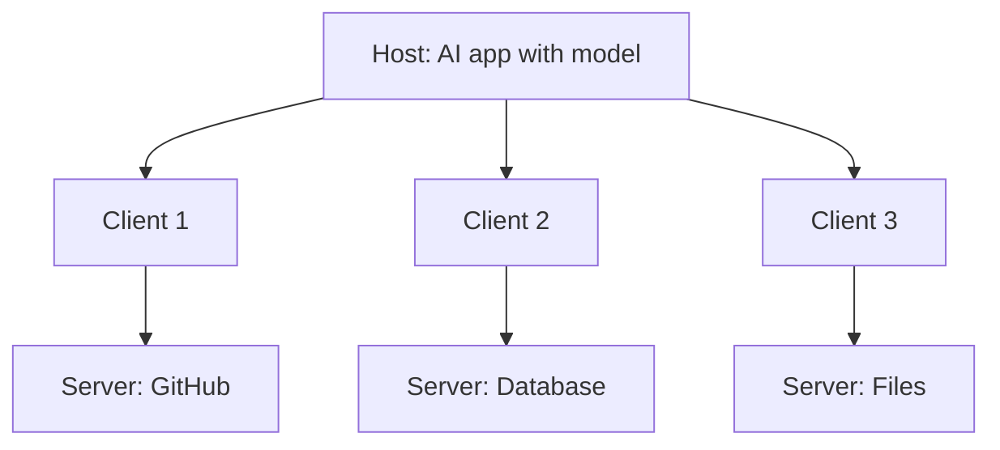

# What is MCP (Model Context Protocol)?

> **Step 10: AI Agents and Agentic Systems** · ⏱️ 16 min read · [Read original](https://outcomeschool.com/blog/what-is-mcp-model-context-protocol)

## TL;DR
MCP is an open standard (created by Anthropic, released November 2024) giving AI applications one common way to connect to outside tools and data. Build a connector once and every MCP-speaking application can use it, collapsing the N x M integration problem.

## Key Concepts
- **N x M problem** — N apps times M systems, each pair needing custom code (5 x 10 = 50).
- **MCP** — Model + Context + Protocol: a rulebook for giving a model the context it needs. Like USB-C for AI apps.
- **Self-describing** — on connection, the server announces its tools in plain English; MCP usually wraps normal APIs, not replaces them.
- **Host** — the AI application (Claude Code, Claude Desktop, Cursor).
- **Client** — connector inside the host holding one connection to one server.
- **Server** — small program offering tools and data (GitHub, database, files).
- **Capability negotiation** — handshake agreeing what each side supports.

## How It Works
### Work with MCP
5 apps + 10 connectors = 15 pieces of work instead of 50, and a new app gets all connectors free.

### Request flow ("Check my GitHub for open issues and summarize them")
1. Host starts the GitHub server and creates a client.
2. Client and server do capability negotiation.
3. Client asks "what tools do you have?"; server lists `list_issues`, `create_issue`, `add_comment` with descriptions and input schemas.
4. Host gives the tool list and question to the model.
5. Model picks `list_issues`.
6. Client sends the call; server talks to GitHub and returns results.
7. Model summarizes.

The model never talks to GitHub directly: the model requests, the host controls.

### Tool description
Name, description (plain English), and `inputSchema`. The model reads this and decides when to use it, then produces a call like `get_weather` with `city = "Delhi"`. This is Function Calling; MCP is how tools get plugged in.

### Transports
| Transport | Where server runs | Use |
|---|---|---|
| stdio | Your own computer; nothing leaves it | Simple, fast, local work |
| Streamable HTTP | On the internet, shared | One hosted server for many people |

Messages use the JSON-RPC format in both cases.

### Why it matters
Build once, use everywhere; no lock-in; thousands of ready-made servers; fresh live data; and it powers agents' tool access.

### Risks
- **Prompt injection** — hidden instructions in data a server returns (for example a malicious GitHub issue); be careful with servers that ingest text from strangers.
- **Untrusted servers** — they run real code on your machine; install only from trusted sources.

## Diagram

## Key Takeaways
- MCP turns an N x M integration problem into roughly N + M.
- It sits on top of APIs and is self-describing, so models discover tools themselves.
- Three roles: host, client (one per server), server.
- The model only asks; the host and client do the work.
- Watch for prompt injection and untrusted servers.
