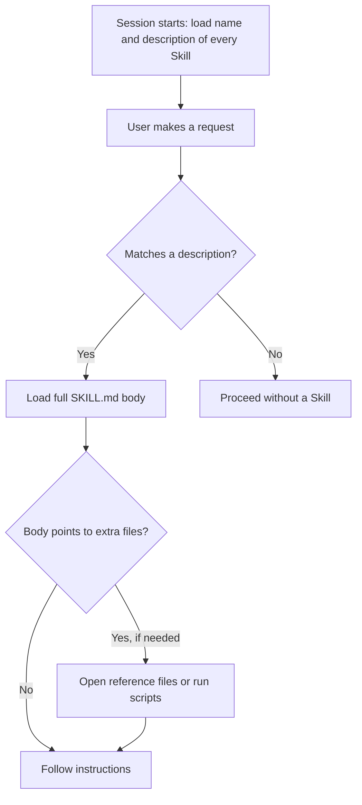

# What are Agent Skills?

> **Step 10: AI Agents and Agentic Systems** · ⏱️ 20 min read · [Read original](https://outcomeschool.com/blog/what-are-agent-skills)

## TL;DR
An Agent Skill is a folder of instructions (optionally with scripts and reference files) that an agent loads by itself only when a task needs it. Introduced by Anthropic in October 2025 as an open format, Skills teach an agent your way of working without permanently filling the context window.

## Key Concepts
- **Skill** — a folder with a required `SKILL.md`; plain English, no programming needed.
- **Frontmatter** — top of `SKILL.md`: `name` (lowercase, hyphens) and `description`.
- **Body** — the detailed instructions below the frontmatter.
- **Description as trigger** — the agent matches requests against descriptions to pick a Skill.
- **Progressive disclosure** — revealing information in stages as needed.
- **Personal vs Project Skills** — in `~/.claude/skills/` (yours, all projects) vs `.claude/skills/` (travels with the project to the team).

## How It Works
### The problem
Agents do not know your team's formats and procedures, so you retype them. A single always-loaded giant instruction file wastes limited context-window space.

### Description is the trigger
Weak: "Report helper." Strong: states what it does and when to use it ("Use this whenever the user asks for a weekly report or a team update"). If a Skill is ignored, the description is almost always the reason.

### Progressive disclosure (three levels)
| Level | What loads | When | Cost |
|---|---|---|---|
| 1 | Name and description | Always | About 100 tokens per Skill |
| 2 | Full `SKILL.md` body | When a request matches | Normally under about 5,000 tokens |
| 3 | Extra files in folder | Only if needed | As needed |

Fifty Skills at Level 1 cost about 5,000 tokens, roughly one Skill body.

### Scripts
Judgment tasks: write plain-English instructions. Exact, repeatable tasks: include a script so the result is the same every time and costs little context.

### Creating one
Make `.claude/skills/<skill-name>/SKILL.md`, add frontmatter, write steps for a capable new teammate, covering only what is specific to you.

### Skills vs MCP
| Point | Agent Skills | MCP |
|---|---|---|
| Gives | Know-how | Reach |
| Made of | Folder of instructions | Running program |
| Answers | How should this be done? | What can the agent reach? |
| Server needed | No | Yes |

They work together: MCP connects the issue tracker, a Skill says how your team writes issues. OKF is a third, similar piece for data meaning.

### Cautions
Skills can run code, so use only trusted ones and read them first. Vague descriptions never fire. Too-long bodies waste space. One Skill, one job.

## Diagram

## Key Takeaways
- A Skill is a folder with `SKILL.md`; the description decides when it fires.
- Progressive disclosure keeps context nearly empty until a Skill is needed.
- Scripts give exactness; instructions give judgment.
- MCP = reach, Skills = know-how; use both.
- Trust and read Skills before use, and keep each focused.
