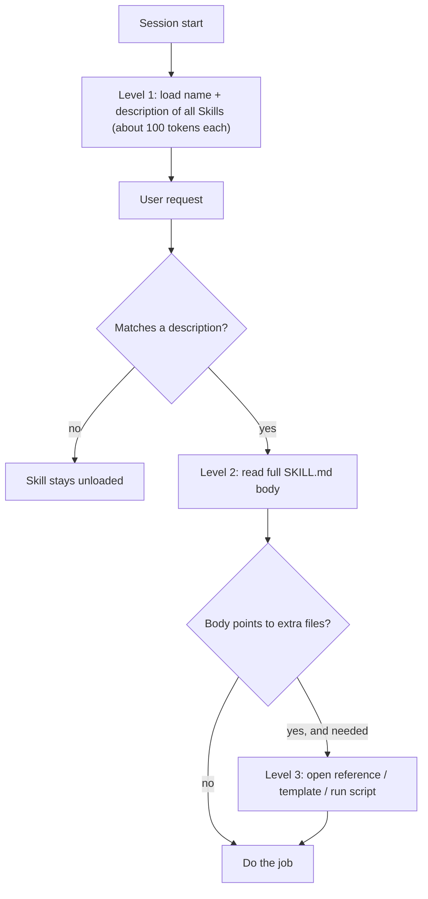
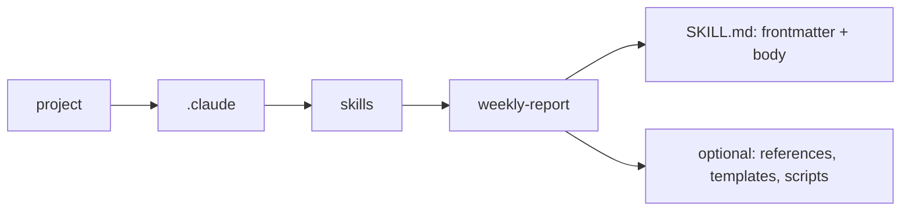

# What are Agent Skills?

> **Step 10: AI Agents and Agentic Systems** · ⏱️ 20 min read · [Read original](https://outcomeschool.com/blog/what-are-agent-skills)

## TL;DR
An Agent Skill is a folder of plain-English instructions (optionally scripts and reference files) that an agent loads by itself only when the task needs it. The description is the trigger, and progressive disclosure keeps the context window nearly empty until a Skill is used. Skills give know-how; MCP gives reach.

## Key Concepts
- **Problem** — agents do not know your team's formats, procedures, brand rules, so you retype them every time. Keeping one giant instruction file always loaded wastes the limited context window ("desk"): twenty procedures loaded means reading nineteen irrelevant ones. (Context Engineering decides what deserves the space.)
- **Agent Skill** — introduced by Anthropic in October 2025; open format. Analogy: a team handbook with chapters; the agent opens only the relevant chapter.
- **SKILL.md** — required markdown file. Part 1 **frontmatter** (between dashes): `name` (lowercase, hyphens, e.g. weekly-report) and `description`. Part 2 **body**: instructions in plain English.
- **Description = trigger** — the agent compares requests to every Skill's name/description. Weak ("Report helper.") never fires; strong states what it does AND when to use it. Write it for the agent to read.
- **Progressive disclosure** — reveal info in stages.
- **Token** — roughly a piece of a word; the unit of desk space.
- **Personal Skills** — `~/.claude/skills/`, yours, in every project. **Project Skills** — `.claude/skills/` inside the project; travel with it so teammates get them automatically.

## How It Works
### Three levels of progressive disclosure
| Level | Loaded | When | Cost |
|---|---|---|---|
| 1 | name + description | always, at start | about 100 tokens per Skill |
| 2 | full SKILL.md body | when request matches | normally under 5,000 tokens, only for the used Skill |
| 3 | extra files in folder (references, templates, scripts) | only if body points to them and they are needed | on demand |

Fifty Skills at Level 1 cost about 5,000 tokens total, equal to one Skill body. The agent acts as if it knows fifty procedures while the desk stays almost empty.

### Skills can carry code
- Without a script the agent rewrites code each time: slower, varies, fills the desk.
- With a script it runs one tested file: fast, identical results, nearly free.
- Rule: judgment needed means plain-English instructions; exactness needed means a script.

### Creating a Skill (no install, no code)
1. Create `.claude/skills/` in the project.
2. Add a folder named after the Skill (weekly-report).
3. Add `SKILL.md` inside.
4. Write frontmatter with name and description.
5. Write steps in plain English like for a capable new teammate: skip what they already know, record only what is specific to you.

Example weekly-report body: collect tasks of last 7 days, group under Shipped / In Progress / Blocked, one short line per task, total count at top, never include internal ticket numbers. (`.claude` folders are read by a coding agent at session start.)

### Worked flow
1. Session starts: only names/descriptions loaded.
2. User: "prepare this week's team update."
3. Matches description ("weekly report or team update").
4. Agent reads full SKILL.md body.
5. Produces report in the exact format without being reminded.

### Agent Skills vs MCP
| Point | Agent Skills | MCP |
|---|---|---|
| Gives | Know-how (your steps/format) | Reach (connection to outside systems) |
| Made of | Folder of instructions, sometimes scripts | Running program offering tools/data |
| Answers | How should this be done? | What can the agent reach? |
| Server needed | No | Yes |
| Best for | Procedures, formats, style, checklists | Databases, apps, live data, actions |

Often used together (MCP connects to issue tracker, a Skill says how your team writes an issue). OKF is a third piece: folder of markdown describing what data tables mean.

## Diagram(s)
### Progressive disclosure

### Skill folder layout

## Importance
- Write once, use forever; desk stays clean; team knowledge shared via Project Skills; no programming needed; portable across tools supporting the open format; compose (one Skill for format, another for checks).

## Trade-offs & Pitfalls
- **Scripts can run code** — like installing a program; use trusted sources and read a Skill first.
- **Vague description** — most common mistake; Skill never fires. If ignored, suspect the description.
- **Too long** — include only what the agent cannot guess (your steps, format, rules), not general knowledge.
- **One Skill, one job** — many small focused Skills match better and load less than a giant one.

## FAQ
- Who created? → Anthropic, Oct 2025, open format.
- Skill not used? → almost always a vague description.
- Many Skills fill context? → No, about 100 tokens each at Level 1.
- Multiple Skills per task? → Yes, they compose.
- Safe from internet? → Only if trusted and read first.

## Key Takeaways
- A Skill is a folder with SKILL.md (frontmatter + body), plus optional scripts/files.
- The description is the trigger; say what and when.
- Progressive disclosure: metadata always, body on match, extra files on need.
- Scripts give exact, repeatable results; instructions give judgment.
- Personal (`~/.claude/skills/`) vs Project (`.claude/skills/`) Skills.
- Skills = know-how, MCP = reach; use both.
