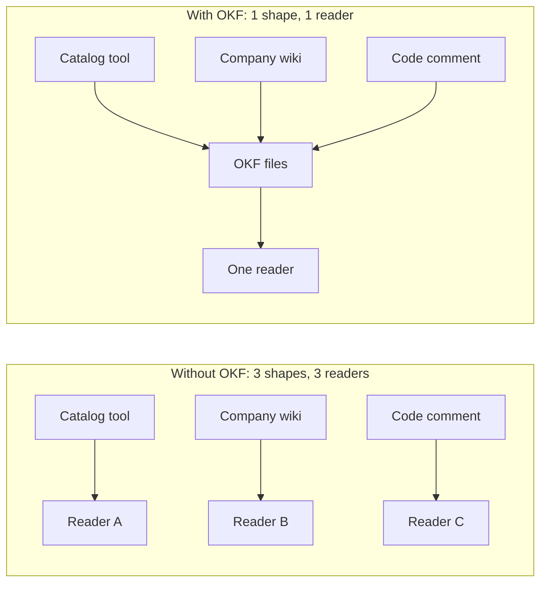
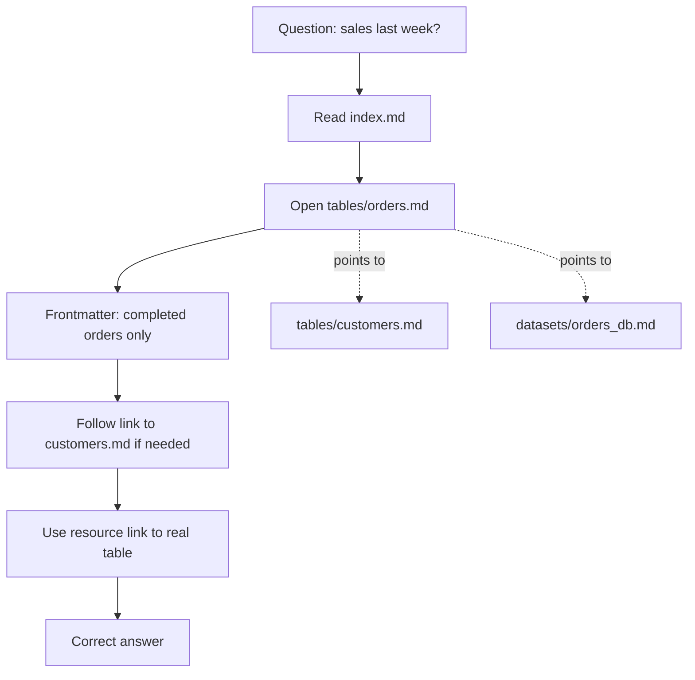

# What is OKF (Open Knowledge Format)?

> **Step 10: AI Agents and Agentic Systems** · ⏱️ 21 min read · [Read original](https://outcomeschool.com/blog/what-is-okf-open-knowledge-format)

## TL;DR
OKF is an open standard (Google Cloud Data Cloud team, 13 June 2026, version 0.1) for writing down what an organization knows about its data and systems as a folder of plain markdown files with YAML frontmatter. It stores the meaning around data, never the data itself, so any agent or tool can read it without custom readers. An agent reads the bundle first and stops guessing.

## Key Concepts
- **The scattered-knowledge problem** — counting "sales last week" from an `orders` table needs five hidden rules, each in a different place: only completed orders count (senior engineer), remove test orders (old wiki page), refund = row with minus (code comment), one country counted twice (last year's spreadsheet), data before March unusable (senior engineer). An agent cannot walk over and ask; it sees column names and guesses confidently and wrongly.
- **Tool-specific storage** — each tool keeps knowledge in a private shape; writing into tool A means tool B cannot read it, and moving tools means redoing it.
- **OKF = Open + Knowledge + Format** — Open: published for everyone; Knowledge: not the data but what a table means, why it exists, what columns are for, caveats; Format: agreed shape.
- **LLM wiki** — earlier habit of keeping a notes folder for the AI; each team invented its own arrangement so notes were not shareable. OKF writes down the rules.
- **Design choice** — "just markdown, just files, just YAML frontmatter": no software, no server, no special reader.
- **Bundle** — a folder of OKF files; one file per concept (orders table, customers table, weekly active users metric). File path = concept identity (`tables/orders.md`), no separate ID system.
- **index.md** (optional) — folder front page/overview; **log.md** (optional) — dated change history.
- **Frontmatter** (YAML "label: value" between dashes) = machine-readable facts; **body** = plain markdown sentences for people. Same file, so they never drift apart.

## How It Works
### Frontmatter fields
```yaml
---
type: BigQuery Table
title: Orders
description: One row per order. Only completed ones count as a sale.
resource: https://console.cloud.google.com/bigquery?p=acme&d=sales&t=orders
tags: [sales, revenue]
timestamp: 2026-05-28T14:30:00Z
---
```
- `type` — kind of thing (BigQuery Table, Dataset, Metric, API, Runbook, Playbook; deliberately loose, no fixed list). **Only required field.**
- `title` human name; `description` one-line explanation (answers the first hidden rule); `resource` link to the real thing; `tags` grouping list; `timestamp` when last true.
- Why so little required: a standard demanding twenty fields never gets filled in; optional fields are agreed names (description, not desc).

### Cross-links make a graph
A row like `| customer_id | STRING | FK to [customers](/tables/customers.md). |` records a foreign key as a plain markdown link. Linked files turn the bundle into a graph; agent follows links step by step, learning only what it needs.

### Why plain markdown
Humans read the same file the agent reads; renders anywhere (repos), searchable; travels as a folder (zip, copy); versions with code; nothing to install.

### Agent usage ("how many sales last week?")
1. Read `index.md` to see what exists.
2. Open `tables/orders.md`.
3. Frontmatter reveals: one row per order, only completed count.
4. Body shows customer_id; follow link to customers.md if needed.
5. Use `resource` link to find the real table.
6. Do the work and produce the right number.

Only one step added at the front; the agent did not get smarter, it stopped guessing.

### OKF vs Agent Skills vs MCP
| Point | OKF | Agent Skills | MCP |
|---|---|---|---|
| Carries | Knowledge about our things | Know-how (steps, format) | Reach (live connection) |
| Answers | What is this thing? | How should this be done? | What can the agent reach? |
| Made of | Folder of markdown | Folder of markdown | Running program |
| Needs running | No | No | Yes |
| Best for | Data meaning, definitions | Procedures, checklists, style | Databases, apps, live actions |

They combine: MCP connects the database, OKF explains the tables, a Skill says how the report is written. OKF and Skills are built almost identically.

### What ships with OKF
- **Enrichment agent** — walks existing data and drafts OKF files automatically (hand-writing hundreds of files is why such efforts die); people then correct.
- **Visualizer** — turns a bundle into one web page showing the concept graph.

## Diagram(s)
### Without vs with a common format


### Bundle structure and agent flow


## Trade-offs & Pitfalls
- OKF holds meaning, not rows: do not mistake it for data storage.
- v0.1 and loose types: teams must keep conventions consistent themselves; optional fields mean uneven quality unless enriched.
- Manual authoring at scale is the traditional failure; hence the enrichment agent.

## FAQ
- Who created it? → Google Cloud Data Cloud team, 13 June 2026, v0.1.
- Stores data? → No, only understanding around it.
- Same as LLM wiki? → No; it standardizes that habit.
- Only for tables? → No; types are loose and only `type` is required.
- Replaces MCP? → No; different question, they work together.

## Key Takeaways
- Data knowledge is scattered; agents cannot ask people and so guess.
- OKF = open, plain-markdown bundle describing what data means; one file per concept, path is identity.
- Only `type` is required in frontmatter; description, resource, tags, timestamp, title are conventions.
- Markdown links turn the bundle into a walkable graph.
- Agents read the bundle before touching data.
- MCP = reach, Skills = know-how, OKF = knowledge.
