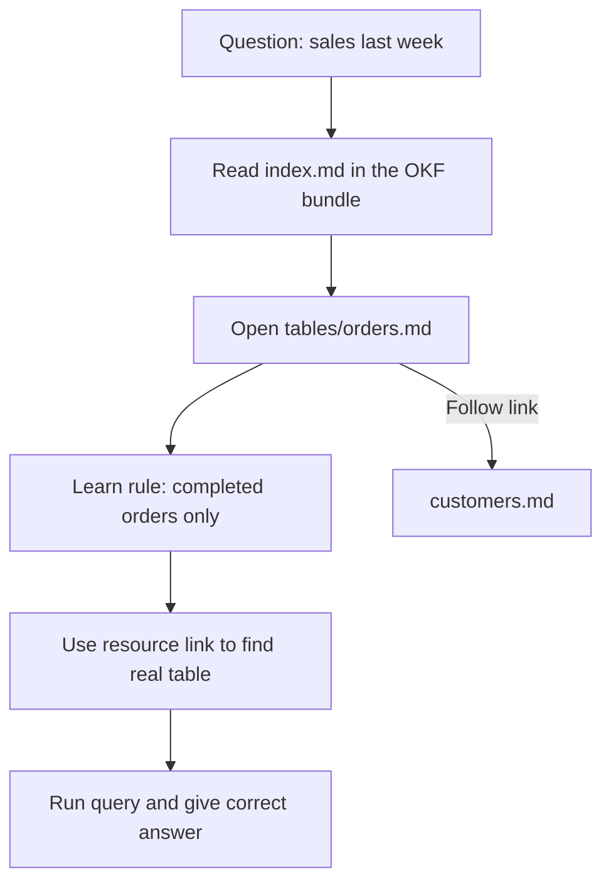

# What is OKF (Open Knowledge Format)?

> **Step 10: AI Agents and Agentic Systems** · ⏱️ 21 min read · [Read original](https://outcomeschool.com/blog/what-is-okf-open-knowledge-format)

## TL;DR
OKF is an open standard for writing down what an organization knows about its data and systems as a folder of plain markdown files, so any AI agent or tool can read it. It records the meaning around the data (not the data), stopping agents from guessing. Published by the Google Cloud Data Cloud team on 13 June 2026 as version 0.1.

## Key Concepts
- **Scattered knowledge** — rules like "only completed orders count" live in people's heads, wikis, code comments, and spreadsheets; agents see column names only.
- **OKF = Open + Knowledge + Format** — openly published shape for writing down what we know; stores understanding, not rows.
- **Bundle** — a folder of `.md` files; one file per concept; the file path is the concept's identity.
- **Frontmatter** — YAML at the top of each file; only `type` is required.
- **LLM wiki** — the earlier informal habit of keeping notes for AI; OKF formalizes it so notes are shareable.

## How It Works
### Why a common format
Without one, each tool stores knowledge in its own shape and each needs its own reader (3 sources, 3 readers). With OKF, one shape and one reader cover all sources.

### Bundle layout
`index.md` (optional folder overview), plus folders such as `datasets/`, `tables/`, `metrics/`. An optional `log.md` keeps a dated change history.

### File anatomy
- **Frontmatter**: `type` (required, loose and free-form: BigQuery Table, Dataset, Metric, API, Runbook, Playbook), and optional `title`, `description`, `resource` (link to the real thing), `tags`, `timestamp`.
- **Body**: ordinary markdown sentences for people.

Asking for almost nothing makes it easy to start with one line and grow.

### Cross-links make a graph
Ordinary markdown links (for example a foreign-key column linking to `customers.md`) turn the bundle into a graph an agent can walk.

### Why plain markdown
Readable by humans and agents (same file, no drift), renders anywhere, travels as a folder, versions with code, nothing to install.

### How an agent uses it
For "how many sales last week?": read `index.md`, open `tables/orders.md`, learn "completed only", follow links if needed, use `resource` to find the table, then query. One step added at the front, and the agent stops guessing.

### OKF vs Skills vs MCP
| Point | OKF | Agent Skills | MCP |
|---|---|---|---|
| Carries | Knowledge about our things | Know-how | Reach |
| Answers | What is this thing? | How should this be done? | What can the agent reach? |
| Made of | Markdown folder | Markdown folder | Running program |
| Needs running | No | No | Yes |

They combine: MCP reaches the database, OKF explains the tables, a Skill formats the report.

### What ships
An enrichment agent that drafts OKF files from existing data, and a visualizer that renders the bundle as a concept graph web page.

## Diagram

## Key Takeaways
- OKF stores meaning around data (definitions, rules, caveats), never the data itself.
- A bundle is a plain folder of markdown files with YAML frontmatter; only `type` is required.
- Markdown links turn files into a graph agents can traverse.
- Read the bundle first so the agent stops guessing.
- MCP gives reach, Skills give know-how, OKF gives knowledge.
