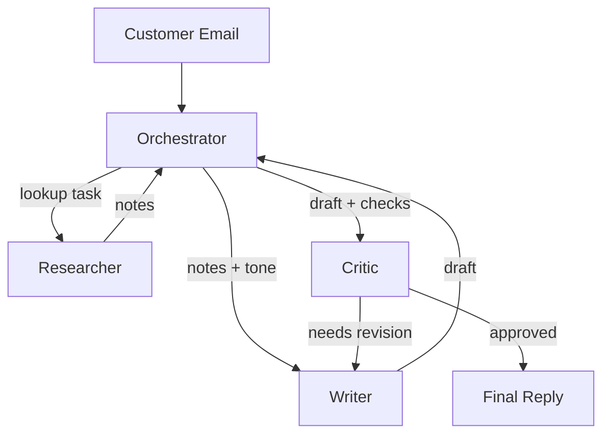

# What are Multi-Agent Systems?

> **Step 10: AI Agents and Agentic Systems** · ⏱️ 20 min read · [Read original](https://outcomeschool.com/blog/multi-agent-systems)

## TL;DR
A Multi-Agent System (MAS) is two or more LLM-driven agents, each with its own prompt and tools, working on a shared task through a coordination layer. It is more powerful for complex multi-skill work but costs more in tokens, latency and debugging, so start with a single agent and add agents only when needed.

## Key Concepts
- **Multi-Agent System** — Specialized agents + a way to communicate + a way to coordinate. Agents that never talk are just a bunch of agents.
- **Three pillars** — Specialization (focused roles), Communication (messages, shared memory, handoffs), Coordination (who runs when, when done).
- **Orchestrator** — Splits the request into subtasks, delegates, merges results.
- **Worker / SubAgent** — Focused specialist (researcher, writer, coder).
- **Router** — Only picks which worker handles a request.
- **Planner** — Writes the step-by-step plan that workers execute.
- **Critic** — Reviews another agent's output; needs independent grounding (sources, tools), not just the writer's context.
- **Tool Specialist** — Owns prompting and schema knowledge for one tool (e.g. a database agent writing SQL).
- **Handoff** — Message + control transfer.

## How It Works
**Example: customer support email.** Orchestrator receives a refund request, the Researcher pulls order, policy and history, the Writer drafts a reply, the Critic checks tone, accuracy and policy compliance and sends it back for revision if needed. Messages between agents are structured objects with named fields, not free chat.

**Communication modes**
1. Message passing — direct structured messages; noisy with many agents.
2. Shared state / blackboard — all agents read and write shared memory; flexible but needs rules.
3. Handoffs — work plus context passed on, sender steps out (relay race).

Real systems mix all three. Memory can be shared fully, via summaries, or not at all (richness vs token cost).

**Coordination patterns**
| Pattern | Idea | Trade-off |
|---|---|---|
| Sequential | A then B then C | Simple, slow |
| Parallel | Independent subtasks, merge | Fast only if independent |
| Router | Router picks a worker | Good for distinct categories |
| Hierarchical | Orchestrator with sub-workers | Handles nested tasks |
| Graph | Any agent calls any other | Flexible, hard to debug |

**Single vs multi-agent**: multi-agent means higher complexity, cost and harder debugging, but scales better on complex tasks and keeps each prompt and tool set small. Splitting tools also helps security (the agent reading untrusted text need not hold dangerous tools).

**Common mistakes and fixes**
- Agents chatting too much — cap turns, explicit handoffs.
- Unclear ownership — scoped roles, only the orchestrator routes.
- Error propagation — critics and validation of intermediate outputs.
- Coordination overhead — simplest pattern, fixed workflows.
- Non-determinism — lower temperature for coordination, fixed structure (reduces, does not eliminate).
- Hidden complexity — every agent needs a clear reason.
- Critic loops that never converge — cap revision rounds, bounded criteria.

## Diagram

## Key Takeaways
- MAS = specialization + communication + coordination; weak pillar means failure.
- Communication between agents must be structured.
- Handoff is a message that also transfers control.
- Use MAS when tasks split into roles, run in parallel, or one agent's prompt/tools grow too big; avoid for tightly coupled work like coding.
- Start with one agent, add the minimum number of agents, and budget for tracing, retries and token limits.
