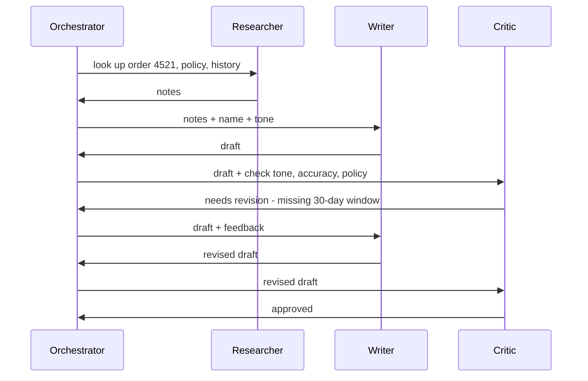
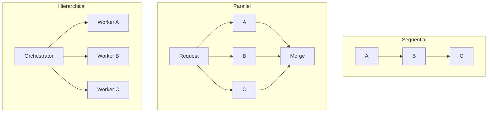

# What are Multi-Agent Systems?

> **Step 10: AI Agents and Agentic Systems** · ⏱️ 20 min read · [Read original](https://outcomeschool.com/blog/multi-agent-systems)

## TL;DR
A Multi-Agent System is two or more LLM-driven agents with their own prompts and tools working on a shared task, glued by communication and coordination. It beats a single agent on complex multi-skill work but costs more in complexity, latency, tokens and debugging. Start with one agent and add the minimum number of agents only when needed.

## Key Concepts
- **Multi-Agent System** = Specialized Agents + A Way to Communicate + A Way to Coordinate. Agents not talking to each other are just a bunch of agents. Analogy: movie crew (single agent = solo chef, multi-agent = whole restaurant).
- **Three pillars** — all must be strong:
  - Specialization: focused roles keep prompts small, tools relevant, behavior reliable. Without it you get a slightly worse single agent.
  - Communication: messages, shared memory or structured handoffs. Without it no cooperation.
  - Coordination: who goes next, who waits, when done (orchestrator agent, fixed workflow, routing rules). Without it agents collide or leave gaps.
- **Roles**:
  - Orchestrator (manager/coordinator): receives request, splits, delegates, combines.
  - Worker: specialist (researcher, writer, coder, analyst); a focused worker is a SubAgent.
  - Router: only picks which worker handles a request; keeps worker prompts small.
  - Planner: produces step plan, workers execute (Plan-and-Execute idea).
  - Critic/Reviewer: checks quality, safety, correctness; needs independent grounding (sources, tools), not just the writer's context. Cousin of LLM as a Judge, in-loop.
  - Tool Specialist: owns prompting strategy and schema for one tool/source (database agent writing good SQL, web search agent).
- Start small: add roles only when a real gap appears.

## How It Works
### Customer-support example
Orchestrator gets "I want a refund for my last order, it arrived damaged" and runs steps in sequence:
1. Researcher gathers order details, return policy, customer history (order 4521, blue running shoes, delivered 2026-04-10; policy: damaged items returnable within 30 days for full refund; Alex, regular tier, 1 past return).
2. Writer drafts personalized reply (hints: customer_name Alex, tone "warm and clear").
3. Critic checks tone, accuracy, policy compliance; verdict "needs revision: does not mention the 30-day return window".
4. Orchestrator sends it back to Writer; loop until approved, then sends final reply.

Messages are structured JSON objects with named fields, not free chat; that keeps agents on the rails. Each agent has a tiny prompt and tight tools.

### Communication modes
| Mode | How | Notes |
|---|---|---|
| Message passing | Structured message with task, context, inputs, point-to-point | Direct, clear; noisy with many agents; good for small systems |
| Shared state / blackboard | All read and write shared memory | Flexible; needs rules to avoid chaos |
| Handoff | Message + control transfer, sender steps out | Relay race; only one agent active; predictable |

Handoff = Message + Control transfer. Modes overlap; real systems mix (handoffs for main flow, messages for side queries, shared state for common context). Memory can be shared fully, partially via summaries, or not at all (context richness vs token cost). Communication must be structured with defined formats and fields.

### Coordination patterns
| Pattern | Idea | Notes |
|---|---|---|
| Sequential | A then B then C | Simple, easy to debug, slow if parallelizable |
| Parallel | Independent subtasks at once, merge | Fast only if truly independent |
| Router | Router picks one worker | Good for distinct categories |
| Hierarchical | Orchestrator delegates, workers may sub-delegate | Complex nested tasks, like an org chart |
| Graph/network | Any agent can call any other | Exploratory tasks, max flexibility, hardest to debug (Graph Engineering) |

Range from fixed workflows (sequential, parallel) to dynamic agent-driven control (graph); most systems sit in the middle. Coordination = wiring diagram, communication = signal on the wires.

### Single vs multi-agent
| Property | Single | Multi |
|---|---|---|
| Complexity | Low | High |
| System prompt | One, can get long | Many, focused |
| Tools | All on one | Split |
| Parallelism | Limited (parallel tool calls) | Natural |
| Debugging | Easier | Harder |
| Latency | Lower for simple tasks | Higher with handoffs, lower with parallelism |
| Cost | Lower | Higher |
| Quality on complex tasks | Degrades as tools grow | Scales with specialization |
| Failure | As a unit | Partial or cascading |
| Best for | Short focused tasks | Complex multi-skill tasks |

Usually a hybrid: one primary agent plus a router or critic. Splitting tools also helps security: the agent reading untrusted text need not hold dangerous tools (prompt injection).

## Diagram(s)
### Support-email pipeline

### Coordination patterns

## Trade-offs & Pitfalls
| Mistake | Fix |
|---|---|
| Agents talking too much, token cost explodes | Cap total turns, explicit handoffs, avoid unstructured back-and-forth |
| Unclear ownership (duplicate/missing work) | Scoped roles in prompts; orchestrator is the only router |
| Error propagation (bad research becomes polished wrong draft; critic checks only style) | Critics at key points; validate intermediate outputs |
| Coordination overhead dominates | Simplest pattern; fixed workflows and handoffs |
| Non-determinism | Lower temperature for coordination decisions (reduces, not eliminates; floating-point and provider effects remain); fixed workflow structure |
| Hidden complexity | Every agent needs a clear reason; add the minimum |
| Critic loops never converge | Cap revision rounds; explicit bounded criteria; accept if two rounds give similar feedback |

Also need tracing, retries, token budgets.

### When to use
- Use: natural specialized roles; very different prompts/models (small fast router, large writer); real parallel speedup; single prompt/tool count too large; quality justifies a critic.
- Avoid: single agent already works; tightly coupled tasks (e.g. coding, shared context); overhead exceeds benefit; no time/tooling to debug; simplicity matters more.
- Frameworks like LangGraph and AutoGen handle much wiring.

## FAQ
- Always better than single agent? → No.
- Non-talking agents a system? → No.
- Use for coding? → Usually not (tightly coupled).
- Temperature 0 deterministic? → No.
- Build orchestration yourself? → No, frameworks help, but still need tracing, retries, budgets.

## Key Takeaways
- Multi-agent = specialization + communication + coordination.
- Common roles: orchestrator, worker, router, planner, critic, tool specialist.
- Communicate via messages, shared state, or handoffs (message + control transfer); keep structured.
- Coordinate via sequential, parallel, router, hierarchical, graph.
- Cost is real: complexity, latency, tokens, debugging.
- Start with a single agent; add the fewest agents with a clear reason each.
