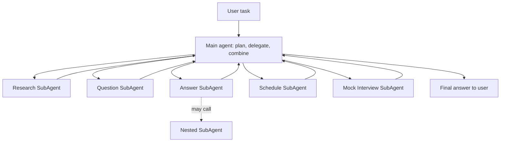

# What are AI SubAgents?

> **Step 10: AI Agents and Agentic Systems** · ⏱️ 9 min read · [Read original](https://outcomeschool.com/blog/ai-subagents)

## TL;DR
An AI SubAgent is a smaller, specialized agent working under a main agent on one part of a big task, like a team member under a manager. The main agent plans, delegates and combines; SubAgents do focused work, each with its own context window. It improves quality, speed and reusability but adds cost, coordination and debugging burden.

## Key Concepts
- **AI Agent** — system using an LLM to think, plan and act toward a goal (e.g. "find latest AI news and email me a summary": search, read, summarize, send, planned itself).
- **AI SubAgent** — specialized agent under a main agent. Main agent = manager (decides who does what, collects results); SubAgents = experts. Trip planner: flights, hotels, itinerary, weather SubAgents.
- SubAgents form a kind of Multi-Agent System; coordination across agents/tools/steps is AI Orchestration.

## How It Works
### Why SubAgents
1. **Context overload** — one agent with every step/tool fills its context window, forgets earlier steps, quality drops.
2. **Lack of focus** — many tools and responsibilities confuse tool choice; a SubAgent with few tools decides better.
3. **Reusability** — a web search SubAgent can serve research, news and shopping agents.
4. **Parallel work** — flights and hotels at the same time.

### Flow
1. User gives task to main agent.
2. Main agent breaks it into pieces.
3. Decides which SubAgent suits each.
4. Sends each piece to the matching SubAgent.
5. Each SubAgent works with its own loop, budget, tools, memory, and can call other SubAgents (tree structure: powerful but avoid deep costly chains). Keeping noisy intermediate steps inside the SubAgent is a Loop Engineering technique.
6. Each returns its result.
7. Main agent combines and answers.

### Example: interview prep
"Help me prepare for an AI Engineer interview next week" splits into Research SubAgent (common topics), Question SubAgent (likely questions per topic), Answer SubAgent (clear answers), Schedule SubAgent (7-day plan), Mock Interview SubAgent (practice). Main agent assembles the package.

### Benefits
Better quality (focus); cleaner context (own window); faster (parallel); easier maintenance (update one); reusable; scalable (add SubAgents without rewriting main).

## Diagram(s)

## Trade-offs & Pitfalls
- Coordination cost: main agent plans, sends tasks, merges (time and tokens).
- Communication errors: wrong input yields wrong output.
- Higher cost: more LLM calls.
- Harder debugging: find which SubAgent failed.
- Over-engineering: simple tasks need only one agent.

### Best practices
- Use only for truly complex, cleanly splittable tasks.
- Clear narrow job per SubAgent; small focused tool list.
- Main agent plans and combines; SubAgents do focused work.
- Run in parallel when possible.
- Log every SubAgent input and output.
- Test each SubAgent alone before connecting.

## FAQ
- Always use SubAgents? → No, overkill for simple tasks.
- Share main context window? → No, own window; only the result returns.
- SubAgent calling SubAgent? → Yes, tree structure, use carefully.
- Same as Multi-Agent System? → A form of it, with a main coordinator.

## Key Takeaways
- SubAgents = specialized workers under a coordinating main agent.
- Reasons: context overload, focus, reuse, parallelism.
- Own context window keeps the main agent clean.
- Costs: coordination, tokens, debugging.
- Keep roles narrow, tools few, log everything.
- Do not use for simple tasks.
