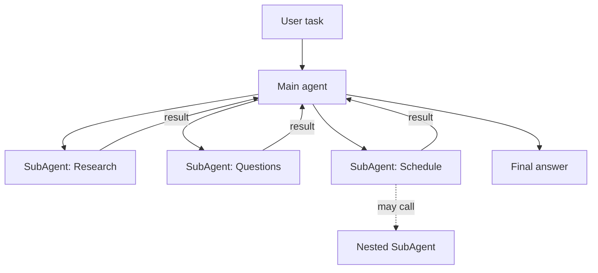

# What are AI SubAgents?

> **Step 10: AI Agents and Agentic Systems** · ⏱️ 9 min read · [Read original](https://outcomeschool.com/blog/ai-subagents)

## TL;DR
An AI SubAgent is a smaller, specialized agent that works under a main agent on one part of a larger task. The main agent acts as manager (plan, delegate, combine) while SubAgents do focused work, giving better quality, cleaner context and parallelism at the cost of coordination, tokens and debugging effort.

## Key Concepts
- **AI Agent** — An LLM-based system that plans and takes actions (calls tools) toward a goal.
- **SubAgent** — A narrow-scope expert agent that runs its own loop, tools and memory under a main agent.
- **Main agent** — Breaks the task, picks SubAgents, collects and merges results.
- **Tree structure** — A SubAgent may call other SubAgents; powerful but risks deep, costly chains.

## How It Works
**Why not a single agent?**
1. Context overload — the context window fills up and earlier steps get forgotten.
2. Lack of focus — many tools confuse tool choice.
3. Reusability — a "web search SubAgent" can serve many main agents.
4. Parallel work — flights and hotels can be searched at once.

**Flow**
1. User gives task to main agent.
2. Main agent splits it into pieces.
3. It picks a SubAgent per piece and sends it.
4. Each SubAgent works in its own loop with its own budget, tools and context (noisy intermediate steps stay inside).
5. Results return to the main agent, which combines them into the final answer.

**Example:** "Prepare me for an AI Engineer interview" becomes Research, Question, Answer, Schedule and Mock Interview SubAgents. Trip planning similarly splits into flights, hotels, itinerary and weather.

**Benefits:** better quality, cleaner context, faster (parallel), easier to maintain, reusable, scalable.

**Challenges:** coordination cost, wrong input yields wrong output, higher LLM bill, harder debugging, over-engineering on simple tasks.

**Best practices:** use only for truly splittable complex tasks; narrow job and small tool list per SubAgent; main agent plans and combines; parallelize; log every SubAgent input/output; test each SubAgent alone first.

## Diagram

## Key Takeaways
- SubAgent = specialist working under a manager-style main agent.
- Each SubAgent has its own context window, so the main agent's context stays clean.
- Benefits: focus, parallelism, reuse; costs: tokens, latency, debugging.
- Do not use SubAgents for simple tasks; a single agent is enough.
- Log and test each SubAgent independently.
