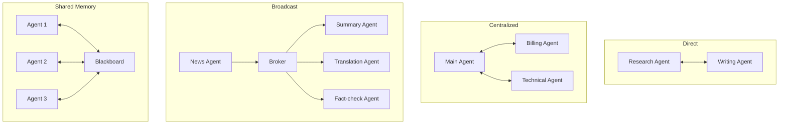
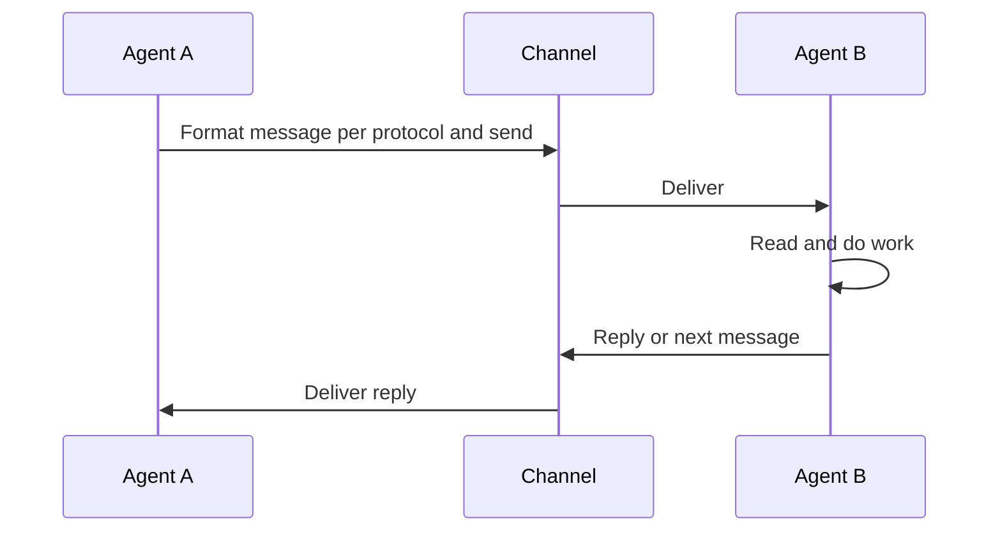

# How AI Agents Communicate

> **Step 10: AI Agents and Agentic Systems** · ⏱️ 19 min read · [Read original](https://outcomeschool.com/blog/how-ai-agents-communicate)

## TL;DR
AI agents communicate by sending structured messages over a channel following an agreed protocol, using one of four patterns: direct, centralized, broadcast (publish-subscribe) or shared memory (blackboard). Real systems mix patterns. Standards like MCP (agent to tools) and A2A (agent to agent) are converging under the Linux Foundation. Key risks are loops, wrong information, security and observability.

## Key Concepts
- **Agent communication** — agents sending messages to share info, ask for help and finish tasks together. Analogy: office team (design, code, testing) talking via messages.
- **Why communicate** — each agent focuses on one job; one's output is another's input; ask for help when stuck; split big tasks; parallel work; check and correct each other; build team-like systems. Without it each agent works alone in a box.
- **Building blocks** — Sender, Receiver, Message (question/result/instruction), Protocol (agreed format and rules), Channel (network call, queue, shared memory), Shared Context (common memory/state).
- **Message parts** — sender, receiver, type (request/result/error), content, context (task id, history). Usually JSON.
- **Protocols** — MCP (agents/models to tools and data, no custom code per tool); A2A (agent to agent, even across teams/companies); HTTP/REST (one agent calls another's API); message queues like Kafka or RabbitMQ (sender and receiver need not be online together). MCP and A2A are both under the Linux Foundation and work together: MCP connects agent to tools, A2A connects agent to agent. OKF records what data means so an agent understands what it sees.
- Mix protocols per need: simple API within one system, A2A across companies.

## How It Works
### Message flow
1. Agent A finishes its part and prepares a message.
2. Formats it per the protocol.
3. Sends via channel to Agent B.
4. B receives and reads.
5. B works using the information.
6. B replies or passes a new message onward.
7. Repeat until the task is done.

At each step an agent can also store the message in shared memory, log it, and check it for safety.

### Four patterns
| Pattern | How | Analogy | Advantages | Disadvantages |
|---|---|---|---|---|
| Direct | Agent to agent, no middleman (research agent to writing agent and back) | Two people face to face | Simple, fast | Hard with many agents (everyone must know everyone); new agent needs manual links |
| Centralized | All talk through a main agent (orchestrator/manager) that routes (billing vs technical support) | Manager routing tasks | Easy to manage, add agents, log and monitor | Bottleneck under traffic; single point of failure |
| Broadcast (pub-sub) | Publisher sends to a broker, subscribers all receive (news agent to summary, translation, fact-check agents in parallel) | Teacher announcing to class | Flexible, sender need not know receivers, easy to add, parallel | Hard to track who did what; traffic if too many listeners |
| Shared memory (blackboard) | Agents read/write a common memory (math problem: values, partial answer, final) | Whiteboard | No need to know each other; easy to add; many build one result | Concurrent writes; mess without rules |

Best for: direct = few agents in fixed flow; centralized = control and logging; broadcast = many reacting in parallel; shared memory = many building one result. Typical mix: centralized for overall flow, shared memory inside a step.

### Message example
```json
{"sender":"research_agent","receiver":"writing_agent","type":"result",
 "content":"Here are the five key facts about the topic...",
 "context":{"task_id":"trip-123","step":"research"}}
```
Fixed format means both agents read it without confusion.

## Diagram(s)
### The four patterns


### Request and reply


## Trade-offs & Pitfalls
| Challenge | Meaning |
|---|---|
| Different formats | Agents cannot understand each other; need a common protocol |
| Message loss | Plan retries and confirmations |
| Latency | Each message adds delay |
| Loops | Endless back-and-forth; add limits |
| Wrong information | Next agent trusts it; errors spread |
| Security | Bad message can trick an agent; check every message |
| Message order | Agents may act on old info |
| Observability | Hard to see what is happening |

### Best practices
- One common protocol; small clear messages; max number of messages per task.
- Validate and log every message (who, what, when, to whom).
- Handle failures (loss, timeouts, retries).
- One clear job per agent; shared context for task state.
- Humans in the loop for critical actions (payments, emails).

## FAQ
- MCP vs A2A? → MCP = agent to tools; A2A = agent to agent; both under Linux Foundation.
- Mix patterns? → Yes, usually.
- Direct good for many agents? → No; centralized scales management better.
- Stop endless messaging? → Cap messages per task, log.
- Wrong info sent? → Gets trusted and spreads; validate and keep humans for high stakes.

## Key Takeaways
- Communication needs sender, receiver, message, protocol, channel, shared context.
- Four patterns: direct, centralized, broadcast, shared memory; mix them.
- Messages should be structured (sender, receiver, type, content, context).
- MCP for tools, A2A for agents, queues for async.
- Cap messages, validate, log, handle failures.
- Human approval for high-stakes actions.
