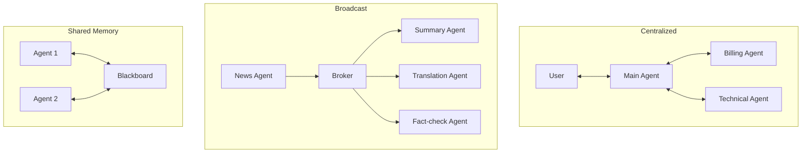

# How AI Agents Communicate

> **Step 10: AI Agents and Agentic Systems** · ⏱️ 19 min read · [Read original](https://outcomeschool.com/blog/how-ai-agents-communicate)

## TL;DR
Agent communication is how multiple AI agents send messages to share information, ask for help and finish a task together. There are four main patterns (direct, centralized, broadcast, shared memory), usually mixed in real systems, and they rely on structured messages and agreed protocols such as MCP and A2A.

## Key Concepts
- **Sender / Receiver** — Agent that creates the message / agent that acts on it.
- **Message** — Question, result or instruction being shared.
- **Protocol** — Agreed format and rules; both sides must follow the same one.
- **Channel** — Path the message travels (network call, queue, shared memory).
- **Shared context** — Common state agents read and write.
- **MCP** — Open standard connecting agents/models to tools and data.
- **A2A (Agent2Agent)** — Standard for agents to talk to other agents across teams or companies. Both MCP and A2A sit under the Linux Foundation and work together: MCP for tools, A2A for agents.

## How It Works
**Message flow:** Agent A prepares and formats a message per protocol, sends it through the channel, Agent B reads it, works, then replies or passes on to the next agent until the task finishes. Messages may also be stored in shared memory, logged and safety-checked.

**Message structure:** sender, receiver, type (request, result, error), content, context (task id, history). Fixed format avoids confusion.

**The four patterns**
| Pattern | How agents talk | Pros | Cons |
|---|---|---|---|
| Direct | Agent to agent, no middleman | Simple, fast | Hard to manage with many agents; new agent must connect to all |
| Centralized | Everything via a main agent (orchestrator) | Easy to manage, add, log | Bottleneck, single point of failure |
| Broadcast (pub-sub) | Publisher sends via broker to subscribers | Flexible, parallel, sender need not know receivers | Hard to trace, heavy traffic |
| Shared memory (blackboard) | Agents read/write a common memory | Agents need not know each other | Concurrent writes, can get messy |

Other protocol options: HTTP/REST APIs, message queues (Kafka, RabbitMQ). Simple API calls inside one system, A2A across organizations.

**Challenges:** differing formats, message loss, latency, endless loops, wrong information spreading, security (malicious messages), ordering, observability.

**Best practices:** common protocol, small clear messages, max message cap per task, validate every message, log everything, handle failures with retries, one clear job per agent, shared context, human approval for critical actions (payments, emails).

## Diagram

## Key Takeaways
- Agents need sender, receiver, message, protocol, channel and shared context.
- Four patterns: direct, centralized, broadcast, shared memory; real systems mix them.
- Use structured messages; one agent's mistake can propagate, so validate every message.
- MCP connects agents to tools; A2A connects agents to agents.
- Cap message counts to prevent loops; log everything; keep humans in the loop for high-stakes actions.
