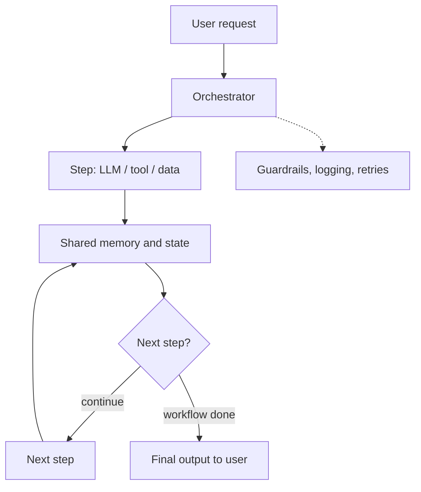

# What is AI Orchestration?

> **Step 10: AI Agents and Agentic Systems** · ⏱️ 18 min read · [Read original](https://outcomeschool.com/blog/ai-orchestration)

## TL;DR
AI Orchestration is the layer that coordinates many LLM calls, tools, data sources and steps into one reliable workflow, like a conductor leading an orchestra. The developer defines the flow; five reusable patterns (sequential, parallel, conditional, loop, orchestrator-worker) cover most real systems.

## Key Concepts
- **Orchestrator** — Runs the workflow: picks steps, stores outputs, retries, logs, routes.
- **Components** — LLMs, prompts, tools, memory, data sources, guardrails, routers, workflows (graph of steps).
- **Orchestration vs Agents** — Developer controls the flow vs the LLM decides the flow at runtime.
- **Prompt chaining** — The sequential pattern where each LLM prompt feeds the next.

## How It Works
**Why needed:** break complex tasks into steps, pick the right model per step (small for easy, big for hard), pass outputs along, parallelize, handle errors and retries, add guardrails and logging, control cost and latency.

**Orchestration vs Agents**
| Aspect | Orchestration | Agents |
|---|---|---|
| Controls flow | Developer | LLM |
| Flow | Fixed, upfront | Dynamic |
| Predictability | High | Low |
| Best for | Known workflows | Open-ended tasks |
| Cost/debugging | Easier | Harder |

Often combined: orchestration for the high-level flow, an agent inside an open-ended step.

**Runtime loop:** request arrives, orchestrator picks first step, step runs (LLM, tool or data), output saved to shared memory, next step chosen from workflow and state, repeat until end, return final output. At each step it can log, check guardrails, retry or reroute.

**Five patterns**
1. **Sequential** — Fixed chain (transcript to summary to action items to formatted notes). Simple but slow; one failure breaks the chain.
2. **Parallel** — Independent steps at once (search docs, web and research DB), then merge. Fast, only for independent steps.
3. **Conditional** — Branch/route on a prior output (classify billing, technical or general). Saves cost; routing can be wrong.
4. **Loop** — Repeat until a condition (write code, run in sandbox, fix errors, max 5 tries). Always cap tries.
5. **Orchestrator-Worker** — Orchestrator splits a task (e.g. five sub-topics), workers run in parallel, orchestrator combines. Scales well but complex. Sakana Fugu is built on this idea.

**Tools:** LangChain, LangGraph (loops and branches), LlamaIndex (RAG data), Haystack, CrewAI, Semantic Kernel, DSPy, or plain code.

**Challenges:** latency, cost, error handling, state management, observability, prompt drift, testing, vendor lock-in.

## Diagram

## Key Takeaways
- Orchestration = developer-defined flow; agents = LLM-defined flow; combine them.
- Five patterns: sequential, parallel, conditional, loop, orchestrator-worker.
- Always cap loops and add timeouts and retries to every step.
- Use the smallest model that works and track cost from day one.
- Start simple (plain code), test step by step, keep humans in the loop for high-stakes actions.
