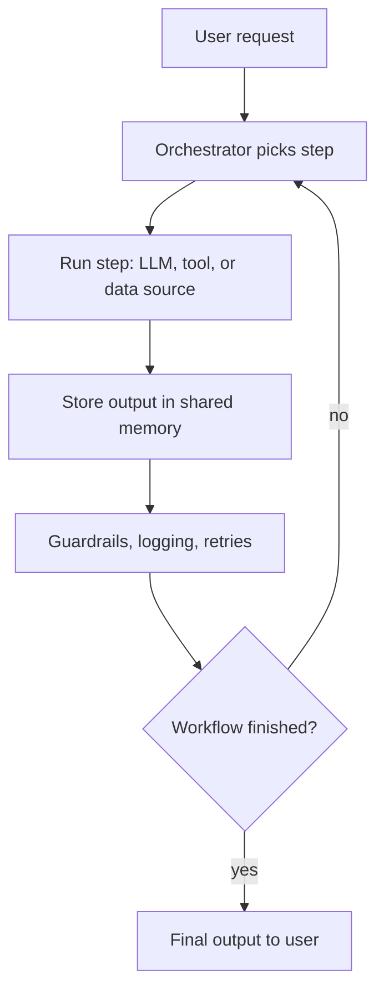
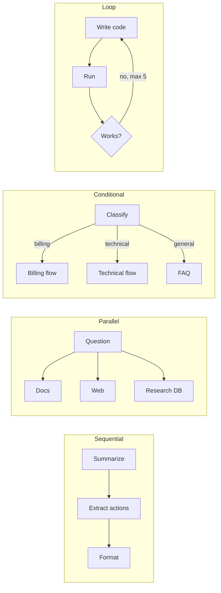

# What is AI Orchestration?

> **Step 10: AI Agents and Agentic Systems** · ⏱️ 18 min read · [Read original](https://outcomeschool.com/blog/ai-orchestration)

## TL;DR
AI Orchestration is the layer that coordinates LLMs, tools, data sources and agents so they finish a complex task: which component runs, in what order, with what input, and what to do with the output. The developer defines the flow (unlike agents, where the LLM decides). Five patterns cover most designs: sequential, parallel, conditional, loop, orchestrator-worker. Start simple, add guardrails, logging and cost tracking.

## Key Concepts
- **Orchestration layer** — needed because real tasks are many LLM calls, tool calls and dependent steps (e.g. search docs, summarize, answer, translate). Analogy: conductor of an orchestra.
- **Why needed** — break complex tasks into steps; right model/tool per step (small for easy, big for hard); pass outputs cleanly; run independent steps in parallel; handle errors and retries; guardrails, logging, monitoring; control cost and latency; make system testable and debuggable.
- **Components** — LLMs, Prompts, Tools (search API, DB query, calculator), Memory (messages, results, state), Data Sources (vector DBs, knowledge bases, files, APIs), Guardrails, Routers, Workflows (graph of steps).

### Orchestration vs Agents
| Aspect | AI Orchestration | AI Agents |
|---|---|---|
| Who controls flow | Developer | LLM |
| Flow | Fixed, upfront | Dynamic, runtime |
| Predictability | High | Low |
| Best for | Known workflows | Open-ended tasks |
| Cost control | Easier | Harder |
| Debugging | Easier | Harder |

Often combined: orchestration for the high-level flow, an agent inside an open-ended step.

## How It Works
### Runtime steps
1. User sends request.
2. Orchestrator picks first step of the workflow.
3. Step runs (LLM, tool, or data source).
4. Output stored in shared memory.
5. Orchestrator picks next step from workflow definition and state.
6. Next step runs.
7. Continue until workflow ends.
8. Final output returned.
At each step it can log I/O, check guardrails, retry on failure, route to another path.

### Five patterns
| Pattern | Idea | Example | Pros | Cons |
|---|---|---|---|---|
| Sequential | Fixed-order chain (= Prompt Chaining when each step is an LLM prompt) | Transcript to summary to action items to formatted notes | Simple, easy to debug | Slow; one failure breaks chain |
| Parallel | Independent steps at once, wait for all | Search internal docs, web, research DB together, then LLM writes answer | Much faster, good resource use | Only for independent steps; harder to debug |
| Conditional | Next step depends on previous output (branching/routing) | Support bot classifies billing / technical / general and routes; saves cost (classification may use a decision-only model, see Jev and System One Models) | Right path, saves cost | Wrong routing risk; complexity |
| Loop | Repeat until condition | Write code, run in sandbox, feed error back, retry; stop after 5 tries | Self-improves output | Can run forever; costs more; always cap tries (Loop Engineering) |
| Orchestrator-Worker | Orchestrator splits task, workers run (often parallel), orchestrator combines | Long research report split into five sub-topics, one worker each | Scales; simple focused prompts; parallel | Complex; orchestrator must split and combine well |

Orchestrator = brain, workers = hands; each worker may use different model/prompt/tools. Sakana Fugu is a real model built on this pattern; Multi-Agent Systems blog covers it. Combine patterns in one workflow.

### Tools
- LangChain (chains, tools, memory); LangGraph (graph-based, loops and branches); LlamaIndex (data/RAG orchestration); Haystack (search and QA); CrewAI (teams of agents); Microsoft Semantic Kernel (mixes AI with traditional code); DSPy (workflow as code, learns best prompts).
- Or plain code for simple workflows.

## Diagram(s)
### Orchestration loop

### The five patterns

## Trade-offs & Pitfalls
- Latency (each step adds delay); cost (10 LLM calls = 10x one); error handling (retries, fallbacks); state management (wrong state breaks next step); observability; prompt drift (changing one prompt breaks the next step); testing (non-deterministic LLMs); vendor lock-in.

### Best practices
- Start simple (plain code or simple chain); match pattern to task; smallest model that works.
- Timeouts and retries on every step; log input, output, time, cost.
- Keep prompts in one place (versioned); test step by step.
- Guardrails at input and output boundaries; watch cost per request/user from day one.
- Humans in the loop for critical actions (emails, payments).

## FAQ
- Orchestration + agents together? → Yes.
- Need LangChain? → No.
- Prompt chaining = orchestration? → No, it is one form of sequential; orchestration is broader.
- Reduce cost? → Small models for easy steps, conditional routing.
- Everything automatic? → No, human approval for high stakes.

## Key Takeaways
- Orchestration = developer-defined coordination of models, tools, data, and agents.
- Differs from agents: fixed flow vs LLM-decided flow; use both.
- Five patterns: sequential, parallel, conditional, loop, orchestrator-worker.
- Always cap loops, set timeouts and retries, log cost.
- Use smallest sufficient model per step.
- Start simple; frameworks optional.
