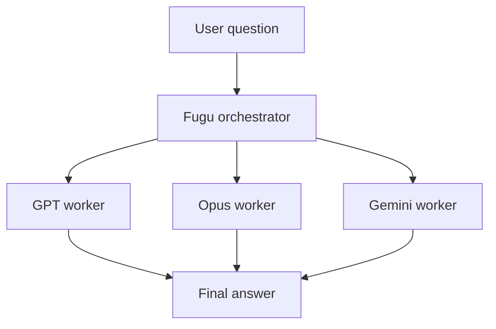
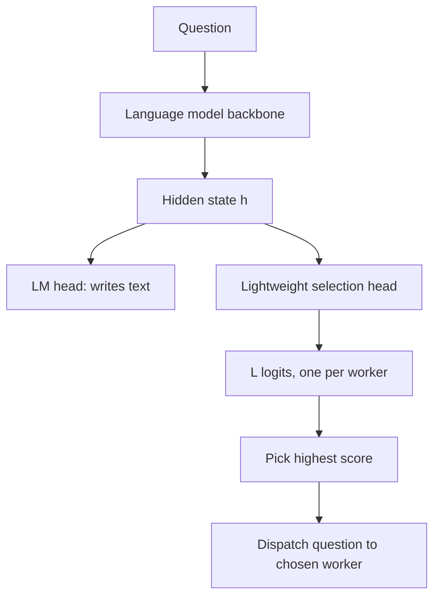
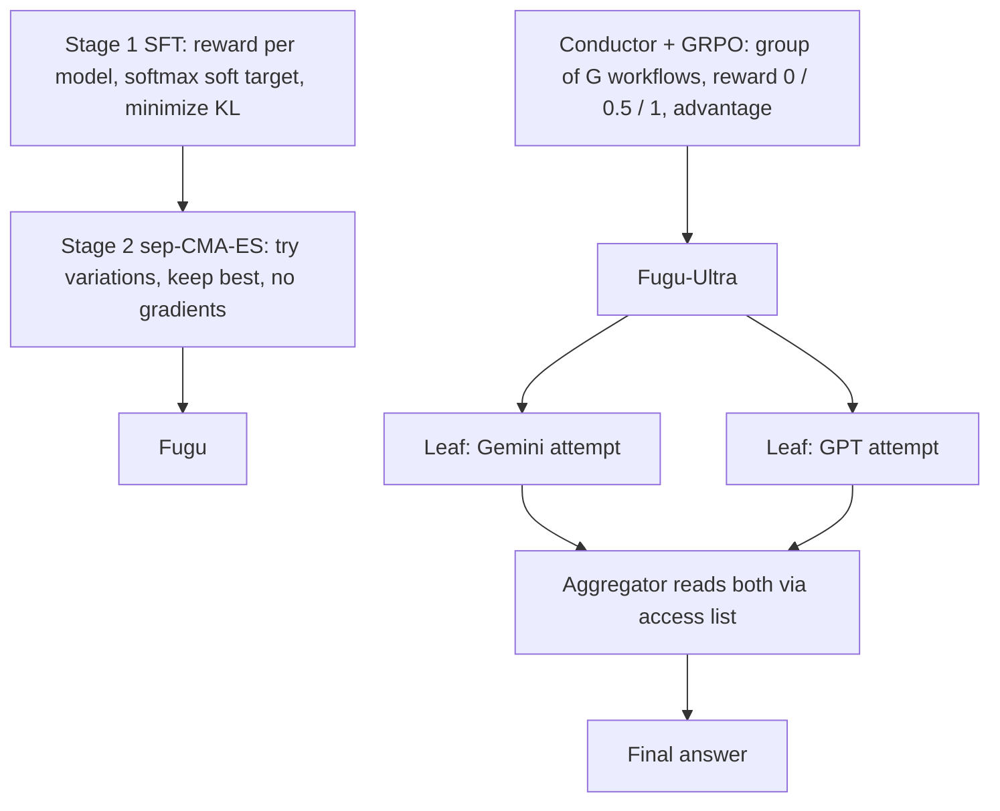

# What is Sakana Fugu? The Technical Report Explained

> **Step 10: AI Agents and Agentic Systems** · ⏱️ 33 min read · [Read original](https://outcomeschool.com/blog/decoding-sakana-fugu)

## TL;DR
Sakana Fugu (Sakana AI, Tokyo; "Sakana Fugu Technical Report") is a family of orchestrator models that do not answer questions themselves but choose and coordinate a pool of frontier models (GPT, Claude Opus, Gemini) and merge their answers. Fugu picks one worker fast via a lightweight selection head (trained by SFT with softmax/KL, then evolution strategies); Fugu-Ultra writes full multi-model agentic workflows (trained with GRPO). A coordinated team can beat every member, making orchestration a new scaling axis.

## Key Concepts
- **Orchestrator model** — arranges many models to act as one smarter system. Analogy: conductor who plays nothing. Sakana co-founder Llion Jones co-authored "Attention Is All You Need".
- **Frontier models** — latest most powerful (paper: GPT-5.5, Claude Opus 4.8, Gemini 3.1 Pro). Specializations: GPT = math, planning, combining ideas; Claude Opus = software engineering, finding security bugs (debugging); Gemini = directly implementing known algorithms, science (chemistry, biology). No single model best at everything.
- **Why not alternatives** — (1) one model: stuck with its weaknesses; (2) hand-built fixed team (X codes, Y reviews): rigid, same plan for every question; (3) simple router: single-step, picks once, cannot change mind or make two models cooperate. Fugu = **learned orchestrator** that builds a per-question plan.
- **Collective intelligence** — a group of limited individuals produces smarter behavior than any member (ant colony). Orchestration is a **new scaling axis** (vs training one bigger model). New model released: add to pool, no retraining; can remove, favor a provider, or block a model for privacy/policy without retraining; routes around outages, access limits, price changes.
- **Fugu vs Fugu-Ultra** (trade-off: quality vs latency):

| Point | Fugu | Fugu-Ultra |
|---|---|---|
| Goal | balance speed and quality | maximum quality |
| Models per input | one worker | many workers in a plan |
| Speed | fast, like one model | slower |
| Built on | Trinity (earlier Sakana paper) | Conductor (earlier Sakana paper) |
| Best for | everyday coding and chat | hardest multi-step problems |

## How It Works
### Fugu: lightweight selection head
- Backbone is a pre-trained language model producing hidden state $h$ (numbers capturing the question's meaning). Normal LM head writes text; Fugu adds a small **selection head** mapping $h$ to $L$ logits, one score per worker model ($L$ = pool size). Highest score is chosen and the question dispatched.
- Key speed trick: uses logits at an early position, no word-by-word generation, so low latency.
- Differs from Trinity: Trinity also assigned roles (Thinker, Worker, Verifier); Fugu always uses the chosen model as worker, fewer choices, faster.
- Cheap adaptation: changes only a small set of "dials" chosen via SVD (from Sakana's Transformer-squared paper) instead of retraining everything; selection head kept small.

### Stage 1: Supervised fine-tuning (SFT)
Collect questions with known answers; run every worker several times; average reward in [0,1] per model. Example: GPT 0.9, Opus 0.6, Gemini 0.3. A hard label ("GPT") loses information, so make a soft target via softmax:

$$
p(j)=\frac{\exp(r_j/T)}{\sum_{j'}\exp(r_{j'}/T)}
$$

$r_j$ = average reward, $T$ = temperature (small $T$ = sharper, large $T$ = flatter). With $T=1$: exp = 2.460, 1.822, 1.350; sum 5.632; target = (0.437, 0.324, 0.240) — GPT best about 44%, Opus a strong backup about 32%.

Fugu's selection scores pass through softmax to give $\pi(\cdot|q)$; loss is KL divergence averaged over questions:

$$
L_{SFT}=\text{avg}_q\, D_{KL}(p\,\|\,\pi(\cdot|q)),\quad D_{KL}=\sum_j p(j)\ln\frac{p(j)}{\pi(j)}
$$

Example with prediction (0.5, 0.3, 0.2): terms -0.059 + 0.025 + 0.044 = about 0.010 (small since close); equals 0 when distributions match.

### Stage 2: Evolutionary strategies (sep-CMA-ES)
Real tasks are multi-turn (read repo, edit, run tools, retry) and give only one final reward (1 done / 0 not), so gradient training fits poorly. Evolution: try variations, keep best, move toward them; no gradients.
Toy example: parent $\theta=0$, $\sigma=1$, population 4 with nudges z = 0.5, -0.3, 1.0, -0.8; fitness 0.8, 0.5, 0.9, 0.2; keep top 2 (z=1.0, z=0.5), weights 0.7 and 0.3: new $\theta = 0+1\cdot(0.7\cdot1.0+0.3\cdot0.5)=0.85$.

$$
\theta_k=\theta_t+\sigma_t D_t z_k,\qquad \theta_{next}=\theta_t+\sigma_t D_t\sum_j w_j z_j
$$

$\sigma_t$ step size, $D_t$ diagonal scaling per direction, $z$ normal random nudge, $w_j$ weights for top candidates. "sep" = separable: only diagonal $D_t$, tunes each value on its own, cheap for many values. Same method trained Trinity.

### Fugu-Ultra: the Conductor
Writes an **agentic workflow**, a sequence of steps each with: subtask (plain-language instruction), worker id, and **access list** (which earlier results this worker may see). Access lists enable chains, best-of-N, or trees (parallel attempts then an aggregator). Real example: hard trivia question; Gemini and GPT attempt independently (both partly wrong); a second Gemini aggregator reads both and produces a fully correct answer. Aggregator is chosen per question (Gemini for niche facts, GPT for hard math), unlike older systems fixed to one final combiner.

### Training Fugu-Ultra: GRPO
Reinforcement learning (Group Relative Policy Optimization, from DeepSeekMath). Reward: r=0 malformed workflow, r=1 valid and correct, r=0.5 valid but wrong. For a question, write $G$ workflows, score relative to group (no separate judge network):

$$
A_i=\frac{r_i-\text{mean}(r_1..r_G)}{\text{std}(r_1..r_G)}
$$

Example $G=4$, rewards 1.0, 0.5, 0.5, 0.0: mean 0.5, variance 0.125, std 0.354; advantages +1.41, 0, 0, -1.41. Correct plan reinforced, malformed discouraged. Full objective also has a clip (limits update size) and a KL term (paper trained Ultra without the KL term).

### Stopping agents copying each other
- **Orchestration collapse** — if all agents see the first agent's full history, they follow its path. Fix: **intra-workflow isolation** (see others only via access list).
- **Forgetting** — complete isolation makes agents repeat tool calls. Fix: **persistent shared memory** across workflows (past tool calls, facts).

### Results (state of the art; Fugu-Ultra often beats every pool model)
| Benchmark | Fugu-Ultra | Fugu | Opus 4.8 | Gemini 3.1 | GPT-5.5 |
|---|---|---|---|---|---|
| SWE Bench Pro | 73.7 | 59.0 | 69.2 | 54.2 | 58.6 |
| Terminal Bench 2.1 | 82.1 | 80.2 | 74.6 | 70.3 | 78.2 |
| GPQA Diamond | 95.5 | 95.5 | 92.0 | 94.3 | 93.6 |
| Humanity's Last Exam | 50.0 | 47.2 | 49.8 | 44.4 | 41.4 |

It even beats some non-pool, non-public models. Other tests: Rubik's cube solver code (Fugu solved all 300 cubes; Ultra mean 19.72 moves vs proven best 20; two of three frontier models wrote code that crashed before solving one), blindfold chess (won all four games, including one against a strong engine, no blunders), 50-week stock trading from 10,000 dollars to 11,943 (19.43% gain, better than each single model); also autonomous AI research, ordering classical Japanese handwritten letters, CAD part generation.

### Emergent strategies (not programmed)
1. **Debate and aggregation** — independent attempts, chosen model merges best parts.
2. **Build and debug** — GPT builds, Opus brought in at key moments to find bugs and security holes (e.g. package server risks GPT missed), findings relayed back.
3. **Bringing in a specialist** — cryptanalysis: Opus starts the attack, GPT re-derives the exact math.

## Diagram(s)
### Overall architecture

### Fugu selection head

### Training pipeline and Ultra workflow

## Trade-offs & Pitfalls
- Fugu-Ultra is slower (multi-model plans); Fugu is fast but picks one worker.
- Complexity comes from stacking pieces, not any one piece.
- Single-step SFT signal does not capture multi-turn work, hence the evolutionary stage.
- Shared history causes orchestration collapse; total isolation causes repeated work; the balance is isolation within a workflow and shared memory across.
- Toy numbers are for illustration; real training uses many questions and workers.

## FAQ
- Does Fugu answer by itself? → No, it dispatches and combines; feels like one model.
- Just a router? → No; learned orchestrator, Ultra writes full workflows.
- Retrain for new models? → No, add to pool.
- Can a team beat the best single model? → Yes (e.g. SWE Bench Pro 73.7 vs 69.2).
- Model unavailable? → Route around it.

## Key Takeaways
- Fugu = orchestrator models that direct frontier models; orchestration is a new scaling axis.
- Fugu: selection head scores workers from hidden state without generating text, so it is fast.
- Training: SFT with softmax soft targets + KL, then sep-CMA-ES on end-to-end tasks.
- Fugu-Ultra: agentic workflows (subtask, worker id, access list), trained with GRPO using group-relative advantage.
- Isolation within a workflow plus shared memory across the conversation prevents collapse and repetition.
- Swappable model pool means no retraining and resilience to outages.
- Emergent strategies: debate and aggregation, build and debug, specialist call-ins.
