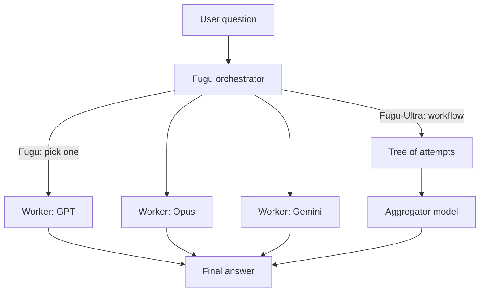

# What is Sakana Fugu? The Technical Report Explained

> **Step 10: AI Agents and Agentic Systems** · ⏱️ 33 min read · [Read original](https://outcomeschool.com/blog/decoding-sakana-fugu)

## TL;DR
Sakana Fugu is a family of orchestrator models from Sakana AI that do not answer questions themselves; they pick and coordinate a pool of frontier models (GPT, Claude Opus, Gemini) and combine their answers. Orchestration is presented as a new scaling axis: a well-coordinated team can beat every individual member.

## Key Concepts
- **Orchestrator model** — A learned model that decides which workers handle a question, how they collaborate, and how answers merge.
- **Collective intelligence** — A group of limited members producing smarter behavior than any alone.
- **Fugu** — Fast variant: picks one worker per input (built on Trinity), for everyday coding and chat.
- **Fugu-Ultra** — Quality variant: writes a multi-model plan per input (built on Conductor), slower, for the hardest tasks.
- **Lightweight selection head** — Small extra head next to the LM head that scores each of $L$ workers from hidden state $h$.
- **Agentic workflow** — Steps of (subtask, worker id, access list).
- **sep-CMA-ES** — Separable evolutionary strategy; gradient-free training.
- **GRPO** — Group Relative Policy Optimization, RL recipe for Fugu-Ultra.

## How It Works
**Why needed:** models have different strengths (GPT: math, planning; Opus: software engineering, debugging, security bugs; Gemini: known algorithms, science). One model has weak spots, a hand-built team is rigid, a simple router picks once and cannot combine models. Fugu builds a per-question plan. New models are added to the pool without retraining; unavailable ones are routed around.

**Fugu selection:** the backbone LM computes a hidden state at an early position; the selection head outputs logits per worker; the highest is dispatched. No text generation is needed, so it is fast. Unlike Trinity it drops roles (Thinker/Worker/Verifier). Only a small set of adjustment parameters is trained.

**Stage 1: supervised fine-tuning.** Run every worker several times per question, average rewards (e.g. GPT 0.9, Opus 0.6, Gemini 0.3). Convert to a soft target with softmax:

$$p(j)=\frac{\exp(r_j/T)}{\sum_{j'}\exp(r_{j'}/T)}$$

With $T=1$ this gives about (0.437, 0.324, 0.240), keeping the info that Opus is a good backup. Lower $T$ sharpens, higher flattens. Loss is KL divergence between target and Fugu's predicted distribution:

$$L_{SFT}=\text{avg}_q\, D_{KL}(p \,\|\, \pi(\cdot|q))$$

(Worked example: predicted (0.5, 0.3, 0.2) gives KL of about 0.010; a perfect match gives 0.)

**Stage 2: evolutionary strategies.** Real tasks are multi-turn with a single end-of-task outcome, so gradients are unavailable. Sample variations of the parameters, measure task-completion fitness, keep the best, and move the parent toward their weighted nudges (toy example: parent 0.0 moves to 0.85). "Sep" means only a diagonal scaling is tracked, which is cheaper.

**Fugu-Ultra and GRPO.** It writes workflows allowing chains, best-of-N, or trees (e.g. Gemini and GPT attempt, a Gemini aggregator combines). Aggregator choice depends on the question (Gemini for niche trivia, GPT for math). Reward: 0 malformed, 0.5 valid but wrong, 1 valid and correct. For a group of $G$ workflows:

$$A_i=\frac{r_i-\text{mean}(r)}{\text{std}(r)}$$

Example rewards (1, 0.5, 0.5, 0) give advantages (+1.41, 0, 0, -1.41).

**Avoiding copycat agents:** intra-workflow isolation (agents see others only via the access list, preventing orchestration collapse) plus persistent shared memory of past tool calls across workflows.

**Results:** Fugu-Ultra beats every pool model on several benchmarks, e.g. SWE Bench Pro 73.7 vs Opus 4.8 at 69.2; Terminal Bench 2.1 82.1; Humanity's Last Exam 50.0. Also strong on Rubik's cube code, blindfold chess and a stock trading simulation.

**Emergent strategies:** debate and aggregation, build and debug (GPT builds, Opus finds bugs), bringing in a specialist only when needed.

## Diagram

## Key Takeaways
- Fugu is a learned orchestrator, not a router: it plans per question and can combine models.
- Fugu = speed (one worker, selection head on logits); Fugu-Ultra = quality (multi-model workflows).
- Training: SFT with softmax soft targets and KL, then gradient-free sep-CMA-ES; Fugu-Ultra uses GRPO.
- Isolation inside a workflow plus shared memory across the conversation keeps agents diverse yet efficient.
- Orchestration is a scaling axis: add models to the pool instead of retraining.
