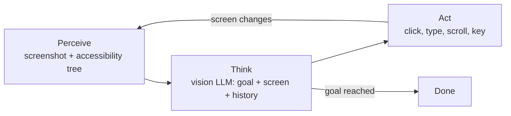
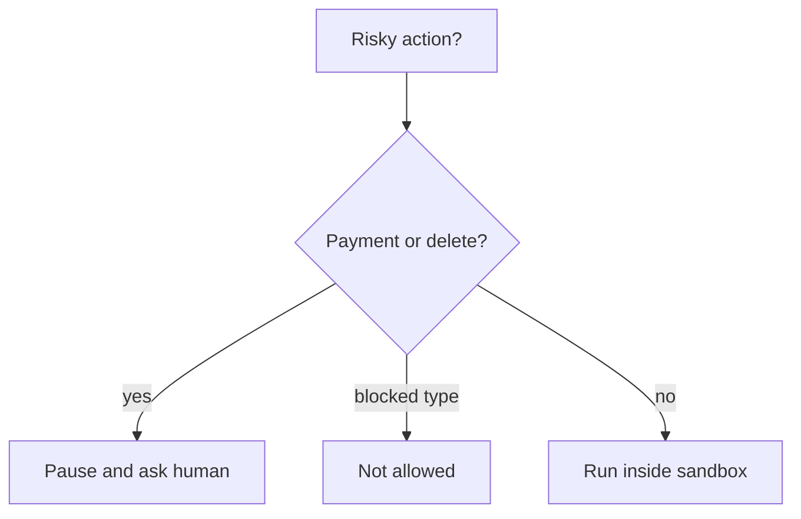

# How do Computer-Use Agents work?

> **Step 10: AI Agents and Agentic Systems** · ⏱️ 17 min read · [Read original](https://outcomeschool.com/blog/how-do-computer-use-agents-work)

## TL;DR
A computer-use agent is an AI that operates a computer like a human: it looks at the screen, moves the mouse, clicks and types to reach a plain-language goal. It runs a perceive, think, act loop, deciding only one action at a time from a fresh screenshot. It matters because it works on any app, even those with no API.

## Key Concepts
- **Computer-use agent** — Computer + Use + Agent: an AI that acts on its own, step by step, using the screen, mouse and keyboard on our behalf.
- **Perceive-think-act loop** — look at screen, decide the next single action, perform it, repeat until the goal is reached.
- **Screenshot** — the agent's eyes; a picture of the screen sent to the model.
- **Vision model** — reads text, finds buttons, understands layout in an image.
- **Pixel coordinates (x, y)** — address of a screen spot; x grows right, y grows downward; e.g. button at (640, 400).
- **Accessibility tree** — hidden text list of on-screen elements ("button named Search at this position"); often used together with the screenshot.
- **JSON action** — structured output (reasoning, action, x, y) the system can parse and execute.
- **Tools** — the allowed actions: click(x, y), type("text"), scroll(direction), key("Enter"), screenshot().
- **System prompt** — the rulebook given before the task: role, allowed actions, reply format, stop condition.
- **Guardrail** — safety rule stopping dangerous autonomous actions.
- **API** — a direct doorway apps expose to programs; **MCP** — open standard giving the model one common way to reach apps that do have such doorways.

## How It Works

### Why we need it
- Old approach 1, click scripts: fragile; break when the design changes or a button moves.
- Old approach 2, APIs: reliable and fast, but most apps do not offer one.
- Computer-use agent needs no doorway: if a human can do it by looking at the screen, the agent can. Where an API/MCP exists, it is still more reliable.

### The loop (human vs agent)
| Step | Human player | Computer-use agent |
|---|---|---|
| Perceive | Eyes look at screen | Takes a screenshot |
| Think | Brain decides move | AI model decides next action |
| Act | Hand presses button | Sends click or keystroke |

### Perceive: seeing the screen
1. System takes a screenshot and sends it to a vision model.
2. Model locates elements and reports pixel addresses, e.g. Search button at (640, 400).
3. Optionally also reads the accessibility tree so buttons are found without guessing.

### Think: deciding
- The model is an LLM joined with vision, so it sees and reasons in words.
- Input: the **goal**, the **current screenshot**, the **history** of actions so far.
- It answers one question: what is the single next action that moves me closer to the goal?
- Only one step at a time, because the screen may change unexpectedly; this keeps the agent flexible.

### Act: doing
- The system translates the model's JSON decision into a real command.
- Example output: `{"reasoning": "The browser is closed. I will open it first.", "action": "click", "x": 50, "y": 760}`.
- Reasoning helps us trust the choice. After the action, a new screenshot is taken.

### Walkthrough: "Search for the weather in London"
| Step | Model sees | Action |
|---|---|---|
| 1 | Desktop with browser icon | Click browser icon |
| 2 | Empty browser | Click address bar |
| 3 | Active address bar | Type "weather in London" |
| 4 | Text in bar | Press Enter |
| 5 | Weather results | Done |

The agent never plans all five steps in advance; it reacts to each new screenshot.

### System prompt and tools
Simplified prompt: you are a computer-use agent; you see via screenshots; allowed actions are click, type, scroll, key, screenshot; return one action at a time as JSON; explain reasoning before each action; stop when the goal is complete. The allowed actions are the agent's tools, and the model picks one per step.

### Diagram

## Trade-offs & Pitfalls
- **Safety guardrails**: human approval for risky actions (payments, deleting data); blocked actions (e.g. changing system settings); limited area, a separate safe space so personal files are untouchable. Always keep a human in control for sensitive tasks.
- **Slow**: every step needs a screenshot plus a model decision.
- **Mistakes**: may misread the screen and click the wrong thing.
- **Gets stuck**: may repeat the same action on a confusing screen.
- **Costly**: image understanding and reasoning at every step use lots of compute.
- Prefer an API when available; use computer-use mostly where no API exists. For work wholly inside a browser, a Browser Agent can read page structure and click by element number instead of pixel position.
- Technology is improving fast (seeing, deciding, recovering from mistakes).

## FAQ
- API or computer-use agent? → API when available (faster, more reliable); agent where none exists.
- Plans all steps ahead? → No, one action at a time, adapting to unexpected screens.
- Why better than click scripts? → Fresh screenshot each step, finds the button wherever it moved.
- Only screenshots? → No; many also use the accessibility tree.
- Can it click "delete account" alone? → No; guardrails make it pause and ask, block some actions, sandbox it.

## Key Takeaways
- Computer-use agents run a perceive, think, act loop until the goal is met.
- The screenshot is the eyes; a vision-capable LLM reports (x, y) pixel targets.
- The model decides only the next single action, returned as structured JSON.
- Actions are a small tool set: click, type, scroll, key, screenshot.
- The system prompt defines role, tools, format and stop condition.
- Guardrails (human approval, blocked actions, sandbox) are essential.
- Slower, costlier and error-prone versus APIs, so use them where no API exists.
