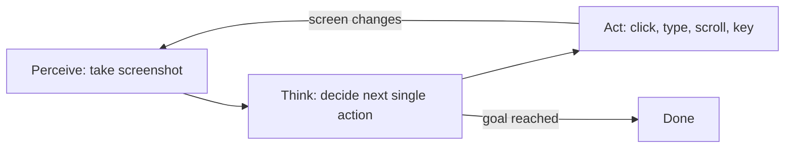

# How do Computer-Use Agents work?

> **Step 10: AI Agents and Agentic Systems** · ⏱️ 17 min read · [Read original](https://outcomeschool.com/blog/how-do-computer-use-agents-work)

## TL;DR
A computer-use agent is an AI that operates a computer through its screen, mouse and keyboard to reach a goal given in plain language. It repeats a perceive, think, act loop (screenshot, decide one action, execute) until done, which lets it work on apps that offer no API.

## Key Concepts
- **Computer-use agent** — Computer + Use + Agent: acts on its own, step by step, on a real machine.
- **Perceive, think, act loop** — Look at the screen, decide the next single action, perform it, repeat.
- **Screenshot** — The agent's eyes; fed to a vision-capable model.
- **(x, y) coordinates** — Pixel address of a UI element; x grows right, y grows down.
- **Accessibility tree** — Hidden text list of on-screen elements ("button Search at this position"); often combined with screenshots.
- **Tools** — Allowed actions: click(x,y), type, scroll, key, screenshot.
- **Guardrails** — Safety rules limiting dangerous actions.

## How It Works
**Why it exists:** click scripts are fragile (a moved button breaks them) and APIs are not offered by every app. A computer-use agent just uses the screen like a human does. Where an API exists (e.g. via MCP), prefer it.

**Perceive.** A screenshot goes to a vision model that reads text, finds buttons and reports their (x, y) address.

**Think.** An LLM joined with vision gets the goal, current screenshot and action history, and answers: what is the single next action? One step at a time keeps it flexible because the screen changes after each action.

**Act.** The model returns structured JSON (reasoning, action, x, y); the system performs the real click or keystroke, then takes a new screenshot.

**Walkthrough: "Search weather in London".** Click browser icon, click address bar, type "weather in London", press Enter, see results, return done.

**System prompt** is the rulebook: what the agent is, allowed actions, JSON reply format, explain reasoning, stop when complete.

**Guardrails:** human approval for risky actions (payments, deletes), blocked actions (system settings), sandboxed environment away from personal files.

**Limitations:** slow (a screenshot and model call per step), mistakes from misreading, getting stuck repeating actions, higher cost. For browser-only tasks, Browser Agents can use page structure instead of pixels.

## Diagram

## Key Takeaways
- Core loop: perceive, think, act, repeated until the goal is met.
- The model decides only the next action, never the whole plan, so it adapts to surprises.
- Vision model finds elements and their (x, y); the accessibility tree adds precision.
- Prefer an API (or MCP) when available; use computer-use where none exists.
- Keep a human in control of sensitive actions.
