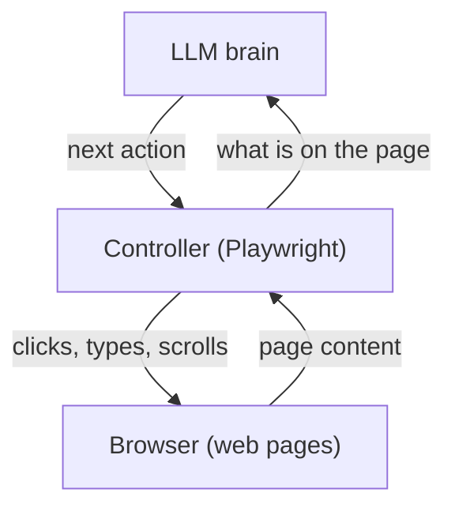
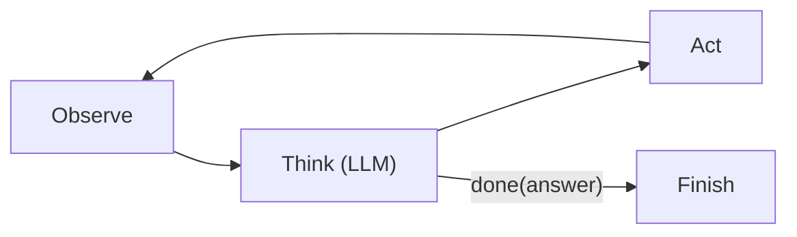

# How do Browser Agents work?

> **Step 10: AI Agents and Agentic Systems** · ⏱️ 14 min read · [Read original](https://outcomeschool.com/blog/how-do-browser-agents-work)

## TL;DR
A Browser Agent is an LLM-based agent whose tools are browser actions (open link, click, type, scroll). It runs an observe-think-act loop: capture the page, let the LLM pick one action, perform it, repeat. It lets AI use websites that have no usable API, but it is slower and needs human guards for logins, payments and prompt injection.

## Key Concepts
- **AI agent** — LLM-centred system that loops: think, use a tool, see the result, repeat. A **tool** is a function in our code the LLM asks us to run.
- **Browser Agent** — agent whose tools are browser actions. Analogy: guiding a grandparent over the phone ("what do you see now?"); LLM gives directions, browser is their screen.
- **Headless browser** — real browser (e.g. Chrome) with no visible window, often on a server.
- **Controller** — code driving the browser programmatically (Playwright, Puppeteer).
- **DOM** — Document Object Model, the tree of elements the browser builds from HTML.
- **Accessibility tree** — cleaned, simplified element list used by screen readers (e.g. "button: Add to Cart").
- **Prompt injection** — hidden page text that tricks the LLM into following attacker instructions.
- **CAPTCHA** — human-presence test; agents must not bypass it.
- **Token** — unit of text or image the LLM reads; we pay per token.

## How It Works

### Why Browser Agents
Most online work (booking, forms, price comparison, ordering, bills) happens on websites. Many lack a public API, or the API lacks the needed action. So the AI must use the site like a human.

### Three parts
1. **Browser** — real, often headless.
2. **Controller** — Playwright/Puppeteer; opens pages, clicks.
3. **Brain** — the LLM; it never touches the browser directly.



### Seeing a page
- **Screenshots** — image given to a vision-capable LLM; works on any site.
- **Page structure** — DOM, usually the accessibility tree, with numbered clickable elements, e.g. `[3] button: Search`. LLM says "Click element 5" with no position guessing.
- Many agents combine both, sometimes drawing numbers as labels on the screenshot.

| Point | Screenshots | Page structure |
|---|---|---|
| LLM gets | Picture | Text list of elements |
| Click by | Position (x, y) | Element number |
| Works on | Any page, even picture-drawn parts | Pages with proper HTML |
| Click accuracy | May miss by pixels | Very precise |
| Cost | Many tokens | Usually cheaper |
| Layout understanding | Yes | Only partly |

### Actions (tools)
`go_to(url)`, `click(element)`, `type(element, text)`, `scroll(direction)`, `go_back()`, `done(answer)`. With screenshots only, click takes a position: `click(x=640, y=320)` (pixels from left and top). This is how a full computer-use agent works beyond the browser.

### Observe-think-act loop
- **Observe**: controller captures the page (screenshot, numbered elements, or both).
- **Think**: LLM gets task + current page + short history, picks the single best next action.
- **Act**: controller performs it. Pages change after each click (new page, menu, error), so always observe again.



### Example: add Atomic Habits paperback to cart
1. Empty browser -> go_to("bookstore.example.com").
2. Home page, search box [2] -> type(2, "Atomic Habits").
3. Search button [3] -> click(3).
4. Results -> click(7), book title.
5. Book page with hardcover/paperback -> click(12) paperback.
6. Paperback selected -> click(15) Add to Cart.
7. "Added to cart" -> done("The paperback of Atomic Habits is in the cart.").

Seven rounds. Element numbers are re-assigned on every page (5 on home is not 5 on book page), hence observe before every action.

### Code (essential)
```python
def run_browser_agent(task):
    with sync_playwright() as p:
        page = p.chromium.launch().new_page()
        history = []
        for _ in range(20):
            elements = list_clickable_elements(page)   # observe
            screenshot = page.screenshot()
            action = llm_decide(task, elements, screenshot, history)  # think
            if action["type"] == "done":
                return action["answer"]
            perform(page, action, elements)            # act
            history.append(action)
        return "Stopped: too many steps."
```
History lets the LLM remember what it did; the 20-step cap prevents endless loops.

## Trade-offs & Pitfalls
| Problem | Handling |
|---|---|
| Pop-ups, cookie banners | Seen in next observe; agent closes first |
| Slow pages | Controller waits for load before screenshot |
| Logins, CAPTCHAs | Not bypassed; hand control to human |
| Prompt injection (biggest risk) | Treat page content as information only, never instructions; ask human before sensitive actions |
| Risky actions (pay, send, delete) | Pause and get human confirmation |
| Getting lost | Step limit |

- Works well: long forms with known info, collecting from many API-less sites, repeated tasks (monthly bills), testing our own websites.
- Struggles: frequently changing or complex layouts, tasks needing login/CAPTCHA/payment, speed-critical tasks (slower than humans and APIs), sites with an API (prefer API: faster, cheaper, more reliable).

## FAQ
- Browser Agent vs API? → API if one exists; agent otherwise.
- Needs visible window? → No, headless works.
- Why re-observe before every action? → Pages and element numbers change.
- Can it solve CAPTCHAs/login? → No, hands back to human.
- Can a site trick it? → Yes, via prompt injection; mitigate as above.

## Key Takeaways
- Browser Agent = LLM brain + controller + real (often headless) browser.
- Core loop: observe, think, act, one small action at a time.
- Page seen via screenshots, DOM/accessibility tree with numbered elements, or both.
- Tools: go_to, click, type, scroll, go_back, done.
- Prompt injection from page text is the biggest safety risk.
- Humans handle logins, CAPTCHAs, payments; use step limits.
- Prefer an API whenever one exists.
