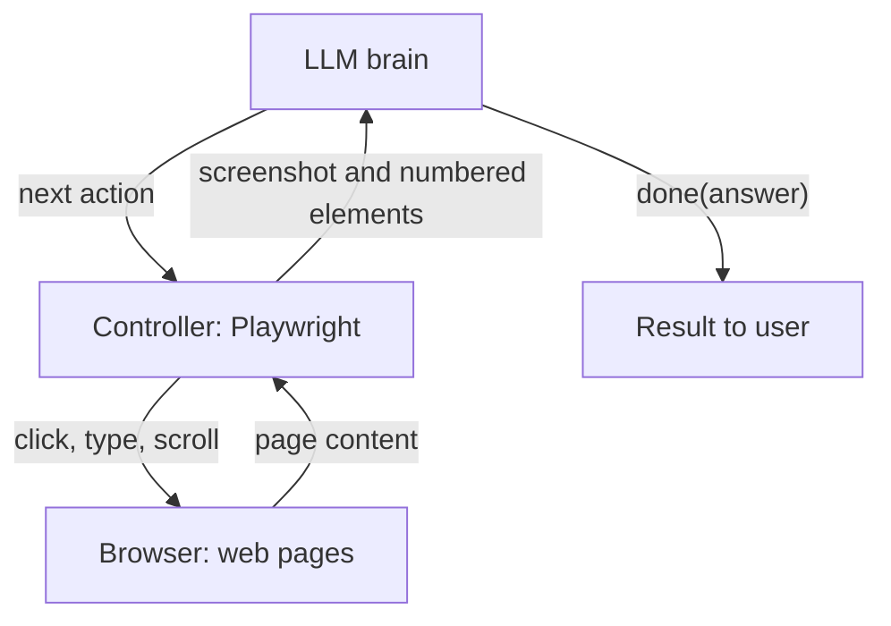

# How do Browser Agents work?

> **Step 10: AI Agents and Agentic Systems** · ⏱️ 14 min read · [Read original](https://outcomeschool.com/blog/how-do-browser-agents-work)

## TL;DR
A Browser Agent is an AI agent whose tools are browser actions (open link, click, type, scroll). It runs an observe, think, act loop where code describes the page to an LLM and the LLM picks one action at a time. It is used for websites that have no suitable API.

## Key Concepts
- **Browser Agent** — LLM agent controlling a real browser via tools.
- **Three parts** — Browser (often headless), Controller (Playwright or Puppeteer), Brain (LLM). The LLM never touches the browser directly.
- **DOM / accessibility tree** — Tree of page elements; the accessibility tree is the cleaner, simplified version screen readers use.
- **Numbered elements** — Each clickable element gets an id, so the LLM says "click element 5".
- **Tools** — go_to(url), click(element), type(element, text), scroll(direction), go_back(), done(answer).
- **Prompt injection** — Hidden page text trying to hijack the agent.

## How It Works
**Seeing a page**
| Point | Screenshots | Page structure |
|---|---|---|
| LLM gets | Picture | Text list of elements |
| Clicks by | Position (x, y) | Element number |
| Works on | Any page | Pages with proper HTML |
| Click accuracy | Can miss by pixels | Very precise |
| Token cost | Higher | Usually cheaper |
| Layout understanding | Yes | Partial |

Many agents combine both, sometimes overlaying numbers on the screenshot.

**Observe-think-act loop:** observe (screenshot and/or element list), think (LLM gets task, page, short history; picks one action), act (controller performs it). Page changes after each action, and element numbers are re-issued per page, so the agent must re-observe every time.

**Example: add "Atomic Habits" paperback to cart** takes 7 rounds: go_to site, type in search box, click Search, click book, choose paperback, click Add to Cart, done with answer.

**Core code idea:** loop up to 20 steps: list elements, screenshot, `llm_decide`, return if `done`, else `perform` and append to history. The step cap prevents infinite loops.

**Problems and handling**
- Pop-ups and cookie banners — seen next round, closed first.
- Slow pages — wait for load before observing.
- Logins and CAPTCHAs — hand control back to the human.
- Prompt injection (biggest risk) — treat page content as information, never instructions.
- Risky actions (payments, deletes, messages) — ask human to confirm.
- Getting lost — step limit.

**Good fit:** long forms, collecting from API-less sites, repeated portal tasks, testing your own site. **Poor fit:** frequently changing layouts, tasks needing login/CAPTCHA/payment, speed-critical work, or any site with an API (prefer the API).

## Diagram

## Key Takeaways
- Browser Agent = LLM brain + controller + (headless) browser, looping observe, think, act.
- Page structure gives precise, cheap clicks; screenshots work everywhere; combine both.
- Always re-observe before acting; element numbers change per page.
- Beware prompt injection from page content and keep humans in charge of logins, CAPTCHAs and payments.
- If an API exists, use it instead.
