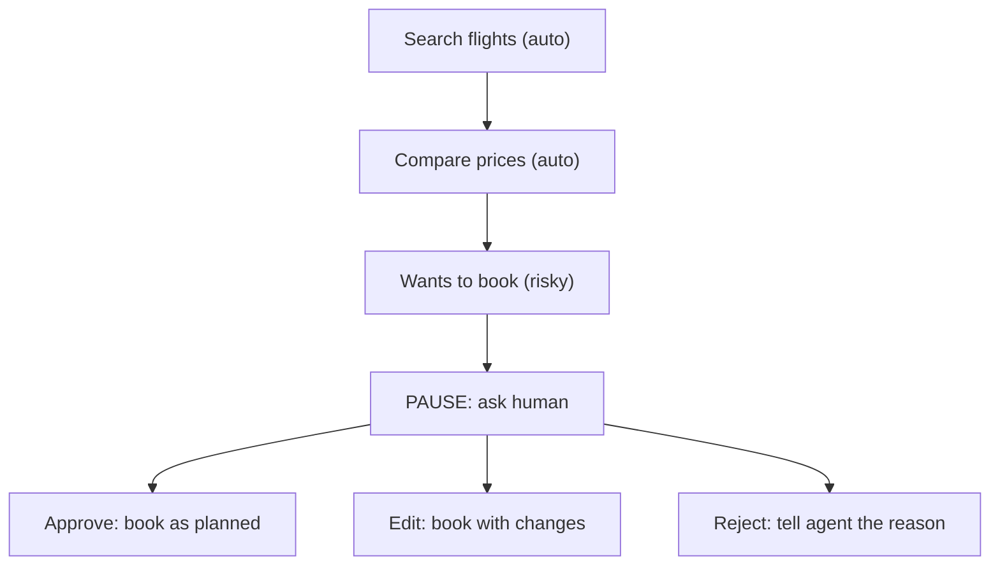
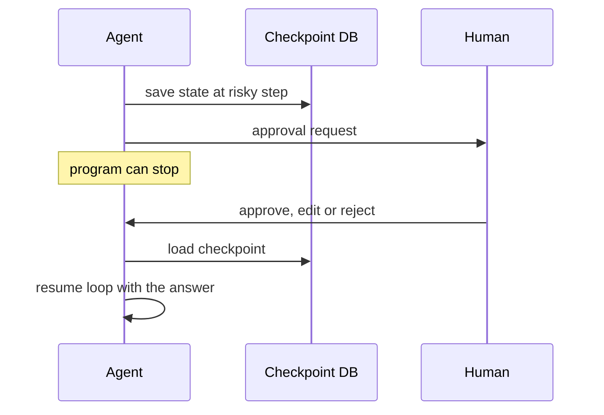

# How do Human-in-the-Loop agents work?

> **Step 10: AI Agents and Agentic Systems** · ⏱️ 13 min read · [Read original](https://outcomeschool.com/blog/human-in-the-loop-agents)

## TL;DR
A Human-in-the-Loop (HITL) agent does most work itself but pauses at chosen risky moments for a human to approve, edit, reject or answer. It saves its state as a checkpoint so it can wait hours or days, then resumes exactly where it stopped. It trades speed for safety, so only high-risk actions should go to a human.

## Key Concepts
- **AI agent** — LLM in a loop: think, pick a tool, see result, repeat; LLM asks for tools (send_email, book_flight), our code runs them.
- **HITL** — a human placed inside the loop as a step. Analogy: junior employee (agent) and manager (us) who approves big decisions.
- **Escalation** — passing the problem to someone with more authority.
- **State** — everything the agent knows: goal, steps done, tool results, next intended action.
- **Checkpoint** — saved copy of state in a database; the program can stop completely meanwhile.
- **Checkpointer** — component that saves checkpoints (memory or DB).
- **Approval fatigue** — human approves without reading when asked too often, making the check useless.

## How It Works

### Why not fully automatic
Agents err quickly: wrong date for "next Friday", flight 5x costlier, email to wrong customer, deleted needed file. Issues: irreversible actions, guessing instead of asking, breaking company rules, no one accountable. Fix: agent works, human checks important parts.

### Where humans step in
| Point | When | Example |
|---|---|---|
| Approve | Before risky action (most common; approve/reject/edit) | "Approve sending this email?" |
| Answer | Agent unsure | "9th or 16th October?" |
| Review | Draft ready | Human edits customer reply |
| Take over | Agent stuck/unusual case (escalation) | Complex refund to support staff |
| Feedback | After task | "Summary missed the price" (used to improve agent) |

### Flow (flight example)
1. Agent searches and compares flights: safe, read-only, automatic.
2. Reaches risky `book_flight` (spends money), marked "needs approval".
3. Pauses: system stops loop, creates approval request showing exact action ("Book flight AB-203, Friday 9th October, 7:00 AM, 5,400 rupees").
4. Human approves, rejects with reason, or edits (e.g. evening flight).
5. Approved/edited: tool runs. Rejected: agent receives reason, tries another way or stops.



### Pause and continue
A human may take 2 seconds or 2 days; a waiting server could restart and lose everything. So:
1. On pause, save full state as a checkpoint.
2. Send request to human (chat button, email, dashboard task).
3. Program may stop entirely.
4. On reply, load checkpoint, add human answer, continue from the same point. (Bookmark analogy.)



LangGraph example:
```python
def booking_step(state):
    decision = interrupt({"action": "book_flight", "details": state["chosen_flight"]})
    if decision == "approve":
        book_flight(state["chosen_flight"])
    return state
# later
graph.invoke(Command(resume="approve"), config)
```
- `interrupt` stops, saves checkpoint, sends details to the app.
- Resume with `Command(resume=...)`; `config` identifies the saved conversation.
- The step re-runs from its start; this time `interrupt` returns the answer. So real work (booking) must come after the interrupt line. Needs a checkpointer.

### Plain Python version
`RISKY_TOOLS = {"book_flight","send_email","delete_file"}`. Non-risky tools run directly. Risky: show what the agent wants, ask approve/edit/reject. Approve runs as planned; edit runs with new args; reject returns "Human rejected... Reason: ..." as the tool result so the agent can adapt. Real systems avoid blocking `input()`; they checkpoint and resume.

### Which actions need a human
Ask: can it be undone? how big is the damage?
| Risk | Examples | Action |
|---|---|---|
| Low | Search, read, summarize | Run automatically |
| Medium | Create draft, small setting | Run, log for later review |
| High | Pay, send to customers, delete data | Always ask first |

Rules also work: refunds up to 500 rupees auto, above 500 need approval.

## Trade-offs & Pitfalls
- Common mistakes: showing too little (approval request must show tool, inputs, why); ignoring rejections (pass the reason back so it does not repeat); no timeout (set safe default, e.g. cancel after 24 hours or remind).
- Advantages: risky actions checked; asks instead of guessing; human stays responsible; more trust; edits/rejections become feedback.
- Disadvantages: slower; needs available human; extra build work (state saving, approval screens, timeouts); approval fatigue if badly designed.
- Speed versus safety: the riskier the action, the more a check is worth the wait.

## FAQ
- Approval on every step? → No, only important moments.
- On rejection? → Tool does not run; agent gets reason.
- No reply? → Safe default after timeout; state is checkpointed so no process needs to wait.
- Why real work after interrupt? → Step re-runs on resume.

## Key Takeaways
- HITL = agent pauses at risky points for approve, edit, reject or answer.
- Human touchpoints: approve, answer, review, take over, feedback.
- Pause and resume rely on checkpointed state, not a waiting process.
- Classify actions by reversibility and damage; avoid approval fatigue.
- Show full details in requests and return rejection reasons to the agent.
- Always add timeouts; put side effects after `interrupt` in LangGraph.
