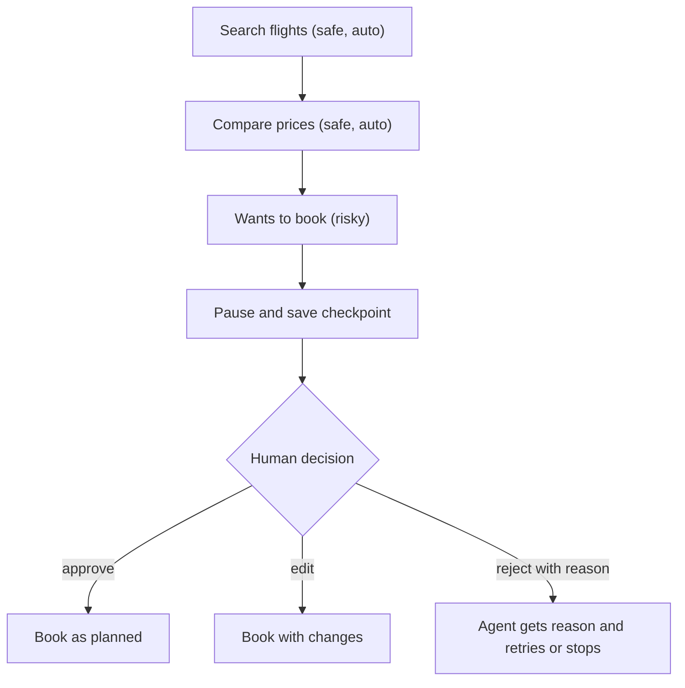

# How do Human-in-the-Loop agents work?

> **Step 10: AI Agents and Agentic Systems** · ⏱️ 13 min read · [Read original](https://outcomeschool.com/blog/human-in-the-loop-agents)

## TL;DR
A Human-in-the-Loop (HITL) agent pauses at chosen points to let a human approve, edit, reject or answer before it continues. The agent does most of the work; humans guard the risky, irreversible steps. It works by saving state to a checkpoint and resuming when the human replies.

## Key Concepts
- **HITL agent** — Agent with a human as a step inside its loop.
- **Escalation** — Handing a stuck or unusual case to someone with more authority.
- **Checkpoint** — Saved full state (goal, steps done, tool results, pending action) in a database.
- **Approval fatigue** — Too many prompts make humans click approve blindly.
- **Risky tools** — Tools flagged as needing approval (book_flight, send_email, delete_file).

## How It Works
**Why:** a fully automatic agent can pick the wrong date, overspend, email the wrong customer or delete needed files; mistakes may be irreversible and nobody owns the decision. Analogy: agent is the junior, we are the manager.

**Where a human steps in**
| Point | When | Example |
|---|---|---|
| Approve | Before a risky action | Approve sending this email? |
| Answer | Agent unsure | Which Friday do you mean? |
| Review | Draft ready | Edit a customer reply |
| Take over | Agent stuck | Complex refund to staff |
| Feedback | After task | Summary missed the price |

**Flow (flight booking):** search and compare (safe, automatic), reach book_flight (marked needs approval), pause with a clear approval request, human approves / edits / rejects with reason, agent continues (rejection reason is returned as the tool result so it can try another way).

**Pause and resume:** a human may take 2 seconds or 2 days, so the program cannot just wait. Save a checkpoint, send the request (chat button, email, dashboard), let the program stop, and on reply load the checkpoint, add the answer and continue (like a bookmark). In LangGraph, `interrupt(...)` pauses and saves; `graph.invoke(Command(resume="approve"), config)` resumes. The step reruns from its start, so real work must come after the interrupt line, and a checkpointer is required.

**Simple wrapper idea:** if tool not in RISKY_TOOLS run directly; else show tool and args and branch on approve / edit / reject. (Real systems use checkpoints, not blocking `input()`.)

**What needs a human:** ask whether it can be undone and how big the damage is.
| Risk | Examples | Action |
|---|---|---|
| Low | Search, read, summarize | Auto |
| Medium | Draft, small setting | Run and log |
| High | Pay, send to customers, delete | Always ask |

Rules can be thresholds (refunds up to 500 auto, above need approval).

**Common mistakes:** showing too little detail, ignoring rejection reasons, no timeout (set a safe default such as cancel after 24 hours).

**Trade-off:** safer, trusted, accountable, feedback source vs slower, needs available humans, extra build work.

## Diagram

## Key Takeaways
- Automate safe actions; gate irreversible or high-damage ones.
- Pausing = save state as a checkpoint, resume later with the human's answer.
- Show the human exactly what will happen (tool, inputs, why).
- Return rejection reasons to the agent and add timeouts.
- Avoid approval fatigue by choosing carefully what to ask.
